<a id="portada"></a>

# Análisis de incidentes de ciberseguridad

**Unidad didáctica 2. Contenido didáctico interactivo para paquete SCORM**

| | |
|---|---|
| Enseñanza | Curso de Especialización en Ciberseguridad en Entornos de las Tecnologías de la Información |
| Módulo profesional | 5021. Incidentes de ciberseguridad |
| Unidad didáctica | UD2. Análisis de incidentes de ciberseguridad |
| Resultado de aprendizaje | RA2. Analiza incidentes de ciberseguridad utilizando herramientas, mecanismos de detección y alertas de seguridad |
| Criterios de evaluación | CE 2.a, 2.b, 2.c, 2.d y 2.e |
| Formato | Guion maestro en Markdown: textos, diagramas Mermaid, cuadros de imagen y de recursos, actividades con retroalimentación |

<a id="indice"></a>

## Índice

- [Portada](#portada)
- [Presentación de la unidad](#m-p)
  - [Qué vas a aprender](#p-p-1)
  - [El caso que nos acompaña: ACME Logística](#p-p-2)
  - [Cómo trabajar con este material](#p-p-3)
- [Módulo 1. Taxonomía y valoración de incidentes](#m-1)
  - [1.1 Lunes, 08:05: hay 1 240 alertas en la cola](#p-1-1)
  - [1.2 Evento, alerta e incidente](#p-1-2)
  - [1.3 La taxonomía de referencia](#p-1-3)
  - [1.4 Nivel de peligrosidad](#p-1-4)
  - [1.5 Nivel de impacto](#p-1-5)
  - [1.6 La matriz de valoración](#p-1-6)
  - [1.7 Tres tipos de incidente frente a frente](#p-1-7)
  - [1.8 Ejemplo práctico: los tres casos del lunes](#p-1-8)
  - [1.9 Recursos y referencias](#p-1-9)
  - [1.10 Actividades interactivas](#p-1-act)
- [Módulo 2. Monitorización técnica: SIEM (Wazuh) y NIDS (Suricata)](#m-2)
  - [2.1 Sin registros no hay detección](#p-2-1)
  - [2.2 Fuentes internas de registros](#p-2-2)
  - [2.3 Dos miradas: el equipo y la red](#p-2-3)
  - [2.4 Suricata: inspección del tráfico](#p-2-4)
  - [2.5 Wazuh: arquitectura y despliegue](#p-2-5)
  - [2.6 Del registro a la alerta: decodificadores, reglas y niveles](#p-2-6)
  - [2.7 Caso de uso: fuerza bruta contra SSH](#p-2-7)
  - [2.8 Recursos y referencias](#p-2-8)
  - [2.9 Actividades interactivas](#p-2-act)
- [Módulo 3. Detección e identificación en seguridad física](#m-3)
  - [3.1 El atacante que entra por la puerta](#p-3-1)
  - [3.2 Tipos de incidentes de seguridad física](#p-3-2)
  - [3.3 Control de accesos](#p-3-3)
  - [3.4 Videovigilancia con analítica de vídeo](#p-3-4)
  - [3.5 Sensores de intrusión y de entorno](#p-3-5)
  - [3.6 Correlación físico-lógica](#p-3-6)
  - [3.7 Ejemplo práctico: la intrusión que el vigilante no vio](#p-3-7)
  - [3.8 Recursos y referencias](#p-3-8)
  - [3.9 Actividades interactivas](#p-3-act)
- [Módulo 4. Ciberinteligencia OSINT y fuentes abiertas](#m-4)
  - [4.1 Lo que se ve desde fuera](#p-4-1)
  - [4.2 OSINT e inteligencia de amenazas](#p-4-2)
  - [4.3 Vigilar la superficie de exposición](#p-4-3)
  - [4.4 Herramientas para activos, fugas y suplantación](#p-4-4)
  - [4.5 Indicadores de compromiso, OTX y MISP](#p-4-5)
  - [4.6 Ejemplo práctico: del indicador a la lista de bloqueo](#p-4-6)
  - [4.7 Recursos y referencias](#p-4-7)
  - [4.8 Actividades interactivas](#p-4-act)
- [Módulo 5. Triaje, registro inicial y seguimiento](#m-5)
  - [5.1 Jueves, 11:52: una alerta de hace dos días](#p-5-1)
  - [5.2 El SOC por niveles](#p-5-2)
  - [5.3 Metodología de triaje](#p-5-3)
  - [5.4 Del aviso al cierre: el flujo de trabajo](#p-5-4)
  - [5.5 La ficha de registro del incidente](#p-5-5)
  - [5.6 Seguimiento inicial y escalado](#p-5-6)
  - [5.7 Ejemplo práctico: ficha de una exfiltración confirmada](#p-5-7)
  - [5.8 Recursos y referencias](#p-5-8)
  - [5.9 Actividades interactivas](#p-5-act)
- [Cierre de la unidad](#m-c)
  - [Ideas clave de la unidad](#p-c-1)
  - [Glosario](#p-c-2)
  - [Referencias generales](#p-c-3)
- [Guía para el docente](#docente)

---

<a id="m-p"></a>

# Presentación de la unidad

<a id="p-p-1"></a>

## Qué vas a aprender

Esta unidad desarrolla el resultado de aprendizaje 2 del módulo profesional Incidentes de ciberseguridad (5021): **analiza incidentes de ciberseguridad utilizando herramientas, mecanismos de detección y alertas de seguridad**.

Todo el contenido gira en torno al trabajo de un analista de nivel 1 de un centro de operaciones de seguridad (SOC Tier 1): la persona que ve primero la alerta y decide qué hacer con ella. Cada módulo responde a una de las preguntas que ese analista se hace a diario.

| Módulo | Criterio de evaluación | Pregunta que responde |
|---|---|---|
| 1. Taxonomía y valoración de incidentes | CE 2.a | ¿Qué tipo de incidente es y cuánto importa? |
| 2. Monitorización técnica: SIEM (Wazuh) y NIDS (Suricata) | CE 2.b | ¿Cómo lo veo en mis sistemas y en mi red? |
| 3. Detección e identificación en seguridad física | CE 2.c | ¿Y si el atacante entra por la puerta? |
| 4. Ciberinteligencia OSINT y fuentes abiertas | CE 2.d | ¿Qué se ve de mi organización desde fuera? |
| 5. Triaje, registro inicial y seguimiento | CE 2.e | ¿Qué hago con cada alerta y cómo lo dejo escrito? |

Al terminar la unidad deberías ser capaz de:

1. Clasificar un suceso con la taxonomía nacional y asignarle un nivel de peligrosidad y un nivel de impacto.
2. Explicar qué registros genera cada sistema y cómo llegan a un SIEM, y leer y escribir reglas sencillas de Suricata y de Wazuh.
3. Relacionar los eventos de los sistemas de seguridad física con los registros de los sistemas de información.
4. Usar fuentes abiertas para vigilar la superficie de exposición de una organización y aprovechar indicadores de compromiso.
5. Hacer el triaje de una alerta, cumplimentar la ficha de registro de un incidente y escalarlo al nivel adecuado.

<a id="p-p-2"></a>

## El caso que nos acompaña: ACME Logística

Para que los ejemplos tengan continuidad, toda la unidad transcurre en la misma organización ficticia.

**ACME Logística, S.L.** es una empresa de transporte y almacenaje con sede en Jaén y almacenes en Sevilla y Valencia. Tiene 180 personas en plantilla. Sus servicios principales son el portal de clientes (seguimiento de envíos), el servidor de ficheros de administración y operaciones, la base de datos de expediciones y el correo corporativo. Además presta el servicio de paquetería a un organismo público, por lo que los sistemas que soportan ese contrato cumplen el Esquema Nacional de Seguridad (categoría MEDIA).

El SOC es pequeño: dos analistas de nivel 1 por turno y un analista de nivel 2 de guardia. Trabajan con Wazuh como SIEM y con Suricata como detector de intrusiones de red. El centro de proceso de datos (CPD) está en la sede y tiene control de acceso por tarjeta.

**Diagrama 0.1. Red de ACME Logística y puntos de observación del SOC.** Los agentes de Wazuh observan cada equipo desde dentro; el sensor de Suricata observa el tráfico copiado por el puerto espejo del conmutador central; el control de acceso físico envía sus eventos al mismo SIEM.

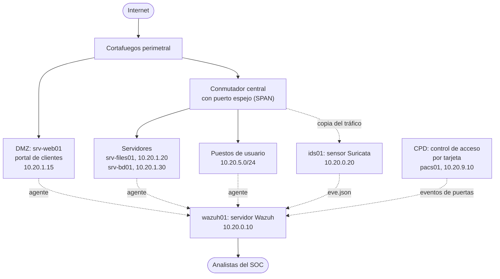

| Dato del caso | Valor |
|---|---|
| Dominio corporativo | `acme-logistica.example` |
| Red interna | `10.20.0.0/16` |
| Direcciones de atacantes en los ejemplos | `203.0.113.45`, `198.51.100.77`, `198.51.100.23` |
| Cuentas que aparecen | `jperez` (administración de sistemas), `mgarcia` (administración), `amolina` (facturación), `svc_backup` (cuenta de servicio) |

> **Recuerda.** Todos los datos del caso son ficticios. Las direcciones IP externas pertenecen a los rangos reservados para documentación (RFC 5737) y el dominio usa el sufijo `.example` (RFC 2606), de modo que ningún ejemplo apunta a un sistema real.

<a id="p-p-3"></a>

## Cómo trabajar con este material

Cada módulo sigue el mismo recorrido: una situación de partida, la teoría con sus diagramas, un ejemplo práctico resuelto, recursos para ampliar y tres actividades interactivas (dos preguntas de test y una actividad de clasificación o emparejamiento).

- **Avanza en orden.** Los módulos se apoyan unos en otros: la taxonomía del módulo 1 se usa en todos los demás y el módulo 5 reúne todo lo anterior.
- **Las actividades puntúan en el primer intento.** Después de responder puedes consultar la retroalimentación de todas las opciones; léela aunque hayas acertado, porque explica por qué fallan las alternativas.
- **Tu progreso se guarda.** Si accedes desde el aula virtual, la plataforma registra las páginas visitadas y la puntuación. La unidad se da por completada cuando has visitado todas las páginas y respondido las quince actividades.
- **Los recuadros tienen siempre el mismo significado:** «Recuerda» resume lo imprescindible, «Ejemplo SOC Tier 1» muestra un caso real de consola, «Atención» avisa de un error frecuente y «En el laboratorio» indica cómo reproducirlo en el aula.

> **En el laboratorio.** Los ejemplos están pensados para máquinas virtuales con Ubuntu y Windows 11 y solo usan herramientas de código abierto. Las reglas de Suricata de esta unidad se han probado con Suricata 7 sobre capturas de tráfico sintéticas; las reglas de Wazuh siguen la sintaxis de la rama 4.x y debes validarlas en tu servidor con `wazuh-logtest` antes de darlas por buenas.

<a id="m-1"></a>

# Módulo 1. Taxonomía y valoración de incidentes

**Criterio de evaluación:** CE 2.a. Se ha clasificado y definido la taxonomía de incidentes de ciberseguridad que pueden afectar a la organización.  
**Tiempo estimado de estudio:** 90 minutos.

<a id="p-1-1"></a>

## 1.1 Lunes, 08:05: hay 1 240 alertas en la cola

Empiezas tu turno como analista de nivel 1 en el SOC de ACME Logística. La consola muestra 1 240 alertas acumuladas durante el fin de semana. Tres de ellas destacan:

- **Caso A.** El sensor de red ha visto 1 500 intentos de conexión a 600 puertos distintos del cortafuegos, todos desde `203.0.113.45`, en cuatro minutos. Ninguna conexión llegó a establecerse.
- **Caso B.** Una administrativa, `mgarcia`, avisó el viernes de que había escrito su contraseña en una página que imitaba el correo corporativo. El sábado hubo un inicio de sesión correcto en su buzón desde otro país.
- **Caso C.** En el servidor de ficheros `srv-files01` hay miles de archivos renombrados con la extensión `.locked` y una nota de rescate en cada carpeta.

¿Cuál atiendes primero? ¿Con qué criterio lo justificas ante tu responsable? ¿Hay que avisar a alguien de fuera de la empresa, y en qué plazo?

Responder a ojo no es una opción: dos analistas distintos llegarían a conclusiones distintas. Este módulo te da las tres herramientas que permiten contestar siempre igual:

1. Un **vocabulario** preciso: evento, alerta e incidente no significan lo mismo.
2. Una **taxonomía**: el catálogo oficial de tipos de incidente.
3. Dos **escalas de valoración**: el nivel de peligrosidad y el nivel de impacto.

Al final del módulo resolveremos los tres casos con ellas.

<a id="p-1-2"></a>

## 1.2 Evento, alerta e incidente

### Tres palabras que no son sinónimos

**Evento.** Es cualquier ocurrencia observable en un sistema o en una red: un inicio de sesión, una conexión, un fichero que se abre, una tarjeta que pasa por un lector. La inmensa mayoría son rutinarios. El glosario del Esquema Nacional de Seguridad reserva la expresión *evento de seguridad* para la ocurrencia que apunta a un posible incumplimiento de la política de seguridad, a un fallo de los controles o a una situación desconocida que puede ser relevante.

**Alerta.** Es el aviso que emite una herramienta, o una persona, cuando uno o varios eventos cumplen una condición definida de antemano: una regla, un umbral o una desviación del comportamiento habitual. Una alerta es una hipótesis: «esto podría ser un problema». Todavía no se sabe si lo es.

**Incidente de seguridad** (o ciberincidente). El Esquema Nacional de Seguridad lo define como un «suceso inesperado o no deseado» con consecuencias en detrimento de la seguridad del sistema. En la práctica, es una alerta que alguien ha analizado y ha confirmado: hay un daño real o una amenaza cierta.

| | Evento | Alerta | Incidente |
|---|---|---|---|
| **Qué es** | Un hecho observable | Un aviso sobre eventos sospechosos | Un suceso confirmado que daña o amenaza la seguridad |
| **Quién lo produce** | Sistemas, aplicaciones, dispositivos de red, lectores de acceso | Reglas del SIEM, del IDS o del EDR; también un usuario que avisa | El analista, al terminar el triaje |
| **Ejemplo en ACME** | `Failed password for root from 203.0.113.45` | «Cinco contraseñas fallidas en 60 segundos desde la misma IP» | «Compromiso de la cuenta `mgarcia` por phishing» |
| **Volumen diario (orden de magnitud)** | Millones | Cientos o miles | Unidades |
| **Qué se hace** | Se registra y se conserva | Se revisa (triaje) | Se abre una ficha, se clasifica, se valora y se gestiona |

**Diagrama 1.1. Del evento al incidente.** Las reglas convierten una pequeña parte de los eventos en alertas; el triaje del analista decide cuáles son incidentes y cuáles se cierran como falsos positivos.

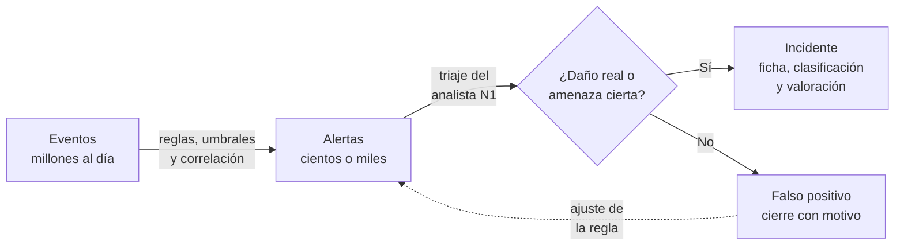

> **Ejemplo SOC Tier 1.** Tres contraseñas mal escritas por `jperez` a las 08:02 son tres *eventos*. Si la regla dice «cinco fallos en 60 segundos», aún no hay *alerta*. A las 03:10, veinte fallos seguidos contra `root` desde una IP externa sí disparan la alerta. Si el analista comprueba que después hubo un inicio de sesión correcto desde esa misma IP, declara un *incidente*. Si no lo hubo y la IP ya está bloqueada, lo registra como intento y sigue vigilando.

> **Atención.** No confundas *incidencia* con *incidente de seguridad*. En la gestión de servicios de TI, una incidencia es cualquier interrupción no planificada de un servicio: una impresora que no imprime es una incidencia, no un incidente de seguridad. La frontera se cruza cuando se ve afectada la confidencialidad, la integridad, la disponibilidad, la autenticidad o la trazabilidad de la información o de los servicios.

### Dónde encaja en el proceso de gestión

La norma ISO/IEC 27035-1:2023 describe la gestión de incidentes en cinco fases: planificar y preparar; detectar e informar; evaluar y decidir; responder; y aprender lecciones. El paso de evento a incidente ocurre en la tercera: alguien evalúa lo detectado y decide si es un incidente.

La Guía Nacional de Notificación y Gestión de Ciberincidentes usa seis fases con otros nombres: preparación, identificación, contención, mitigación, recuperación y actuaciones posteriores al incidente. Esta unidad se centra en la identificación y en el arranque de la contención; el resto de fases se trabaja en las unidades siguientes.

<a id="p-1-3"></a>

## 1.3 La taxonomía de referencia

### Por qué hace falta un catálogo común

Una taxonomía es un sistema de clasificación. Sin ella, un analista escribe «virus», otro «malware» y un tercero «equipo comprometido» para el mismo suceso, y después nadie puede sacar estadísticas, comparar meses ni intercambiar información con otro equipo.

En España no hay que inventarla. La taxonomía común procede del trabajo de ENISA y de la comunidad europea de equipos de respuesta (TF-CSIRT), y se ha incorporado a tres documentos que dicen lo mismo:

- la **Guía Nacional de Notificación y Gestión de Ciberincidentes** (aprobada por el Consejo Nacional de Ciberseguridad el 21 de febrero de 2020);
- la guía **CCN-STIC 817**, que aplica esa clasificación al Esquema Nacional de Seguridad;
- la **Instrucción nacional de notificación y gestión de ciberincidentes**, publicada como anexo del Real Decreto 43/2021.

INCIBE-CERT y CCN-CERT clasifican con esta misma tabla los incidentes que reciben, de modo que usarla dentro de la organización ahorra una traducción cada vez que se notifica.

### Las diez clasificaciones

| Clasificación | Tipos de incidente | Ejemplo |
|---|---|---|
| **Contenido abusivo** | Spam · Delito de odio · Pornografía infantil, contenido sexual o violento inadecuado | Campaña masiva de correo no solicitado |
| **Contenido dañino** | Sistema infectado · Servidor C&C (mando y control) · Distribución de malware · Configuración de malware | Un puesto contacta periódicamente con un servidor de mando y control |
| **Obtención de información** | Escaneo de redes (*scanning*) · Análisis de paquetes (*sniffing*) · Ingeniería social | Barrido de puertos contra el cortafuegos |
| **Intento de intrusión** | Explotación de vulnerabilidades conocidas · Intento de acceso con vulneración de credenciales · Ataque desconocido | Fuerza bruta contra SSH sin éxito |
| **Intrusión** | Compromiso de cuenta con privilegios · Compromiso de cuenta sin privilegios · Compromiso de aplicaciones · Robo (intrusión física) | Inyección SQL que entrega el control de una aplicación |
| **Disponibilidad** | DoS · DDoS · Mala configuración · Sabotaje · Interrupciones | Inundación de peticiones que tumba el portal de clientes |
| **Compromiso de la información** | Acceso no autorizado a información · Modificación no autorizada de información · Pérdida de datos | Cifrado de ficheros por un ransomware |
| **Fraude** | Uso no autorizado de recursos · Derechos de autor · Suplantación · Phishing | Página falsa que pide la contraseña del correo |
| **Vulnerable** | Criptografía débil · Amplificador DDoS · Servicios con acceso potencial no deseado · Revelación de información · Sistema vulnerable | Escritorio remoto accesible desde Internet |
| **Otros** | APT (amenaza persistente avanzada) · Otros | Ataque dirigido, sofisticado y sostenido contra una organización concreta |

La tabla de INCIBE-CERT añade algunos tipos más recientes, como el dominio generado por algoritmo (DGA) dentro de «Contenido dañino». En la documentación del CCN esta misma clasificación aparece también con el nombre «código dañino».

**Diagrama 1.2. Árbol de la taxonomía.** Las diez clasificaciones y sus tipos principales, de un vistazo.

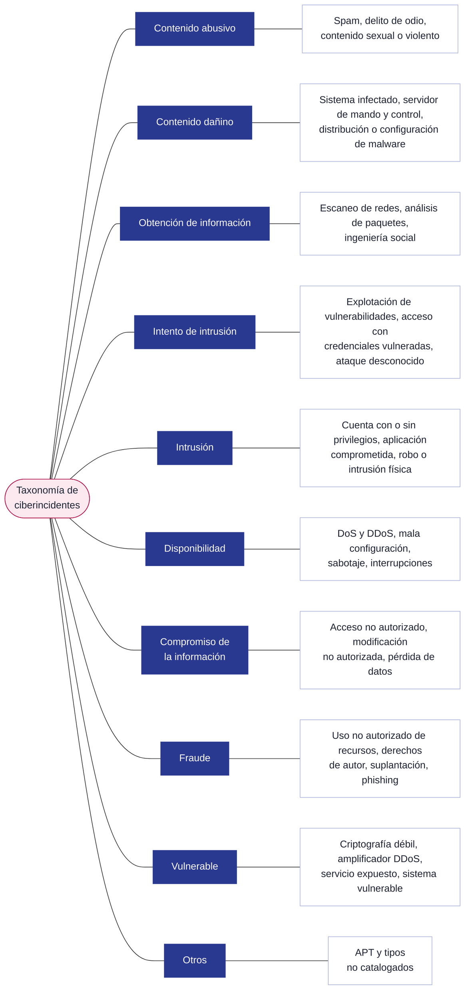

### Cómo se clasifica en la práctica

1. **Describe el hecho, no la herramienta.** «Regla 5763 de Wazuh» no es una clasificación; «intento de acceso con vulneración de credenciales» sí.
2. **Elige el tipo más específico** que encaje con lo que se ha confirmado, no con lo que se sospecha.
3. **Si encaja en varios tipos, manda el más peligroso.** La Instrucción nacional establece que el suceso se asocia al tipo con el «nivel de peligrosidad superior». Los demás tipos se anotan como clasificación secundaria.
4. **Reclasifica cuando sepas más.** Un «intento de intrusión» pasa a «intrusión» en cuanto se confirma que el atacante entró.

> **Ejemplo SOC Tier 1.** Un ransomware es, a la vez, un *sistema infectado* (contenido dañino) y una *modificación no autorizada de información* (compromiso de la información). Si además se han llevado ficheros, hay *acceso no autorizado a información*. Se registra una clasificación principal y el resto como secundarias; ninguna sobra, porque cada una activa obligaciones distintas.

> **Recuerda.** Los incidentes de seguridad física también están en la taxonomía: el *robo* se clasifica dentro de «Intrusión», y el *sabotaje* y las *interrupciones* (un incendio, un corte de suministro) dentro de «Disponibilidad». Los verás en el módulo 3.

<a id="p-1-4"></a>

## 1.4 Nivel de peligrosidad

### Qué mide

El nivel de peligrosidad indica la **amenaza potencial** que supondría que el incidente se materializara. Depende de las características propias del tipo de amenaza y de su comportamiento, no de lo que ya haya ocurrido. Por eso se puede asignar en cuanto se clasifica el suceso, aunque todavía no se conozca el alcance.

Hay cinco niveles. Cada tipo de la taxonomía tiene uno asignado en la Instrucción nacional:

| Nivel | Tipos de incidente |
|---|---|
| **CRÍTICO** | APT |
| **MUY ALTO** | Distribución de malware · Configuración de malware · Robo · Sabotaje · Interrupciones |
| **ALTO** | Pornografía infantil, contenido sexual o violento inadecuado · Sistema infectado · Servidor C&C · Compromiso de aplicaciones · Compromiso de cuentas con privilegios · Ataque desconocido · DoS · DDoS · Acceso no autorizado a información · Modificación no autorizada de información · Pérdida de datos · Phishing |
| **MEDIO** | Discurso de odio · Ingeniería social · Explotación de vulnerabilidades conocidas · Intento de acceso con vulneración de credenciales · Compromiso de cuentas sin privilegios · Mala configuración · Uso no autorizado de recursos · Derechos de autor · Suplantación · Criptografía débil · Amplificador DDoS · Servicios con acceso potencial no deseado · Revelación de información · Sistema vulnerable |
| **BAJO** | Spam · Escaneo de redes · Análisis de paquetes · Otros |

**Diagrama 1.3. Árbol de decisión de la peligrosidad.** Se recorre de arriba abajo; la primera pregunta que se responde con un «sí» fija el nivel.

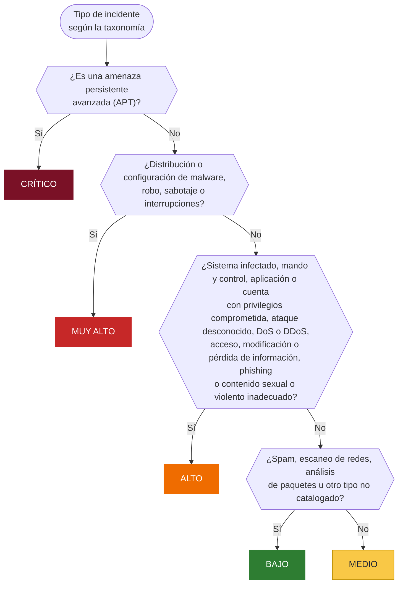

> **Atención.** La peligrosidad de un phishing es ALTO aunque nadie haya picado todavía, y la de un escaneo de puertos es BAJO aunque dure toda la noche. La peligrosidad habla del tipo de amenaza; lo que de verdad ha pasado en tu organización lo mide el impacto.

<a id="p-1-5"></a>

## 1.5 Nivel de impacto

### Qué mide

El nivel de impacto valora las **consecuencias** que el incidente ha tenido, o puede tener, en las funciones y actividades de la organización, en sus activos o en las personas afectadas. La Instrucción nacional enumera los parámetros que se tienen en cuenta: la seguridad nacional o ciudadana, los servicios esenciales e infraestructuras críticas, el tipo de información o de sistemas afectados, el grado de afectación a las instalaciones, la interrupción del servicio, el tiempo y el coste de la recuperación, las pérdidas económicas, la extensión geográfica y los daños reputacionales.

Hay seis niveles: los cinco de la peligrosidad y uno más, SIN IMPACTO.

| Nivel | Sistemas afectados | Interrupción del servicio | Esfuerzo de resolución | Otros criterios |
|---|---|---|---|---|
| **CRÍTICO** | Más del 90 % | Más de 24 horas y más del 50 % de los usuarios | Más de 100 jornadas-persona | Afecta a la seguridad nacional, a la vida de las personas o a una infraestructura crítica; alcance supranacional; pérdidas superiores al 0,1 % del PIB |
| **MUY ALTO** | Más del 75 % | Más de 8 horas y más del 35 % de los usuarios | Entre 30 y 100 jornadas-persona | Afecta a un servicio esencial o pone en peligro bienes materiales; más de 4 comunidades autónomas; daños reputacionales elevados con cobertura nacional continua |
| **ALTO** | Más del 50 % | Más de 1 hora y más del 10 % de los usuarios | Entre 5 y 30 jornadas-persona | Más de 3 comunidades autónomas; daños reputacionales de difícil reparación, con eco mediático |
| **MEDIO** | Más del 20 % | Más del 5 % de los usuarios | Entre 1 y 5 jornadas-persona | Más de 2 comunidades autónomas; daños reputacionales apreciables |
| **BAJO** | Algún sistema de la organización | Interrupción de un servicio | Menos de 1 jornada-persona | Daños reputacionales puntuales, sin eco mediático |
| **SIN IMPACTO** | — | — | — | No hay ningún impacto apreciable |

Una *jornada-persona* es el trabajo de una persona durante una jornada. Si tres técnicos dedican dos días completos a resolver el incidente, el esfuerzo es de seis jornadas-persona.

> **Recuerda.** Los umbrales de la tabla están pensados para todo tipo de entidades, incluidos los operadores de servicios esenciales. En una empresa mediana lo habitual es moverse entre SIN IMPACTO y ALTO. Basta con que se cumpla un criterio de un nivel para asignarlo. Cuando se cumplen criterios de niveles distintos, el criterio de trabajo prudente es quedarse con el más alto y revisarlo a medida que se conoce el alcance; la Instrucción no fija una regla de combinación.

### El impacto cambia; la ficha debe reflejarlo

La peligrosidad suele mantenerse desde el principio. El impacto, en cambio, se revisa varias veces: al abrir el incidente es una estimación y, a medida que avanza la investigación, se corrige. Cada cambio se anota en la ficha con fecha, autor y motivo (lo verás en el módulo 5).

<a id="p-1-6"></a>

## 1.6 La matriz de valoración

### Dos escalas, una decisión

Peligrosidad e impacto se asignan por separado, pero el analista necesita una sola respuesta: con qué urgencia se trata el incidente y si hay que notificarlo. La regla de la Instrucción nacional es sencilla: **son de notificación obligatoria los incidentes cuyo nivel de peligrosidad o de impacto sea ALTO, MUY ALTO o CRÍTICO**. Basta con que lo sea uno de los dos.

La matriz siguiente es una ayuda de trabajo construida con esa regla. Cruza las dos escalas y devuelve el nivel que rige la gestión, que es el mayor de los dos.

| Peligrosidad ↓ / Impacto → | SIN IMPACTO | BAJO | MEDIO | ALTO | MUY ALTO | CRÍTICO |
|---|---|---|---|---|---|---|
| **CRÍTICO** | CRÍTICO | CRÍTICO | CRÍTICO | CRÍTICO | CRÍTICO | CRÍTICO |
| **MUY ALTO** | MUY ALTO | MUY ALTO | MUY ALTO | MUY ALTO | MUY ALTO | CRÍTICO |
| **ALTO** | ALTO | ALTO | ALTO | ALTO | MUY ALTO | CRÍTICO |
| **MEDIO** | MEDIO | MEDIO | MEDIO | ALTO | MUY ALTO | CRÍTICO |
| **BAJO** | BAJO | BAJO | MEDIO | ALTO | MUY ALTO | CRÍTICO |

**Diagrama 1.4. Los tres casos de ACME sobre la matriz.** Cada punto sitúa un caso según su peligrosidad (eje vertical) y su impacto (eje horizontal). Todo lo que no está en el cuadrante inferior izquierdo exige notificación si la entidad está obligada.

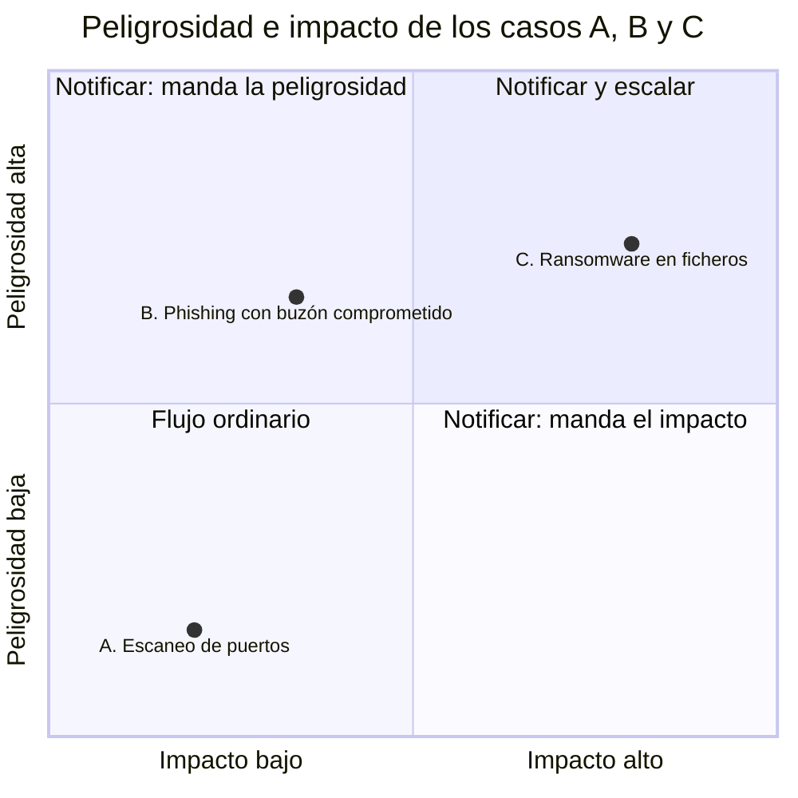

### A quién se notifica y en qué plazo

La obligación de notificar recae sobre los *sujetos obligados*: las entidades del sector público sujetas al Esquema Nacional de Seguridad, los operadores de servicios esenciales, los operadores críticos y los proveedores de servicios digitales. Para el resto de empresas y para la ciudadanía la notificación es voluntaria, aunque recomendable.

| Quién sufre el incidente | CSIRT de referencia |
|---|---|
| Sector público | CCN-CERT (Centro Criptológico Nacional) |
| Empresas, ciudadanía y entidades afiliadas a RedIRIS | INCIBE-CERT |
| Ámbito de la Defensa | ESPDEF-CERT |
| Empresa privada que presta servicios a una entidad pública | INCIBE-CERT, que lo traslada al CCN-CERT (artículo 33 del Real Decreto 311/2022) |

Los plazos forman la *ventana temporal de reporte*:

| Nivel de peligrosidad o impacto | Notificación inicial | Notificación intermedia | Notificación final |
|---|---|---|---|
| CRÍTICO | Inmediata | A las 24 o 48 horas | A los 20 días |
| MUY ALTO | Inmediata | A las 72 horas | A los 40 días |
| ALTO | Inmediata | — | — |
| MEDIO | — | — | — |
| BAJO | — | — | — |

La notificación inicial se cuenta desde que se tiene conocimiento del incidente; la intermedia y la final, desde que se envió la inicial.

> **Atención.** Estos plazos conviven con otros. Si el incidente afecta a datos personales y supone un riesgo para las personas, el Reglamento General de Protección de Datos (artículo 33) obliga a notificarlo a la Agencia Española de Protección de Datos en un máximo de 72 horas desde que se tiene constancia. Y si hay indicios de delito, procede la denuncia ante las Fuerzas y Cuerpos de Seguridad. Son tres vías distintas y pueden darse a la vez.

> **Recuerda.** A la fecha de cierre de este material (noviembre de 2026) España no ha publicado la ley que transpone la directiva europea NIS2, de modo que siguen vigentes el Real Decreto-ley 12/2018 y su desarrollo, el Real Decreto 43/2021. Antes de aplicar plazos en un caso real, comprueba si la normativa ha cambiado.

### De la valoración a la prioridad del SOC

Cada SOC traduce el nivel resultante a una prioridad interna con un tiempo máximo de primera respuesta. En ACME se usa esta correspondencia (es un ejemplo; cada organización fija la suya):

| Nivel que rige | Prioridad interna | Primera respuesta | Quién lo lleva |
|---|---|---|---|
| CRÍTICO o MUY ALTO | P1 | 15 minutos | Nivel 2 y comité de crisis |
| ALTO | P2 | 1 hora | Nivel 2 |
| MEDIO | P3 | 8 horas laborables | Nivel 1 |
| BAJO | P4 | Siguiente día hábil | Nivel 1 |

<a id="p-1-7"></a>

## 1.7 Tres tipos de incidente frente a frente

Malware, denegación de servicio y fuga de información son los tres grandes bloques con los que te encontrarás. Se parecen poco: atacan dimensiones de seguridad distintas, dejan señales distintas y piden una primera reacción distinta.

| | Malware | Denegación de servicio | Fuga de información |
|---|---|---|---|
| **Qué ocurre** | Se ejecuta código hostil en un equipo | Un servicio deja de responder por saturación | Sale información hacia quien no debe tenerla |
| **Dimensión más afectada** | Integridad (y, con ransomware, disponibilidad) | Disponibilidad | Confidencialidad |
| **Clasificación** | Contenido dañino | Disponibilidad | Compromiso de la información |
| **Tipo habitual** | Sistema infectado | DoS o DDoS | Acceso no autorizado a información |
| **Peligrosidad** | ALTO | ALTO | ALTO |
| **Señales típicas** | Alerta del antivirus o del EDR, procesos extraños, conexiones periódicas a un mismo destino | Pico de tráfico, errores 503, quejas de los usuarios | Volumen de salida anómalo, consultas DNS extrañas, datos publicados fuera |
| **Dónde se ve primero** | Agente del equipo (HIDS, EDR) | Sensor de red y monitorización del servicio | Proxy, DNS, cortafuegos y vigilancia en fuentes abiertas |
| **Primera contención** | Aislar el equipo de la red | Filtrar el tráfico con el proveedor o el cortafuegos | Cortar el canal de salida y revocar credenciales |
| **Obligación añadida** | — | — | Valorar la brecha de datos personales (72 horas) |

> **[IMAGEN ILUSTRATIVA 1.1: Infografía comparativa «Malware, denegación de servicio y fuga de información»]**
>
> - **Qué debe mostrar:** tres columnas del mismo ancho, una por tipo de incidente, con un icono grande en la cabecera (un insecto para malware, un servidor saturado para la denegación de servicio y un documento que sale de una caja para la fuga). Debajo, cinco filas alineadas: dimensión afectada, clasificación en la taxonomía, nivel de peligrosidad, señales de detección y primera medida de contención. Los contenidos son los de la tabla anterior.
> - **Formato:** infografía horizontal de 1 600 × 900 píxeles en PNG o SVG, fondo blanco, un color por columna y la etiqueta de peligrosidad «ALTO» en naranja en las tres.
> - **Texto alternativo:** «Comparación de malware, denegación de servicio y fuga de información según la dimensión de seguridad afectada, su clasificación, sus señales de detección y su primera contención».
> - **Nota para el docente:** el paquete SCORM ya incluye esta infografía construida en HTML; sustitúyela solo si quieres un diseño propio.

<a id="p-1-8"></a>

## 1.8 Ejemplo práctico: los tres casos del lunes

Aplicamos el método completo a los tres casos de la situación inicial. Los pasos son siempre los mismos: clasificar, asignar peligrosidad, estimar impacto, obtener el nivel que rige y decidir.

### Caso A. Barrido de puertos contra el cortafuegos

| Paso | Resultado | Razonamiento |
|---|---|---|
| Clasificación | Obtención de información → Escaneo de redes | Hay sondeo de puertos; no hay intento de autenticación ni conexión establecida |
| Peligrosidad | BAJO | Es el nivel que la tabla asigna al escaneo de redes |
| Impacto | SIN IMPACTO | Ningún servicio ni dato afectado |
| Nivel que rige | BAJO (P4) | El mayor de los dos |
| Decisión | No se notifica. Se registra y se cierra | Se comprueba que no hay servicios expuestos que no deban estarlo (módulo 4) |

### Caso B. Credenciales entregadas en una página falsa

| Paso | Resultado | Razonamiento |
|---|---|---|
| Clasificación | Fraude → Phishing. Secundaria: Intrusión → Compromiso de cuenta sin privilegios | La usuaria entregó la contraseña y después alguien entró en el buzón |
| Peligrosidad | ALTO | Phishing es ALTO; el compromiso de cuenta sin privilegios es MEDIO. Manda el superior |
| Impacto | MEDIO (estimación inicial) | Un buzón afectado; restablecer credenciales, revisar reglas de reenvío y avisar a los contactos requiere entre 1 y 5 jornadas-persona |
| Nivel que rige | ALTO (P2) | La peligrosidad supera al impacto |
| Decisión | Escalar a nivel 2. Notificación inicial inmediata si el buzón interviene en el servicio prestado al organismo público | El buzón contiene datos personales: hay que valorar si procede notificar a la AEPD |

### Caso C. Ficheros cifrados en `srv-files01`

| Paso | Resultado | Razonamiento |
|---|---|---|
| Clasificación | Contenido dañino → Sistema infectado. Secundaria: Compromiso de la información → Modificación no autorizada | Hay malware activo y ha alterado la información |
| Peligrosidad | ALTO | Ambos tipos tienen nivel ALTO |
| Impacto | MUY ALTO (estimación inicial) | El servidor da servicio a 120 de las 180 personas (67 %) y la restauración se estima en 14 horas: se supera el umbral de 8 horas y 35 % de usuarios |
| Nivel que rige | MUY ALTO (P1) | El impacto supera a la peligrosidad |
| Decisión | Escalar de inmediato a nivel 2 y activar el comité de crisis | Notificación inicial inmediata, intermedia a las 72 horas y final a los 40 días; valorar la brecha de datos personales |

### Conclusión

El orden de atención es **C, B, A**. La peligrosidad por sí sola no lo habría resuelto, porque B y C empatan en ALTO: lo que desempata es el impacto. Y el caso A, que es el que más alertas ha generado, es el menos importante de los tres.

> **Idea clave.** El número de alertas no mide la gravedad. La gravedad la dan el tipo de amenaza (peligrosidad) y sus consecuencias (impacto), y se decide con las tablas, no con la intuición.

### Errores frecuentes

- **Clasificar por la herramienta que avisó** en lugar de por lo que ha ocurrido.
- **Asignar el impacto por miedo.** «Ransomware» no implica impacto CRÍTICO: hay que contar sistemas, usuarios y horas.
- **Olvidar la clasificación secundaria**, que es la que activa la notificación de la brecha de datos.
- **No revisar la valoración** cuando la investigación descubre más equipos o más datos afectados.

<a id="p-1-9"></a>

## 1.9 Recursos y referencias

> **[VÍDEO / RECURSO RECOMENDADO 1.1: La Guía Nacional de Notificación y Gestión de Ciberincidentes, explicada por INCIBE-CERT]**
>
> - **Enlace:** <https://www.incibe.es/incibe-cert/blog/conoces-guia-nacional-notificacion-y-gestion-ciberincidentes>
> - **Formato e idioma:** artículo en español; lectura de cinco minutos.
> - **Qué aporta:** resume para qué sirve la guía, cómo se prioriza un incidente según su peligrosidad e impacto y cómo se notifica a INCIBE-CERT.
> - **Cómo usarlo:** léelo antes de la actividad de clasificación y localiza en la guía completa la tabla de niveles de impacto.
> - **Nota para el docente:** no he localizado una píldora oficial en vídeo del CCN-CERT sobre la guía con enlace estable. Si quieres grabar una propia de cuatro a seis minutos, este guion funciona: (1) qué es la guía y a quién obliga; (2) la taxonomía en una diapositiva; (3) peligrosidad frente a impacto con el caso B; (4) la ventana temporal de reporte; (5) a qué CSIRT se notifica.

> **[REFERENCIAS Y GUÍAS OFICIALES]**
>
> - [Guía Nacional de Notificación y Gestión de Ciberincidentes (2020)](https://www.incibe.es/sites/default/files/contenidos/guias/doc/guia_nacional_notificacion_gestion_ciberincidentes.pdf). Taxonomía, niveles, ventana temporal de reporte y estados del incidente.
> - [CCN-STIC 817. Esquema Nacional de Seguridad. Gestión de ciberincidentes (abril de 2020)](https://www.ccn-cert.cni.es/series-ccn-stic/800-guia-esquema-nacional-de-seguridad/988-ccn-stic-817-gestion-de-ciberincidentes/file.html). Aplicación de la guía al sector público y a la herramienta LUCIA.
> - [Real Decreto 43/2021, anexo: Instrucción nacional de notificación y gestión de ciberincidentes](https://www.boe.es/buscar/act.php?id=BOE-A-2021-1192). Texto legal de las tablas de peligrosidad e impacto.
> - [Real Decreto 311/2022, Esquema Nacional de Seguridad](https://www.boe.es/buscar/act.php?id=BOE-A-2022-7191). Artículos 25 y 33, medida op.exp.7 (gestión de incidentes) y glosario del anexo IV.
> - [Taxonomía de INCIBE-CERT](https://www.incibe.es/incibe-cert/incidentes/taxonomia). Tabla completa con descripción y ejemplo de cada tipo.
> - [Reference Security Incident Taxonomy (ENISA y TF-CSIRT)](https://github.com/enisaeu/Reference-Security-Incident-Taxonomy-Task-Force). Taxonomía europea de la que deriva la española.
> - [NIST SP 800-61 Rev. 3 (abril de 2025)](https://csrc.nist.gov/pubs/sp/800/61/r3/final). Recomendaciones de respuesta a incidentes alineadas con el Cybersecurity Framework 2.0; sustituye a la revisión 2.
> - [ISO/IEC 27035-1:2023](https://webstore.iec.ch/en/publication/83157). Principios y proceso de la gestión de incidentes de seguridad de la información.
> - [RFC 4949. Internet Security Glossary, Version 2](https://www.rfc-editor.org/rfc/rfc4949). Definiciones de referencia de evento e incidente de seguridad.

<a id="p-1-act"></a>

## 1.10 Actividades interactivas

Cada actividad cuenta una vez, en el primer intento. Las preguntas de test muestran después la retroalimentación de todas las opciones.

### Actividad 1.1. Clasificar con lo confirmado (pregunta de test)

El sensor de red de ACME registra 40 intentos de inicio de sesión fallidos contra el servicio SSH de `srv-web01`. Todos proceden de la misma dirección externa y prueban usuarios distintos. No hay ningún acceso correcto. ¿Cómo se clasifica el suceso y qué nivel de peligrosidad le corresponde?

- **a)** Intrusión → Compromiso de cuenta con privilegios. Peligrosidad ALTO.
- **b)** Intento de intrusión → Intento de acceso con vulneración de credenciales. Peligrosidad MEDIO.
- **c)** Intrusión → Compromiso de cuenta sin privilegios. Peligrosidad MEDIO.
- **d)** Obtención de información → Escaneo de redes. Peligrosidad BAJO.

| Opción | Resultado | Retroalimentación |
|---|---|---|
| a) | Incorrecta | No. Es el peor desenlace posible, pero no ha ocurrido. Valorar por miedo desordena las prioridades: este caso pasaría por delante de incidentes reales. Si se confirma un acceso, se reclasifica en ese momento. |
| b) | **Correcta** | Correcto. Se han probado credenciales y ninguna ha funcionado: es un intento, no una intrusión. La tabla de peligrosidad asigna a este tipo el nivel MEDIO. Si más adelante apareciera un acceso correcto desde esa dirección, habría que reclasificarlo como «Intrusión». |
| c) | Incorrecta | No. «Intrusión» exige que el atacante haya entrado, y aquí no consta ningún acceso correcto. Se clasifica lo que se ha confirmado, no lo que se teme. El nivel coincide, pero la clasificación cambia las estadísticas y la forma de tratar el caso. |
| d) | Incorrecta | No. Un escaneo sondea qué puertos y servicios hay. Aquí el atacante ya conoce el servicio y está probando credenciales contra él, que es un paso más: un intento de intrusión, con peligrosidad MEDIO. |

*Tipo de contenido H5P o Moodle:* Multiple Choice (una sola respuesta), con la retroalimentación de cada fila en el campo de la opción correspondiente.

### Actividad 1.2. El nivel que rige (pregunta de test)

Un incidente se clasifica como «Mala configuración», de peligrosidad MEDIO. La investigación muestra que dejó sin servicio el portal de clientes durante 3 horas y que afectó al 40 % de los usuarios. ACME está obligada a notificar por su contrato con el organismo público. ¿Qué nivel rige la gestión y qué hay que hacer?

- **a)** ALTO, pero solo se notifica si la peligrosidad también es ALTO.
- **b)** MUY ALTO, porque afecta a más del 35 % de los usuarios. Notificación inmediata e intermedia a las 72 horas.
- **c)** ALTO, porque manda el impacto. Notificación inicial inmediata al CSIRT de referencia.
- **d)** MEDIO, porque la peligrosidad es la del tipo de incidente. No hay que notificar.

| Opción | Resultado | Retroalimentación |
|---|---|---|
| a) | Incorrecta | No. La Instrucción nacional pide notificar cuando la peligrosidad **o** el impacto son ALTO, MUY ALTO o CRÍTICO. No hace falta que coincidan. |
| b) | Incorrecta | No. El tramo MUY ALTO exige las dos condiciones a la vez: más de 8 horas y más del 35 % de los usuarios. La interrupción duró 3 horas, así que se queda en ALTO. |
| c) | **Correcta** | Correcto. Una interrupción de más de 1 hora que afecta a más del 10 % de los usuarios es impacto ALTO. El nivel que rige es el mayor de los dos, y a partir de ALTO la notificación inicial es obligatoria e inmediata. |
| d) | Incorrecta | No. La peligrosidad es solo una de las dos escalas. El impacto mide lo que de verdad ha ocurrido, y aquí es ALTO. Basta con que una de las dos alcance ese nivel para que haya que notificar. |

*Tipo de contenido H5P o Moodle:* Multiple Choice (una sola respuesta), con la retroalimentación de cada fila en el campo de la opción correspondiente.

### Actividad 1.3. Cada suceso, en su clasificación (clasificación)

Coloca cada suceso en la clasificación de la taxonomía que le corresponde.

| Elemento | Categoría | Comentario al corregir |
|---|---|---|
| Un puesto contacta cada diez minutos con un servidor de mando y control | Contenido dañino | El equipo ejecuta malware: tipo «Sistema infectado». |
| Barrido de puertos contra el cortafuegos | Obtención de información | Tipo «Escaneo de redes»: se sondea, no se intenta entrar. |
| Un falso técnico pide por teléfono la contraseña a una empleada | Obtención de información | Tipo «Ingeniería social»: se busca información manipulando a una persona. |
| Una inyección SQL entrega el control de la aplicación web | Intrusión | Tipo «Compromiso de aplicaciones»: el atacante ya está dentro. |
| Una persona ajena entra en el CPD con una tarjeta copiada | Intrusión | Tipo «Robo»: la intrusión física se clasifica aquí. |
| Una inundación de peticiones deja sin servicio el portal de clientes | Disponibilidad | Tipo «DoS» o «DDoS», según haya uno o muchos orígenes. |
| Una página imita el correo corporativo para capturar contraseñas | Fraude | Tipo «Phishing». |
| El escritorio remoto de un servidor es accesible desde Internet | Vulnerable | Tipo «Servicios con acceso potencial no deseado»: todavía no ha pasado nada. |

*Tipo de contenido H5P recomendado:* Drag and Drop (zonas con texto) o Drag the Words.

Texto preparado para pegar en **Drag the Words** (las respuestas van entre asteriscos):

```text
Un puesto contacta cada diez minutos con un servidor de mando y control: *Contenido dañino*
Barrido de puertos contra el cortafuegos: *Obtención de información*
Un falso técnico pide por teléfono la contraseña a una empleada: *Obtención de información*
Una inyección SQL entrega el control de la aplicación web: *Intrusión*
Una persona ajena entra en el CPD con una tarjeta copiada: *Intrusión*
Una inundación de peticiones deja sin servicio el portal de clientes: *Disponibilidad*
Una página imita el correo corporativo para capturar contraseñas: *Fraude*
El escritorio remoto de un servidor es accesible desde Internet: *Vulnerable*
```


<a id="m-2"></a>

# Módulo 2. Monitorización técnica: SIEM (Wazuh) y NIDS (Suricata)

**Criterio de evaluación:** CE 2.b. Se han establecido controles, herramientas y mecanismos de monitorización, identificación, detección y alerta de incidentes.  
**Tiempo estimado de estudio:** 150 minutos.

<a id="p-2-1"></a>

## 2.1 Sin registros no hay detección

Martes, 08:14. En el panel de Wazuh aparece una alerta de nivel 10: «sshd: 5 autenticaciones fallidas en 60 s desde 203.0.113.45». Un segundo después llega otra del sensor de red: «Posible fuerza bruta SSH». Las dos hablan del mismo ataque contra `srv-web01`, visto desde dos sitios distintos.

Para que esas dos líneas llegaran a tu pantalla han tenido que funcionar muchas piezas: el servidor escribió un registro, un agente lo leyó y lo envió, un motor lo descompuso en campos, una regla contó repeticiones y otra herramienta inspeccionó los paquetes en la red. Si falla cualquiera de ellas, el ataque ocurre igual, pero nadie lo ve.

En este módulo vas a recorrer esa cadena completa:

1. Qué registros genera cada sistema y dónde están.
2. Qué diferencia hay entre observar un equipo (HIDS) y observar la red (NIDS).
3. Cómo se escribe una regla de Suricata.
4. Cómo está construido Wazuh y cómo convierte un registro en una alerta.
5. Cómo se escribe una regla de correlación en XML para un caso de uso real.

<a id="p-2-2"></a>

## 2.2 Fuentes internas de registros

### Linux

| Qué se quiere ver | Dónde está | Qué contiene |
|---|---|---|
| Autenticación | `/var/log/auth.log` (Debian y Ubuntu), `/var/log/secure` (familia Red Hat) o el diario de systemd | Inicios de sesión SSH, `sudo`, cambios de usuario |
| Sistema | `/var/log/syslog` o el diario de systemd | Servicios que arrancan o fallan, mensajes del núcleo |
| Auditoría del núcleo | `/var/log/audit/audit.log` (auditd) | Ejecución de programas, cambios en ficheros sensibles |
| Aplicaciones | `/var/log/nginx/access.log`, `/var/log/apache2/access.log`, registros de PostgreSQL | Peticiones web, errores, consultas |

Así se ve un intento fallido de SSH, en el formato clásico y en el formato con fecha ISO 8601 que usan por defecto las versiones recientes de Ubuntu:

```text
Nov 10 08:14:22 srv-web01 sshd[2301]: Failed password for root from 203.0.113.45 port 40104 ssh2
2026-11-10T08:14:22.003512+01:00 srv-web01 sshd[2301]: Failed password for root from 203.0.113.45 port 40104 ssh2
```

Para consultarlos a mano:

```bash
# Últimos intentos fallidos de SSH en el diario de systemd
journalctl -u ssh --since "15 min ago" | grep "Failed password"

# Lo mismo en el fichero clásico
grep "Failed password" /var/log/auth.log | tail -n 20
```

> **En el laboratorio.** Desde OpenSSH 9.8 el proceso que escribe estas líneas se llama `sshd-session` en lugar de `sshd`. El decodificador de Wazuh se aplica a cualquier programa cuyo nombre empiece por `sshd`, pero si escribes tus propios filtros con `grep` o con expresiones regulares, tenlo en cuenta.

### Windows

Windows guarda sus registros en canales del Visor de eventos. Cada evento tiene un identificador numérico; conviene memorizar los más útiles.

| Canal | Identificador | Significado |
|---|---|---|
| Security | 4624 | Inicio de sesión correcto |
| Security | 4625 | Inicio de sesión fallido |
| Security | 4672 | Inicio de sesión con privilegios especiales |
| Security | 4688 | Creación de un proceso (hay que activar su auditoría) |
| Security | 4720 | Creación de una cuenta de usuario |
| Security | 4732 | Usuario añadido a un grupo local con privilegios |
| Security | 4740 | Cuenta bloqueada |
| Security | 1102 | Se ha borrado el registro de auditoría |
| System | 7045 | Se ha instalado un servicio nuevo |
| Microsoft-Windows-PowerShell/Operational | 4104 | Bloque de script de PowerShell ejecutado |
| Microsoft-Windows-Sysmon/Operational | 1, 3, 11, 22 | Proceso creado, conexión de red, fichero creado, consulta DNS |

```powershell
# Cinco últimos inicios de sesión fallidos
Get-WinEvent -FilterHashtable @{LogName='Security'; Id=4625} -MaxEvents 5 |
  Format-List TimeCreated, Message
```

Sysmon no viene instalado: es una utilidad gratuita de Microsoft Sysinternals que añade al sistema un registro mucho más detallado de procesos, conexiones y ficheros. Sin Sysmon (o sin la auditoría de creación de procesos con línea de comandos) es muy difícil detectar el abuso de herramientas legítimas como PowerShell.

### Dispositivos de red

Cortafuegos, conmutadores, encaminadores, puntos de acceso, servidores DNS y proxies no admiten un agente, así que envían sus registros por la red.

- **Syslog** (RFC 5424). Cada mensaje lleva una prioridad que combina el origen (*facility*) y la gravedad (*severity*), de 0 a 7.
- **NetFlow e IPFIX** (RFC 7011). No transportan el contenido, sino el resumen de cada conversación: quién habló con quién, por qué puerto, cuánto y durante cuánto tiempo.
- **Registros propios**: conexiones permitidas y denegadas del cortafuegos, consultas DNS, peticiones del proxy, concesiones DHCP, sesiones VPN.

| Gravedad syslog | Nombre | Ejemplo |
|---|---|---|
| 0 | Emergencia | El sistema no se puede usar |
| 1 | Alerta | Hay que actuar de inmediato |
| 2 | Crítico | Fallo de un componente principal |
| 3 | Error | Un servicio no ha podido arrancar |
| 4 | Aviso | Espacio en disco al 90 % |
| 5 | Notificación | Cambio de configuración |
| 6 | Información | Inicio de sesión correcto |
| 7 | Depuración | Trazas para el desarrollador |

```text
<38>1 2026-11-10T07:14:22.003Z srv-web01 sshd 2301 - - Failed password for root from 203.0.113.45 port 40104 ssh2
```

En ese mensaje, `<38>` es la prioridad: origen 4 (autenticación) por 8, más gravedad 6 (información).

### Tres condiciones para que los registros sirvan

1. **Relojes sincronizados.** Todos los equipos deben tomar la hora del mismo servidor NTP. Si dos relojes difieren en cinco minutos, la correlación entre fuentes falla y la cronología del incidente no se sostiene.
2. **Retención y protección.** Lo primero que hace un intruso con privilegios es borrar sus huellas. Los registros deben salir del equipo en cuanto se generan y guardarse donde el administrador del equipo no pueda alterarlos.
3. **Cobertura.** Hay que saber qué fuentes existen y cuáles llegan al SIEM. Un servidor sin agente es un punto ciego.

> **Recuerda.** El Esquema Nacional de Seguridad recoge estas exigencias en la medida **op.exp.8, Registro de la actividad**, cuyos refuerzos piden revisar los registros, sincronizar el reloj, definir la retención, controlar el acceso y, en categoría ALTA, correlacionar los eventos de forma automática. La detección de intrusiones es la medida **op.mon.1** y la recolección y correlación de eventos de seguridad, la **op.mon.3, Vigilancia**.

<a id="p-2-3"></a>

## 2.3 Dos miradas: el equipo y la red

Un sistema de detección de intrusiones (IDS) puede mirar dos cosas distintas.

| | HIDS (de equipo) | NIDS (de red) |
|---|---|---|
| **Qué observa** | Lo que ocurre dentro de un equipo: registros, procesos, ficheros, configuración | Los paquetes que circulan por un segmento de red |
| **Dónde se instala** | Un agente en cada servidor y cada puesto | Un sensor conectado a un puerto espejo o a un TAP |
| **Qué ve muy bien** | Quién inició sesión, qué programa se ejecutó, qué fichero cambió | Escaneos, conexiones a destinos sospechosos, movimiento entre equipos |
| **Qué no ve** | Los equipos sin agente y el tráfico que no toca al equipo | El contenido cifrado y lo que ocurre dentro del equipo |
| **Herramienta de esta unidad** | Agente de Wazuh | Suricata |

Ninguna de las dos basta por separado. El ataque de las 08:14 lo ven las dos: Suricata detecta muchas conexiones nuevas al puerto 22 y el agente de `srv-web01` lee en el registro que las contraseñas fueron incorrectas. Solo el agente puede decir si alguna fue correcta.

Un **IPS** (sistema de prevención) es un IDS colocado en línea, por donde pasa el tráfico, de modo que además de avisar puede descartar los paquetes. Suricata puede trabajar de las dos maneras; en esta unidad lo usamos como IDS.

**Diagrama 2.1. Dónde se coloca cada sensor en la red de ACME.** Los agentes envían los registros de cada equipo; el sensor de red recibe una copia del tráfico y envía sus alertas al mismo servidor.

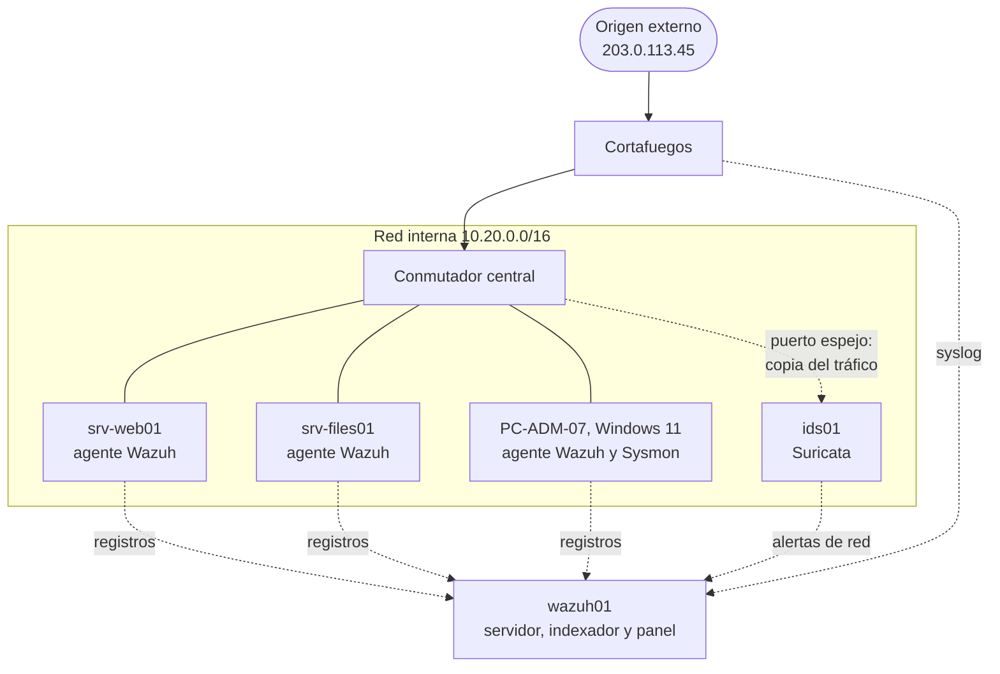

<a id="p-2-4"></a>

## 2.4 Suricata: inspección del tráfico

### Qué es y cómo trabaja

Suricata es un motor de código abierto, mantenido por la Open Information Security Foundation (OISF), que analiza el tráfico de red. Reconoce los protocolos por su contenido (no solo por el puerto), aplica reglas y escribe todo lo que ve en un fichero JSON llamado `eve.json`. La rama estable actual es la 8; la rama 7 llegó al final de su ciclo de vida en septiembre de 2026.

Las reglas pueden proceder de un conjunto público (por ejemplo, Emerging Threats Open, que se descarga con `suricata-update`) o escribirse a medida.

### Anatomía de una regla

Una regla tiene tres partes: la **acción**, la **cabecera** (qué tráfico se examina) y las **opciones** entre paréntesis (qué se busca y cómo se informa).

```text
alert tcp $EXTERNAL_NET any -> $HOME_NET 22 (msg:"LOCAL Posible fuerza bruta SSH: 5 conexiones nuevas en 60 s desde el mismo origen"; flow:to_server; flags:S,12; threshold:type both, track by_src, count 5, seconds 60; classtype:attempted-admin; sid:1000002; rev:1;)
```

| Parte | Valor en el ejemplo | Significado |
|---|---|---|
| Acción | `alert` | Genera una alerta. Otras: `pass`, `drop` y `reject` (las dos últimas, solo en línea) |
| Protocolo | `tcp` | También `udp`, `icmp`, `ip` o un protocolo de aplicación: `http`, `dns`, `tls`, `ssh`… |
| Origen | `$EXTERNAL_NET any` | Cualquier dirección externa, cualquier puerto |
| Dirección | `->` | De origen a destino. `<>` examina los dos sentidos |
| Destino | `$HOME_NET 22` | La red propia, puerto 22 |
| `msg` | Texto | Lo que verá el analista |
| `flow` | `to_server` | Solo paquetes del cliente hacia el servidor |
| `flags` | `S,12` | Paquetes con el indicador SYN: inicios de conexión |
| `threshold` | `type both, track by_src, count 5, seconds 60` | Avisa una sola vez cuando el mismo origen acumula cinco coincidencias en 60 segundos |
| `classtype` | `attempted-admin` | Categoría, que fija la prioridad (1 es la más alta) |
| `sid` y `rev` | `1000002`, `1` | Identificador único y versión. El rango de 1 000 000 a 1 999 999 está reservado para reglas locales |

`$HOME_NET` y `$EXTERNAL_NET` son variables que se definen en `/etc/suricata/suricata.yaml`. Si `HOME_NET` no describe bien tu red, las reglas no se disparan o se disparan con todo.

### Cuatro reglas locales para ACME

```text
# /etc/suricata/rules/local.rules

# 1. Ping hacia la red interna (regla de prueba para comprobar que el sensor funciona)
alert icmp any any -> $HOME_NET any (msg:"LOCAL ICMP echo request hacia la red interna"; itype:8; classtype:misc-activity; sid:1000001; rev:1;)

# 2. Posible fuerza bruta contra SSH
alert tcp $EXTERNAL_NET any -> $HOME_NET 22 (msg:"LOCAL Posible fuerza bruta SSH: 5 conexiones nuevas en 60 s desde el mismo origen"; flow:to_server; flags:S,12; threshold:type both, track by_src, count 5, seconds 60; classtype:attempted-admin; sid:1000002; rev:1;)

# 3. Consulta DNS a un dominio que imita al corporativo (lo localizaremos en el módulo 4)
alert dns $HOME_NET any -> any any (msg:"LOCAL Consulta DNS a dominio de typosquatting vigilado"; dns.query; content:"acrne-logistica.example"; nocase; classtype:bad-unknown; sid:1000003; rev:1;)

# 4. Descarga de un ejecutable por HTTP sin cifrar
alert http $HOME_NET any -> $EXTERNAL_NET any (msg:"LOCAL Descarga de ejecutable .exe por HTTP en claro"; flow:established,to_server; http.method; content:"GET"; http.uri; content:".exe"; nocase; endswith; classtype:policy-violation; sid:1000004; rev:1;)
```

En las reglas 3 y 4 aparecen los *búferes*: `dns.query`, `http.method` y `http.uri` indican en qué parte del protocolo debe buscarse el `content` que viene a continuación. Así la regla 3 solo mira el nombre consultado y no cualquier paquete que contenga ese texto.

Para activar las reglas:

```yaml
# /etc/suricata/suricata.yaml
vars:
  address-groups:
    HOME_NET: "[10.20.0.0/16]"
    EXTERNAL_NET: "!$HOME_NET"

default-rule-path: /var/lib/suricata/rules
rule-files:
  - suricata.rules
  - /etc/suricata/rules/local.rules
```

```bash
# Comprueba la configuración y las reglas sin arrancar el motor
sudo suricata -T -c /etc/suricata/suricata.yaml

# Aplica los cambios
sudo systemctl restart suricata

# Mira las alertas según llegan
sudo tail -f /var/log/suricata/fast.log
```

### Qué escribe Suricata cuando una regla se dispara

Este es el registro que deja la regla 2 en `eve.json`. Es una salida real, obtenida al procesar una captura de tráfico de laboratorio con ocho inicios de conexión separados cinco segundos; la alerta aparece exactamente en el quinto.

```json
{
  "timestamp": "2026-11-10T08:14:22.000000+0100",
  "event_type": "alert",
  "src_ip": "203.0.113.45",
  "src_port": 40104,
  "dest_ip": "10.20.1.15",
  "dest_port": 22,
  "proto": "TCP",
  "alert": {
    "action": "allowed",
    "gid": 1,
    "signature_id": 1000002,
    "rev": 1,
    "signature": "LOCAL Posible fuerza bruta SSH: 5 conexiones nuevas en 60 s desde el mismo origen",
    "category": "Attempted Administrator Privilege Gain",
    "severity": 1
  },
  "direction": "to_server"
}
```

> **Atención.** Suricata ve *conexiones*, no contraseñas: el tráfico SSH va cifrado. Cinco conexiones nuevas en un minuto pueden ser un ataque o un script de copias de seguridad mal programado. Por eso la regla de red es un indicio que hay que contrastar con el registro del servidor.

<a id="p-2-5"></a>

## 2.5 Wazuh: arquitectura y despliegue

### Los cuatro componentes

Wazuh es una plataforma de código abierto que reúne las funciones de un SIEM y de un HIDS. Está formada por un agente y tres componentes centrales.

| Componente | Función | Puertos por defecto |
|---|---|---|
| **Agente** | Se instala en cada equipo vigilado. Lee registros, vigila la integridad de ficheros, revisa la configuración, hace inventario y ejecuta respuestas | Sale hacia el servidor |
| **Servidor** (*manager*) | Recibe los datos de los agentes, los decodifica, aplica las reglas y genera las alertas. También gestiona los agentes | 1514/TCP (agentes), 1515/TCP (alta de agentes), 55000/TCP (API) |
| **Indexador** | Almacena e indexa las alertas para poder buscarlas | 9200/TCP |
| **Panel** (*dashboard*) | Interfaz web para consultar, filtrar y visualizar | 443/TCP |

Los dispositivos que no admiten agente (cortafuegos, conmutadores) pueden enviar sus registros al servidor por syslog.

En un laboratorio o en una organización pequeña, los tres componentes centrales se instalan en la misma máquina (despliegue *todo en uno*). En entornos mayores se separan y se montan en clúster.

**Diagrama 2.2. Del registro al panel.** Recorrido completo de un evento: se genera en el equipo, el agente lo envía, el servidor lo analiza en tres fases, la regla produce la alerta y el indexador la pone a disposición del panel.

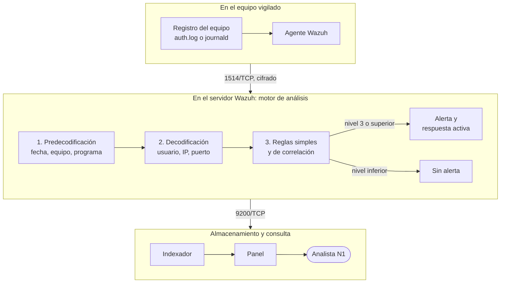

### Despliegue en el laboratorio

El asistente de instalación monta los tres componentes centrales en una sola máquina. Para vigilar hasta 25 equipos, la documentación recomienda 4 CPU virtuales, 8 GB de memoria y 50 GB de disco.

```bash
# En wazuh01: instalación todo en uno (rama 4.14)
curl -sO https://packages.wazuh.com/4.14/wazuh-install.sh
sudo bash ./wazuh-install.sh -a

# Al terminar, el asistente muestra el usuario y la contraseña del panel:
# https://10.20.0.10
```

```bash
# En cada equipo Ubuntu vigilado: repositorio, agente y alta en el servidor
sudo apt-get install gnupg apt-transport-https curl
curl -s https://packages.wazuh.com/key/GPG-KEY-WAZUH | sudo gpg --no-default-keyring \
  --keyring gnupg-ring:/usr/share/keyrings/wazuh.gpg --import
sudo chmod 644 /usr/share/keyrings/wazuh.gpg
echo "deb [signed-by=/usr/share/keyrings/wazuh.gpg] https://packages.wazuh.com/4.x/apt/ stable main" \
  | sudo tee -a /etc/apt/sources.list.d/wazuh.list
sudo apt-get update

sudo WAZUH_MANAGER="10.20.0.10" apt-get install wazuh-agent
sudo systemctl daemon-reload
sudo systemctl enable --now wazuh-agent
```

En Windows, lo más sencillo es abrir en el panel **Agents management → Summary → Deploy new agent**: el asistente genera el comando exacto de PowerShell para tu versión.

El agente decide qué lee en su fichero `/var/ossec/etc/ossec.conf`, con bloques `<localfile>`:

```xml
<ossec_config>
  <!-- Registro clásico de autenticación -->
  <localfile>
    <log_format>syslog</log_format>
    <location>/var/log/auth.log</location>
  </localfile>

  <!-- En equipos sin fichero de texto: lectura directa del diario de systemd -->
  <localfile>
    <location>journald</location>
    <log_format>journald</log_format>
    <filter field="_SYSTEMD_UNIT">^ssh.service$</filter>
  </localfile>
</ossec_config>
```

> **Atención.** Esta unidad usa la rama 4.x de Wazuh (la 4.14 en noviembre de 2026), cuyas reglas se escriben en XML. La versión 5.0, en fase de candidata a versión definitiva al cierre de este material, sustituye el motor de análisis y el formato de las reglas, y no admite actualización directa desde la 4.x. Si en tu laboratorio instalas la 5, la arquitectura general es la misma, pero los ejemplos de reglas no te servirán tal cual.

<a id="p-2-6"></a>

## 2.6 Del registro a la alerta: decodificadores, reglas y niveles

### Las tres fases del análisis

Cuando un registro llega al servidor pasa por tres fases. La herramienta `wazuh-logtest` permite verlas una a una: se le pega una línea de registro y muestra qué ha entendido.

```bash
sudo /var/ossec/bin/wazuh-logtest
```

```text
Type one log per line

Nov 10 08:14:02 srv-web01 sshd[2301]: Failed password for root from 203.0.113.45 port 40100 ssh2

**Phase 1: Completed pre-decoding.
        timestamp: 'Nov 10 08:14:02'
        hostname: 'srv-web01'
        program_name: 'sshd'

**Phase 2: Completed decoding.
        name: 'sshd'
        parent: 'sshd'
        dstuser: 'root'
        srcip: '203.0.113.45'
        srcport: '40100'

**Phase 3: Completed filtering (rules).
        id: '5760'
        level: '5'
        description: 'sshd: authentication failed.'
        firedtimes: '1'
**Alert to be generated.
```

- **Fase 1, predecodificación.** Separa lo común a cualquier registro: fecha, equipo y programa.
- **Fase 2, decodificación.** Un *decodificador* específico (aquí, el de `sshd`) extrae los campos con significado: usuario, IP de origen, puerto.
- **Fase 3, reglas.** El motor recorre el árbol de reglas y se queda con la más específica que coincide. En este caso, la 5760.

La salida anterior está resumida: la real incluye además la línea completa y los grupos de la regla.

### Los niveles

Cada regla tiene un nivel de 0 a 16. Por defecto solo generan alerta las reglas de nivel 3 o superior.

| Nivel | Qué representa | Ejemplo |
|---|---|---|
| 0 | Se ignora. Sirve para agrupar o para silenciar | Regla base 5700, «mensajes de sshd» |
| 1 a 2 | Información de contexto sin relevancia propia | Notificaciones de estado del sistema |
| 3 | Evento correcto o autorizado | Inicio de sesión correcto |
| 4 a 5 | Error de configuración o del usuario | Una contraseña mal escrita |
| 6 a 9 | Actividad sospechosa de relevancia baja o media | Primer acceso de un usuario, origen no válido |
| 10 a 11 | Errores repetidos o cambios de integridad | Muchas contraseñas fallidas seguidas |
| 12 a 14 | Evento de alta importancia, normalmente fruto de correlación | Fallos repetidos seguidos de un acceso correcto |
| 15 a 16 | Ataque grave, atención inmediata | Reservado para las reglas más críticas |

### Cómo se escribe una regla

Las reglas propias se guardan en `/var/ossec/etc/rules/local_rules.xml` (o en otros ficheros de esa carpeta) y deben usar identificadores entre 100000 y 120000 para no chocar con las de serie. Las reglas de serie están en `/var/ossec/ruleset/rules/` y no deben modificarse allí, porque se sobrescriben al actualizar.

| Elemento | Para qué sirve |
|---|---|
| `id`, `level` | Identificador y nivel de la regla |
| `<if_sid>` | La regla solo se evalúa si antes ha coincidido la regla indicada (regla «hija») |
| `<match>`, `<regex>` | Texto o expresión regular que debe aparecer en el registro |
| `<field name="…">` | Condición sobre un campo extraído por el decodificador |
| `frequency` y `timeframe` | Número de coincidencias necesarias y ventana de tiempo en segundos |
| `<if_matched_sid>` | Regla cuyas coincidencias anteriores se cuentan. Es la base de la correlación |
| `<same_srcip />`, `<same_user />` | Las coincidencias contadas deben compartir IP de origen o usuario |
| `<global_frequency />` | Cuenta eventos de todos los agentes; sin esta etiqueta solo se cuentan los del mismo agente |
| `<time>`, `<weekday>` | Franja horaria o días de la semana, según el reloj del servidor |
| `ignore` | Segundos durante los que la regla no vuelve a dispararse, para evitar avalanchas |
| `<mitre>` | Técnica de MITRE ATT&CK asociada |
| `<group>` | Etiquetas para agrupar y filtrar alertas |

> **Recuerda.** Una regla *simple* mira un solo evento («esta línea contiene Failed password»). Una regla de *correlación* mira varios eventos relacionados en una ventana de tiempo («cinco de esas líneas, desde la misma IP, en 60 segundos»). Lo que distingue a un SIEM de un simple almacén de registros es la segunda.

<a id="p-2-7"></a>

## 2.7 Caso de uso: fuerza bruta contra SSH

### El ataque en los registros

Entre las 08:14:02 y las 08:14:37, `203.0.113.45` prueba ocho contraseñas contra la cuenta `root` de `srv-web01`:

```text
Nov 10 08:14:02 srv-web01 sshd[2301]: Failed password for root from 203.0.113.45 port 40100 ssh2
Nov 10 08:14:07 srv-web01 sshd[2304]: Failed password for root from 203.0.113.45 port 40101 ssh2
Nov 10 08:14:12 srv-web01 sshd[2307]: Failed password for root from 203.0.113.45 port 40102 ssh2
Nov 10 08:14:17 srv-web01 sshd[2310]: Failed password for root from 203.0.113.45 port 40103 ssh2
Nov 10 08:14:22 srv-web01 sshd[2313]: Failed password for root from 203.0.113.45 port 40104 ssh2
```

### Qué trae Wazuh de serie

| Regla | Nivel | Qué detecta |
|---|---|---|
| 5710 | 5 | Intento de acceso con un usuario que no existe |
| 5712 | 10 | Ocho intentos con usuarios inexistentes desde la misma IP en 120 segundos |
| 5760 | 5 | Contraseña incorrecta de un usuario que sí existe |
| 5763 | 10 | Ocho contraseñas incorrectas desde la misma IP en 120 segundos |
| 5715 | 3 | Inicio de sesión correcto |
| 40112 | 12 | Varios fallos de autenticación seguidos de un acceso correcto desde la misma IP |

Con las reglas de serie, el ataque no genera una alerta de nivel 10 hasta el octavo intento. En ACME se ha decidido avisar antes.

### La regla propia

```xml
<!-- /var/ossec/etc/rules/local_rules.xml -->
<group name="local,syslog,sshd,">

  <!-- Cinco contraseñas fallidas desde la misma IP en 60 segundos -->
  <rule id="100100" level="10" frequency="5" timeframe="60" ignore="60">
    <if_matched_sid>5760</if_matched_sid>
    <same_srcip />
    <description>sshd: 5 autenticaciones fallidas en 60 s desde $(srcip). Posible fuerza bruta.</description>
    <mitre>
      <id>T1110.001</id>
    </mitre>
    <group>authentication_failures,ud2_fuerza_bruta,</group>
  </rule>

  <!-- La misma lógica para intentos con usuarios que no existen -->
  <rule id="100101" level="10" frequency="5" timeframe="60" ignore="60">
    <if_matched_sid>5710</if_matched_sid>
    <same_srcip />
    <description>sshd: 5 intentos con usuarios inexistentes en 60 s desde $(srcip). Posible fuerza bruta.</description>
    <mitre>
      <id>T1110.001</id>
    </mitre>
    <group>authentication_failures,ud2_fuerza_bruta,</group>
  </rule>

</group>
```

Lectura de la regla 100100, etiqueta a etiqueta:

- `frequency="5" timeframe="60"`: se dispara con el quinto evento que cumpla las condiciones dentro de una ventana de 60 segundos.
- `<if_matched_sid>5760</if_matched_sid>`: los eventos que se cuentan son los que dispararon la regla 5760 (contraseña incorrecta).
- `<same_srcip />`: solo se cuentan juntos los que vienen de la misma IP. Sin esta etiqueta, cinco empleados que se equivocan a la vez dispararían la alerta.
- `ignore="60"`: tras dispararse, calla 60 segundos para no repetir la alerta con cada intento.
- `$(srcip)`: inserta en la descripción el valor del campo decodificado.
- `T1110.001`: técnica «Fuerza bruta: adivinación de contraseñas» de MITRE ATT&CK.
- `<group>authentication_failures,…</group>`: no es decorativo. La regla de serie 40112 vigila los accesos correctos que llegan después de eventos de ese grupo; al etiquetar así nuestra regla, la 40112 avisará con nivel 12 si el atacante acaba entrando.

### Prueba y puesta en marcha

```bash
# 1. Prueba la regla sin tocar la producción: pega las cinco líneas una a una
sudo /var/ossec/bin/wazuh-logtest

# 2. Si la quinta línea devuelve id '100100' y level '10', carga la regla
sudo systemctl restart wazuh-manager

# 3. Genera el ataque desde otra máquina del laboratorio, solo contra tus propios equipos
hydra -l root -P contrasenas.txt 10.20.1.15 ssh
```

En el panel, la alerta se localiza en **Threat Hunting → Events** con el filtro `rule.id:(100100 OR 100101 OR 5763)`. Su contenido, resumido, es este (ejemplo ilustrativo del formato):

```json
{
  "timestamp": "2026-11-10T08:14:22.512+0100",
  "rule": {
    "id": "100100",
    "level": 10,
    "description": "sshd: 5 autenticaciones fallidas en 60 s desde 203.0.113.45. Posible fuerza bruta.",
    "frequency": 5,
    "mitre": { "id": ["T1110.001"], "tactic": ["Credential Access"] },
    "groups": ["local", "syslog", "sshd", "authentication_failures", "ud2_fuerza_bruta"]
  },
  "agent": { "id": "003", "name": "srv-web01", "ip": "10.20.1.15" },
  "data": { "srcip": "203.0.113.45", "srcport": "40104", "dstuser": "root" },
  "location": "/var/log/auth.log"
}
```

**Diagrama 2.3. El ataque visto por los dos sensores.** El servidor atacado y el sensor de red informan por separado; el servidor Wazuh correlaciona y el analista comprueba si hubo un acceso correcto posterior.

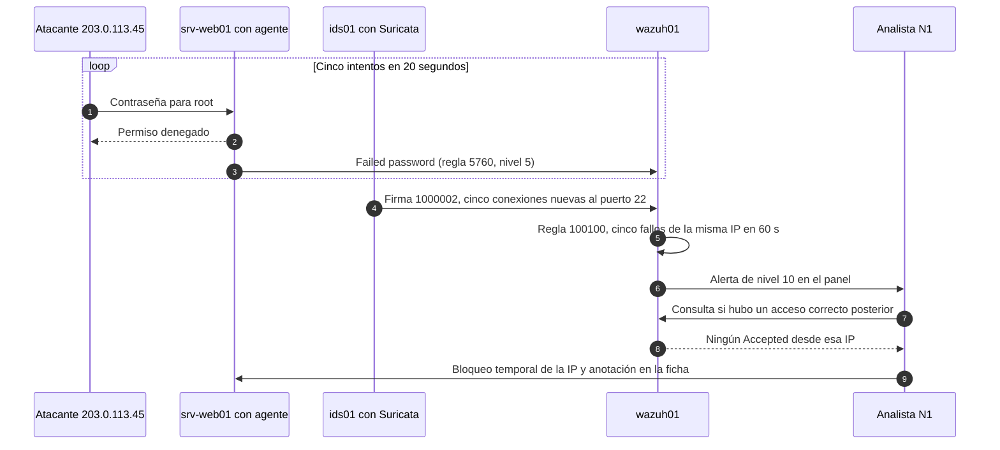

### Integrar Suricata en Wazuh

Para que las alertas de red lleguen al mismo panel, el agente instalado en `ids01` lee el fichero `eve.json`:

```xml
<!-- /var/ossec/etc/ossec.conf del agente de ids01 -->
<localfile>
  <log_format>json</log_format>
  <location>/var/log/suricata/eve.json</location>
</localfile>
```

Wazuh ya trae una regla (la 86601, de nivel 3) que convierte cada alerta de Suricata en una alerta propia. Como el nivel 3 pasa desapercibido, conviene elevar las firmas que más importan:

```xml
<group name="local,ids,suricata,">
  <rule id="100200" level="10">
    <if_sid>86601</if_sid>
    <field name="alert.signature_id">^1000002$</field>
    <description>Suricata: posible fuerza bruta SSH desde $(src_ip) (firma local 1000002).</description>
    <mitre>
      <id>T1110</id>
    </mitre>
  </rule>
</group>
```

### Respuesta automática (opcional)

Wazuh puede reaccionar por sí mismo. Este bloque, en el `ossec.conf` del servidor, ordena al agente del equipo atacado que bloquee la IP durante diez minutos cuando se dispara cualquiera de las reglas de fuerza bruta:

```xml
<active-response>
  <command>firewall-drop</command>
  <location>local</location>
  <rules_id>100100,100101,5763</rules_id>
  <timeout>600</timeout>
</active-response>
```

> **Atención.** Automatizar un bloqueo es cómodo y peligroso. Antes de activarlo hay que excluir las direcciones propias (la del equipo de administración, la del sistema de copias) y probarlo: un bloqueo automático mal ajustado se convierte en una denegación de servicio que te haces a ti mismo.

> **[IMAGEN ILUSTRATIVA 2.1: Captura anotada del panel de Wazuh con el evento de fuerza bruta SSH]**
>
> - **Qué capturar:** el módulo **Threat Hunting → Events** del panel de Wazuh del laboratorio, con el filtro `rule.id:(5760 OR 100100)` y el intervalo «últimos 15 minutos», justo después de lanzar el ataque de prueba contra `srv-web01`.
> - **Anotaciones numeradas sobre la captura:** (1) la barra de búsqueda con el filtro; (2) el histograma, donde se aprecia el pico de eventos; (3) la fila de la alerta de nivel 10 con la regla 100100; (4) los campos `agent.name`, `data.srcip` y `rule.mitre.id` en el detalle del evento; (5) las filas de nivel 5 de la regla 5760, que son los cinco intentos individuales.
> - **Formato:** PNG a 1 920 × 1 080 píxeles, con las anotaciones en círculos numerados y una leyenda debajo.
> - **Texto alternativo:** «Panel de Wazuh con cinco eventos de contraseña fallida de nivel 5 y una alerta de nivel 10 por fuerza bruta SSH desde 203.0.113.45 contra srv-web01».
> - **Nota para el docente:** el paquete SCORM muestra en este punto una recreación esquemática con datos ficticios. Sustitúyela por la captura real de tu laboratorio en cuanto la tengas.

<a id="p-2-8"></a>

## 2.8 Recursos y referencias

> **[VÍDEO / RECURSO RECOMENDADO 2.1: Despliegue de Wazuh y alta de un agente]**
>
> - **Enlace:** <https://www.youtube.com/watch?v=n7kTYWiSp5k>
> - **Autor, duración e idioma:** Akamai Developers, «Wazuh is a Cybersecurity Powerhouse», 10 minutos, en inglés (admite subtítulos traducidos).
> - **Qué aporta:** muestra la instalación del servidor, el acceso al panel, el alta de un agente y un primer recorrido por las alertas.
> - **Cómo usarlo:** fíjate en el minuto 3:50, donde se añade el agente, y compara los pasos con los de la página 2.5. En el vídeo el servidor se crea en la nube; en el aula lo harás en una máquina virtual.

> **[VÍDEO / RECURSO RECOMENDADO 2.2: Seminario web de INCIBE-CERT «Reglas de Snort»]**
>
> - **Enlace:** <https://www.incibe.es/incibe-cert/seminarios-web/reglas-snort>
> - **Autor e idioma:** INCIBE-CERT, en español.
> - **Qué aporta:** explica la detección basada en reglas en un IDS de red y cómo adaptar una regla a una amenaza concreta. La sintaxis de Snort es la base de la de Suricata: acción, cabecera y opciones se leen igual.
> - **Cómo usarlo:** después de verlo, reescribe una de las reglas del seminario con los búferes de Suricata (`http.uri`, `dns.query`).

> **[VÍDEO / RECURSO RECOMENDADO 2.3: Seminario de la OISF «An Introduction to Writing Suricata Rules»]**
>
> - **Enlace:** <https://www.youtube.com/watch?v=tvoqFBVSShA>
> - **Autor, duración e idioma:** Open Information Security Foundation, con Tatyana Shishkova, 59 minutos, en inglés.
> - **Qué aporta:** escritura de reglas paso a paso por parte del equipo que mantiene Suricata, con errores habituales y consejos de rendimiento.
> - **Cómo usarlo:** material de ampliación para quien quiera profundizar tras el caso de uso.

> **[REFERENCIAS Y GUÍAS OFICIALES]**
>
> - [Wazuh: arquitectura y puertos](https://documentation.wazuh.com/current/getting-started/architecture.html).
> - [Wazuh: sintaxis XML de las reglas](https://documentation.wazuh.com/current/user-manual/ruleset/ruleset-xml-syntax/rules.html) y [reglas personalizadas](https://documentation.wazuh.com/current/user-manual/ruleset/rules/custom.html).
> - [Wazuh: prueba de reglas con wazuh-logtest](https://documentation.wazuh.com/current/user-manual/ruleset/testing.html).
> - [Wazuh: detección de un ataque de fuerza bruta](https://documentation.wazuh.com/current/proof-of-concept-guide/detect-brute-force-attack.html) e [integración con Suricata](https://documentation.wazuh.com/current/proof-of-concept-guide/integrate-network-ids-suricata.html).
> - [Suricata: formato de las reglas](https://docs.suricata.io/en/latest/rules/intro.html) y [umbrales](https://docs.suricata.io/en/latest/rules/thresholding.html).
> - [Real Decreto 311/2022, Esquema Nacional de Seguridad](https://www.boe.es/buscar/act.php?id=BOE-A-2022-7191). Medidas op.exp.8 (registro de la actividad), op.mon.1 (detección de intrusión) y op.mon.3 (vigilancia).
> - [MITRE ATT&CK, técnica T1110: fuerza bruta](https://attack.mitre.org/techniques/T1110/).
> - [Sysmon (Microsoft Sysinternals)](https://learn.microsoft.com/sysinternals/downloads/sysmon).
> - [RFC 5424. The Syslog Protocol](https://www.rfc-editor.org/rfc/rfc5424) y [RFC 5425. TLS Transport Mapping for Syslog](https://www.rfc-editor.org/rfc/rfc5425).
> - [RFC 7011. IP Flow Information Export (IPFIX)](https://www.rfc-editor.org/rfc/rfc7011).
> - [RFC 5905. Network Time Protocol Version 4](https://www.rfc-editor.org/rfc/rfc5905).

<a id="p-2-act"></a>

## 2.9 Actividades interactivas

Cada actividad cuenta una vez, en el primer intento. Las preguntas de test muestran después la retroalimentación de todas las opciones.

### Actividad 2.1. Leer una regla de Suricata (pregunta de test)

Observa la regla y decide cuándo genera una alerta.

```text
alert tcp $EXTERNAL_NET any -> $HOME_NET 22 (msg:"LOCAL Posible fuerza bruta SSH";
    flow:to_server; flags:S,12;
    threshold:type both, track by_src, count 5, seconds 60;
    classtype:attempted-admin; sid:1000002; rev:1;)
```

- **a)** Cuando una misma dirección externa abre cinco conexiones nuevas al puerto 22 en 60 segundos, y como máximo una vez por origen en cada ventana.
- **b)** Cuando cinco direcciones externas distintas se conectan al puerto 22 en 60 segundos.
- **c)** Cada vez que cualquier equipo se conecta al puerto 22.
- **d)** Cuando se escriben cinco contraseñas incorrectas en 60 segundos.

| Opción | Resultado | Retroalimentación |
|---|---|---|
| a) | **Correcta** | Correcto. `flags:S,12` selecciona los paquetes que inician una conexión; `track by_src` cuenta por dirección de origen, y `type both` combina el umbral con el límite: avisa al llegar a cinco y no repite la alerta dentro de la misma ventana. |
| b) | Incorrecta | No. `track by_src` lleva una cuenta separada por cada dirección de origen. Cinco orígenes con una conexión cada uno suman uno en cinco contadores distintos, y ninguno alcanza el umbral. |
| c) | Incorrecta | No. La cabecera limita la regla al tráfico que va de la red externa a la interna, y el umbral exige cinco conexiones nuevas del mismo origen en 60 segundos. Una conexión aislada no dispara nada. |
| d) | Incorrecta | No. Suricata ve el tráfico, y la sesión SSH va cifrada: no puede saber si una contraseña falló. Cuenta inicios de conexión. Quien sabe que la autenticación falló es el agente del equipo, que lee el registro de `sshd`. Por eso las dos miradas se complementan. |

*Tipo de contenido H5P o Moodle:* Multiple Choice (una sola respuesta), con la retroalimentación de cada fila en el campo de la opción correspondiente.

### Actividad 2.2. Una etiqueta de correlación (pregunta de test)

En la regla propia de Wazuh aparece la etiqueta `<same_srcip />`. ¿Qué hace y qué ocurriría si se eliminara?

```xml
<rule id="100100" level="10" frequency="5" timeframe="60" ignore="60">
  <if_matched_sid>5760</if_matched_sid>
  <same_srcip />
  <description>sshd: 5 autenticaciones fallidas en 60 s desde $(srcip).</description>
</rule>
```

- **a)** Exige que cada evento proceda de una dirección de origen distinta.
- **b)** Bloquea la dirección de origen en el cortafuegos del equipo.
- **c)** Hace que la regla solo tenga en cuenta los eventos del mismo agente.
- **d)** Exige que los cinco eventos procedan de la misma dirección de origen. Sin ella, cinco fallos de cinco orígenes distintos en 60 segundos también dispararían la regla.

| Opción | Resultado | Retroalimentación |
|---|---|---|
| a) | Incorrecta | No. Eso lo hace la etiqueta contraria, `<different_srcip />`, útil para detectar un ataque repartido entre muchos orígenes. `same_srcip` pide justo lo opuesto. |
| b) | Incorrecta | No. Una regla solo detecta y asigna un nivel. El bloqueo es una *respuesta activa*, que se configura aparte en el servidor y se asocia a los identificadores de las reglas. |
| c) | Incorrecta | No. Contar solo los eventos de un mismo agente es el comportamiento normal de la correlación, sin ninguna etiqueta; para contar entre agentes se usa `<global_frequency />`. `same_srcip` se refiere al campo de la dirección de origen. |
| d) | **Correcta** | Correcto. `frequency` y `timeframe` fijan cuántos eventos y en cuánto tiempo; `same_srcip` añade que todos compartan origen. Sin esa condición, cinco usuarios que se equivocan a la vez un lunes por la mañana generarían una alerta de fuerza bruta: un falso positivo. |

*Tipo de contenido H5P o Moodle:* Multiple Choice (una sola respuesta), con la retroalimentación de cada fila en el campo de la opción correspondiente.

### Actividad 2.3. Cada pieza, con su función (emparejamiento)

Relaciona cada elemento de la arquitectura de monitorización con lo que hace.

| Elemento | Va con | Comentario al corregir |
|---|---|---|
| Agente de Wazuh | Recoge los registros del equipo y los envía al servidor | Es la mirada desde dentro del equipo. |
| Decodificador | Extrae de una línea de registro campos como el usuario o la dirección de origen | Sin campos no hay nada que comparar. |
| Regla | Compara los campos con unas condiciones y asigna un nivel | Las reglas de correlación añaden frecuencia y tiempo. |
| Indexador | Almacena las alertas y permite buscarlas | Es lo que hace posible la búsqueda retrospectiva. |
| Puerto espejo (SPAN) | Entrega al sensor de red una copia del tráfico | Sin copia del tráfico, Suricata no ve nada. |
| `wazuh-logtest` | Prueba una regla con líneas de registro antes de cargarla | Ninguna regla propia va a producción sin pasar por aquí. |

*Tipo de contenido H5P recomendado:* Drag the Words.

Texto preparado para pegar en **Drag the Words** (las respuestas van entre asteriscos):

```text
Recoge los registros del equipo y los envía al servidor: *Agente de Wazuh*
Extrae de una línea de registro campos como el usuario o la dirección de origen: *Decodificador*
Compara los campos con unas condiciones y asigna un nivel: *Regla*
Almacena las alertas y permite buscarlas: *Indexador*
Entrega al sensor de red una copia del tráfico: *Puerto espejo (SPAN)*
Prueba una regla con líneas de registro antes de cargarla: *wazuh-logtest*
```


<a id="m-3"></a>

# Módulo 3. Detección e identificación en seguridad física

**Criterio de evaluación:** CE 2.c. Se han establecido controles y mecanismos de detección e identificación de incidentes de seguridad física.  
**Tiempo estimado de estudio:** 100 minutos.

<a id="p-3-1"></a>

## 3.1 El atacante que entra por la puerta

Domingo, 22:47. La puerta del CPD de ACME se abre con la tarjeta de `jperez`, administrador de sistemas. El vigilante de recepción no ve nada raro: la tarjeta es válida y la puerta se ha abierto como debe. Cuatro minutos después, alguien inicia sesión por SSH en el servidor de bases de datos con la cuenta de `jperez`. Javier Pérez está en su casa, cenando.

Todas las defensas del módulo anterior parten de una suposición: que el atacante está lejos, al otro lado de la red. Cuando alguien llega físicamente hasta los equipos, esa suposición cae. Con acceso físico se puede arrancar un servidor desde una memoria USB, conectar un aparato a un puerto libre del conmutador y quedar *dentro* del cortafuegos, llevarse un disco o, sencillamente, desenchufar.

Por eso la detección de incidentes no termina en los registros de los sistemas. En este módulo vas a ver:

1. Qué tipos de incidentes de seguridad física existen y cómo se clasifican.
2. Qué mecanismos los detectan: control de accesos, videovigilancia y sensores.
3. Cómo llevar sus eventos al SIEM y cruzarlos con los registros de los sistemas (correlación físico-lógica).

<a id="p-3-2"></a>

## 3.2 Tipos de incidentes de seguridad física

| Tipo | En qué consiste | Ejemplos | Clasificación en la taxonomía | Peligrosidad |
|---|---|---|---|---|
| **Acceso no autorizado** | Alguien entra en una zona restringida sin tener derecho | Colarse detrás de un empleado (*tailgating*), usar una tarjeta clonada o prestada, forzar una puerta | Intrusión → Robo (intrusión física) | MUY ALTO |
| **Dispositivo no autorizado o hardware malicioso** | Se conecta a la red o a un equipo un aparato que no pertenece a la organización | Registrador de teclas intercalado en el cable, memoria USB que se hace pasar por un teclado, miniordenador oculto en un rack, punto de acceso inalámbrico pirata | Intrusión (física) y, según el efecto, Contenido dañino → Sistema infectado | MUY ALTO o ALTO |
| **Robo o sabotaje de activos** | Se sustrae o se daña deliberadamente un equipo o un soporte | Portátil o disco robado, cable de fibra cortado, servidor apagado a propósito | Intrusión → Robo · Disponibilidad → Sabotaje · Compromiso de la información → Pérdida de datos | MUY ALTO |
| **Desastre ambiental o fallo de infraestructura** | Una causa externa interrumpe el servicio | Incendio, inundación, avería de la climatización, corte de suministro eléctrico | Disponibilidad → Interrupciones | MUY ALTO |

Fíjate en la última columna: la Instrucción nacional asigna a casi todos los incidentes físicos el nivel de peligrosidad MUY ALTO. Tiene lógica: quien toca el hardware puede saltarse casi todos los controles lógicos.

El Esquema Nacional de Seguridad dedica a esta materia el grupo de medidas **mp.if, Protección de las instalaciones e infraestructuras**:

| Medida | Qué exige, en resumen | Mecanismo que la detecta |
|---|---|---|
| mp.if.1 Áreas separadas y con control de acceso | El equipamiento está en áreas separadas a las que solo se entra por los accesos previstos | Control de accesos, sensores de puerta |
| mp.if.2 Identificación de las personas | Se identifica a quien entra y se registran entradas y salidas | Lectores de tarjeta, registro de visitas |
| mp.if.3 Acondicionamiento de los locales | Temperatura y humedad adecuadas y cableado protegido | Sondas de temperatura y humedad |
| mp.if.4 Energía eléctrica | Suministro garantizado y, como refuerzo, alimentación de emergencia | Monitorización del SAI |
| mp.if.5 Protección frente a incendios | Protección conforme a la normativa industrial | Detectores de humo |
| mp.if.6 Protección frente a inundaciones | Protección frente a incidentes causados por el agua | Sondas de inundación |
| mp.if.7 Registro de entrada y salida de equipamiento | Registro de cada movimiento de equipos y de quién lo autoriza | Inventario y control de salida |

<a id="p-3-3"></a>

## 3.3 Control de accesos

### Las piezas del sistema

Un sistema de control de accesos tiene cinco elementos: la **credencial** que lleva la persona, el **lector** de la puerta, la **controladora** que decide si abre, el **servidor** que guarda los permisos y el historial, y la **cerradura** con su sensor de estado de puerta.

| Credencial | Cómo funciona | Punto débil |
|---|---|---|
| Tarjeta de proximidad de 125 kHz | Emite un número fijo, sin cifrado | Se copia en segundos con un lector portátil, incluso sin sacarla del bolsillo de su dueño |
| Tarjeta inteligente de 13,56 MHz | Tarjeta y lector se autentican mutuamente con claves criptográficas | Las generaciones antiguas tienen el cifrado roto; hay que usar las actuales |
| Credencial en el móvil (NFC o Bluetooth) | El teléfono actúa como tarjeta | Depende de la seguridad del teléfono |
| PIN | Código que se teclea | Se puede observar o compartir |
| Biometría (huella, rostro, iris) | Compara un rasgo físico con una plantilla | Tasas de error y fuertes restricciones legales |
| Varios factores | Tarjeta y PIN, por ejemplo | Mayor coste y más fricción |

Además de la credencial, hay mecanismos pensados para detectar el uso indebido:

- **Esclusa** (*mantrap*): dos puertas enclavadas con espacio para una sola persona. La segunda no se abre hasta que se cierra la primera.
- **Antirretorno** (*anti-passback*): una tarjeta que ya ha entrado no puede volver a entrar sin haber salido. Delata las tarjetas prestadas y las entradas en grupo.
- **Puerta forzada**: el sensor indica que la puerta se ha abierto sin una lectura válida.
- **Puerta retenida**: la puerta lleva abierta más tiempo del permitido.
- **Manipulación** (*tamper*): alguien ha abierto o arrancado el lector.

> **Atención.** El cable entre el lector y la controladora también se puede atacar. El protocolo tradicional, Wiegand, no cifra nada: un dispositivo intercalado detrás del lector registra todas las tarjetas que pasan. El estándar actual, OSDP con canal seguro, cifra la comunicación y vigila que el lector siga conectado.

### Biometría y protección de datos

Los datos biométricos usados para identificar a una persona son datos de categoría especial según el Reglamento General de Protección de Datos. La guía que la Agencia Española de Protección de Datos publicó en noviembre de 2023 es muy restrictiva: si existe un medio equivalente y menos intrusivo, como una tarjeta con PIN, el tratamiento biométrico difícilmente supera el juicio de necesidad. Antes de proponer un lector de huella para el CPD, hay que consultar esa guía y al delegado de protección de datos.

### Qué eventos genera

| Evento | Qué significa | Qué puede estar indicando |
|---|---|---|
| Acceso concedido | Credencial válida y con permiso | Nada, salvo que ocurra fuera de horario o no encaje con otros datos |
| Acceso denegado | Credencial desconocida, sin permiso o fuera de su horario | Tanteo de puertas; tarjeta de un exempleado |
| Puerta forzada | Apertura sin lectura válida | Intrusión, o una salida de emergencia mal usada |
| Puerta retenida | Abierta demasiado tiempo | Puerta calzada para que entre más gente |
| Violación de antirretorno | Segunda entrada sin salida previa | Tarjeta prestada o clonada |
| Manipulación del lector | Lector abierto o desconectado | Instalación de un dispositivo de captura |

<a id="p-3-4"></a>

## 3.4 Videovigilancia con analítica de vídeo

Una cámara que nadie mira no detecta nada: solo sirve para reconstruir lo ocurrido. La **analítica de vídeo** convierte la imagen en eventos, igual que una regla convierte registros en alertas.

| Analítica | Qué detecta | Uso típico |
|---|---|---|
| Cruce de línea | Alguien atraviesa una línea virtual en un sentido | Perímetro, acceso a una sala |
| Intrusión en zona | Presencia en un área en un horario prohibido | Pasillo del CPD por la noche |
| Merodeo | Permanencia prolongada en un punto | Entrada trasera, muelle de carga |
| Recuento de personas | Dos personas donde solo debería pasar una | Esclusa: detección de *tailgating* |
| Objeto abandonado o retirado | Algo aparece o desaparece de la escena | Mochila junto a un rack; equipo sustraído |
| Manipulación de la cámara | Imagen tapada, desenfocada o cámara girada | Sabotaje previo a una intrusión |

Las cámaras IP y los grabadores publican estos eventos mediante interfaces estandarizadas por ONVIF (sus perfiles T y M cubren los eventos y los metadatos de analítica) o mediante mensajes MQTT o syslog. Eso permite enviarlos al SIEM como cualquier otro registro.

> **Atención.** La videovigilancia trata datos personales. La Ley Orgánica 3/2018 (artículo 22) permite captar imágenes para preservar la seguridad de personas, bienes e instalaciones, exige informar con un cartel visible y obliga a suprimir las grabaciones en el plazo máximo de un mes, salvo que deban conservarse para acreditar actos contra personas, bienes o instalaciones. El reconocimiento facial añade un tratamiento biométrico, con las restricciones del apartado anterior.

<a id="p-3-5"></a>

## 3.5 Sensores de intrusión y de entorno

### Detección de intrusión

Un sistema de alarma de intrusión es el equivalente físico de un IDS: sensores repartidos por el edificio que avisan a una central.

| Sensor | Qué detecta |
|---|---|
| Contacto magnético | Apertura de una puerta, una ventana o la puerta de un rack |
| Detector volumétrico (infrarrojos pasivos) | Movimiento de un cuerpo caliente en una sala |
| Doble tecnología (infrarrojos y microondas) | Lo mismo, con menos falsas alarmas |
| Rotura de cristal | El sonido característico de un vidrio que se rompe |
| Sísmico o de vibración | Golpes o taladros en paredes y cajas fuertes |
| Barrera de infrarrojos | Cruce de un perímetro exterior |

La norma UNE-EN 50131 clasifica estos sistemas en cuatro grados de seguridad, del 1 (riesgo bajo) al 4 (riesgo alto). La normativa de seguridad privada determina el grado mínimo exigible y las condiciones de conexión a una central receptora de alarmas.

### Sensores ambientales

| Sensor | Qué vigila | Medida del ENS |
|---|---|---|
| Temperatura y humedad | Climatización del CPD | mp.if.3 |
| Estado del SAI y del suministro | Cortes y microcortes eléctricos, autonomía de las baterías | mp.if.4 |
| Humo (detección precoz por aspiración) | Conato de incendio antes de que haya llama | mp.if.5 |
| Sonda de inundación | Agua bajo el suelo técnico | mp.if.6 |

Estos sensores suelen comunicarse por SNMP, Modbus o MQTT con un sistema de monitorización, que reenvía las alarmas al SIEM.

> **Ejemplo SOC Tier 1.** A las 03:20 caen a la vez tres servidores del mismo rack. Antes de pensar en un ataque, el analista mira los eventos ambientales: a las 03:12 la sonda marcó 41 °C y a las 03:18 el SAI pasó a baterías. No es una intrusión: es una avería de climatización con corte eléctrico. Se clasifica como *Disponibilidad → Interrupciones* y se escala a mantenimiento, no al equipo forense.

<a id="p-3-6"></a>

## 3.6 Correlación físico-lógica

### La idea

Los sistemas físicos responden a la pregunta «¿quién estaba dónde?». Los sistemas lógicos responden a «¿qué cuenta hizo qué?». Por separado, los dos pueden parecer normales. Cruzados, aparecen las contradicciones: una persona que está en dos sitios a la vez, una sesión en un equipo al que nadie ha podido llegar, una puerta que se abre para alguien que no está.

Para poder cruzarlos hacen falta cuatro cosas:

1. **Una identidad común.** El número de tarjeta no dice nada al SIEM; hay que traducirlo a la misma cuenta de usuario que aparece en los registros de los sistemas.
2. **Un reloj común.** El servidor de control de accesos debe sincronizarse con el mismo servidor de hora que el resto.
3. **Un mapa de zonas y activos.** Hay que saber qué servidores están detrás de cada puerta.
4. **Los eventos físicos dentro del SIEM**, en un formato que las reglas puedan leer.

**Diagrama 3.1. Integración de la seguridad física con el SIEM.** Los tres subsistemas físicos envían sus eventos al mismo servidor que recibe los registros de los equipos; el directorio corporativo aporta la relación entre tarjeta y cuenta de usuario.

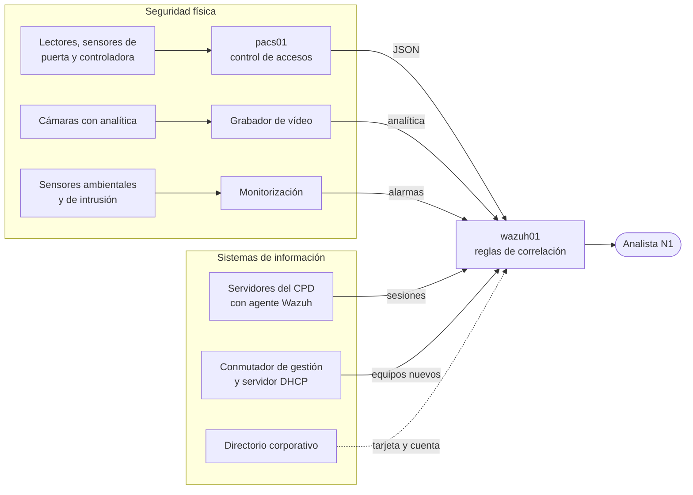

### Casos de uso de correlación

| Lo que dice el sistema físico | Lo que dicen los sistemas | Qué puede estar pasando |
|---|---|---|
| Acceso al CPD fuera de horario | Inicio de sesión del mismo usuario minutos después | Tarjeta y credenciales comprometidas, o un trabajo no planificado |
| Ningún acceso registrado al CPD | Sesión abierta desde la consola local de un servidor | Alguien entró sin fichar o usa la cuenta de otro |
| Fichaje de entrada en la sede | Conexión VPN de esa cuenta desde otro país | Credenciales robadas: nadie está en dos sitios a la vez |
| Tarjeta dada de baja que intenta entrar | Intentos de acceso con la cuenta del mismo exempleado | Antiguo empleado que conserva la tarjeta |
| Puerta de rack abierta sin orden de trabajo | Dirección física nueva en el conmutador o dispositivo USB nuevo | Hardware malicioso conectado |
| Alarma de temperatura y SAI en baterías | Caída simultánea de varios servicios | Incidente ambiental, no un ataque |

### Cómo se implementa en Wazuh

**Paso 1. Llevar los eventos al SIEM.** Un pequeño conector en `pacs01` exporta cada evento del sistema de control de accesos como una línea JSON en `/var/log/pacs/eventos.json`. El conector consulta el directorio corporativo y añade la cuenta de usuario del titular de la tarjeta en el campo `dstuser`.

```json
{"timestamp":"2026-11-15T22:47:12+01:00","pacs":{"evento":"acceso_concedido","puerta":"CPD-01","zona":"CPD","lector":"L-CPD-ENT","tarjeta":"0004587123","titular":"Javier Pérez"},"dstuser":"jperez"}
```

El agente de `pacs01` lee ese fichero:

```xml
<localfile>
  <log_format>json</log_format>
  <location>/var/log/pacs/eventos.json</location>
</localfile>
```

**Paso 2. Escribir las reglas.**

```xml
<!-- /var/ossec/etc/rules/local_rules.xml -->
<group name="local,pacs,seguridad_fisica,">

  <!-- Regla base: cualquier evento del control de accesos -->
  <rule id="100300" level="3">
    <decoded_as>json</decoded_as>
    <field name="pacs.evento">\.+</field>
    <description>Control de accesos: $(pacs.evento) en $(pacs.puerta).</description>
    <options>no_full_log</options>
  </rule>

  <!-- Acceso concedido al CPD entre las 20:00 y las 07:00 -->
  <rule id="100310" level="7">
    <if_sid>100300</if_sid>
    <field name="pacs.evento">^acceso_concedido$</field>
    <field name="pacs.zona">^CPD$</field>
    <time>8 pm - 7 am</time>
    <description>Control de accesos: entrada al CPD fuera de horario con la tarjeta de $(pacs.titular).</description>
    <group>acceso_fuera_de_horario,</group>
  </rule>

  <!-- Puerta forzada o lector manipulado -->
  <rule id="100311" level="10">
    <if_sid>100300</if_sid>
    <field name="pacs.evento">^puerta_forzada$|^manipulacion_lector$</field>
    <description>Control de accesos: $(pacs.evento) en $(pacs.puerta).</description>
  </rule>

  <!-- Correlación: inicio de sesión SSH del mismo usuario en los diez minutos siguientes -->
  <rule id="100320" level="12" timeframe="600">
    <if_sid>5715</if_sid>
    <if_matched_sid>100310</if_matched_sid>
    <same_user />
    <global_frequency />
    <description>Correlación físico-lógica: entrada al CPD fuera de horario seguida de un inicio de sesión SSH de $(dstuser).</description>
    <mitre>
      <id>T1078</id>
    </mitre>
    <group>correlacion_fisico_logica,</group>
  </rule>

</group>
```

Lo que hace cada pieza de la regla 100320:

- `<if_sid>5715</if_sid>`: el evento actual debe ser un inicio de sesión SSH correcto.
- `<if_matched_sid>100310</if_matched_sid>` con `timeframe="600"`: en los diez minutos anteriores tiene que haberse disparado la regla 100310 (entrada al CPD fuera de horario).
- `<same_user />`: el usuario de los dos eventos debe coincidir. Funciona porque el conector escribe la cuenta en el campo `dstuser`, que es el mismo en el que el decodificador de SSH guarda el usuario.
- `<global_frequency />`: imprescindible aquí. Sin esta etiqueta Wazuh solo correlaciona eventos del mismo agente, y los nuestros vienen de dos equipos distintos (`pacs01` y el servidor).

**Paso 3. Probar.** En `wazuh-logtest` se pega primero la línea JSON del control de accesos y después la línea de SSH. Si la prueba se hace entre las 20:00 y las 07:00 (hora del servidor Wazuh), la segunda línea debe devolver la regla 100320:

```text
Nov 15 22:51:40 srv-bd01 sshd[4410]: Accepted password for jperez from 10.20.9.77 port 51844 ssh2
```

**Diagrama 3.2. Fichaje fuera de horario e inicio de sesión concurrente.** Ninguno de los dos eventos es alarmante por separado; la alerta de nivel 12 nace de que coinciden el usuario y la ventana de tiempo.

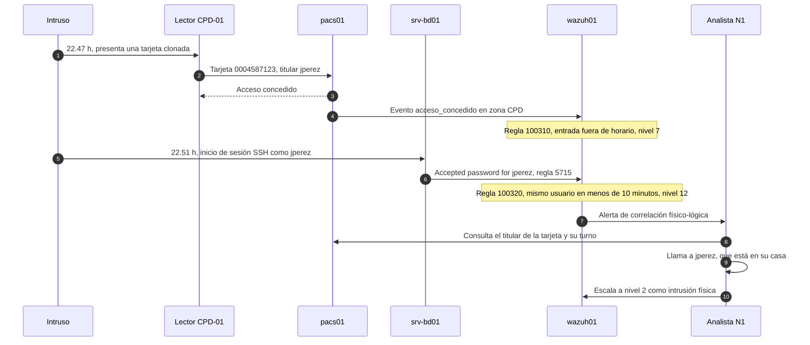

> **Atención.** Estas reglas tienen tres límites que debes conocer. Primero, `<time>` y `timeframe` usan la hora a la que el servidor Wazuh procesa el evento, no la que figura en el registro: si los eventos llegan con retraso, la correlación falla. Segundo, una regla solo puede reaccionar a algo que ocurre; el caso «sesión en consola *sin* fichaje previo» (ausencia de un evento) no se puede expresar así y se resuelve con consultas programadas sobre el indexador. Tercero, todo depende de que la relación entre tarjeta y cuenta esté al día.

> **[IMAGEN ILUSTRATIVA 3.1: Esquema de la arquitectura de integración entre el sistema de fichaje físico y el servidor SIEM]**
>
> - **Qué debe mostrar:** a la izquierda, el plano simplificado de una planta con la puerta del CPD, su lector, una cámara y una sonda de temperatura; en el centro, el servidor de control de accesos, el grabador de vídeo y el sistema de monitorización; a la derecha, el servidor SIEM con el panel del analista. Flechas etiquetadas con el formato de cada flujo: «eventos en JSON», «eventos de analítica», «alarmas SNMP» e «inicios de sesión». Un recuadro inferior con las tres condiciones de la correlación: identidad común, reloj común y mapa de zonas y activos.
> - **Formato:** esquema horizontal de 1 600 × 900 píxeles en SVG o PNG, con los elementos físicos en un color y los lógicos en otro.
> - **Texto alternativo:** «Arquitectura de integración: los lectores, las cámaras y los sensores del CPD envían sus eventos al SIEM, que los cruza con los inicios de sesión de los servidores».
> - **Nota para el docente:** el paquete SCORM incluye una versión de este esquema construida en HTML. El diagrama 3.1 contiene la misma información en formato Mermaid.

<a id="p-3-7"></a>

## 3.7 Ejemplo práctico: la intrusión que el vigilante no vio

### Los hechos

Domingo, 15 de noviembre de 2026. Hora local.

| Hora | Fuente | Qué ocurrió |
|---|---|---|
| 22:41 | Ninguna | Una persona con uniforme de mensajería entra en el edificio detrás de una empleada de limpieza. El vigilante la ve pasar y no le da importancia: los repartos nocturnos son habituales. No queda registro |
| 22:47:12 | Control de accesos | Acceso concedido en la puerta CPD-01 con la tarjeta de `jperez` |
| 22:47 | Cámara del pasillo | Una persona entra en el CPD. La analítica no avisa: el acceso es válido |
| 22:49 | Conmutador de gestión y DHCP | Aparece una dirección física desconocida en el puerto 14; se le asigna la IP `10.20.9.77` |
| 22:51:40 | `srv-bd01` | `Accepted password for jperez from 10.20.9.77` |
| 22:51:41 | Wazuh | Regla 100320, nivel 12: correlación físico-lógica |
| 22:53 | Analista N1 | Comprueba que `jperez` trabaja en turno de mañana y que no hay ninguna intervención planificada. Lo llama: está en su casa y conserva su tarjeta |
| 22:58 | Analista N2 | Deshabilita la cuenta `jperez`, desactiva el puerto 14 del conmutador y avisa al vigilante |
| 22:59 | Control de accesos | Salida por la puerta CPD-01 |
| 23:04 | Vigilante | Encuentra un rack abierto y un miniordenador conectado al conmutador de gestión. El intruso ya no está |

### Por qué no lo detectó la seguridad física

Cada control físico funcionó como estaba diseñado, y aun así no saltó ninguna alarma:

- La tarjeta era de proximidad de 125 kHz. El intruso la había copiado días antes, acercando un lector portátil al bolsillo de Javier en una cafetería.
- El lector solo comprobó que el número de tarjeta tenía permiso. No había segundo factor.
- El vigilante vio un uniforme creíble y un acceso válido en su pantalla.
- La cámara grabó, pero ninguna regla de analítica relacionaba «una persona en el CPD» con «domingo por la noche».

### Por qué lo detectó el SIEM

Ninguno de estos eventos era grave por sí solo. La alerta nació de sumarlos: una entrada al CPD fuera de horario, un inicio de sesión del mismo usuario cuatro minutos después y, como dato añadido, una IP de origen que no pertenecía a ningún equipo inventariado.

### Clasificación y valoración

| Paso | Resultado |
|---|---|
| Clasificación principal | Intrusión → Robo (intrusión física) |
| Clasificaciones secundarias | Intrusión → Compromiso de cuenta con privilegios; hardware malicioso conectado (técnica T1200 de MITRE ATT&CK) |
| Peligrosidad | MUY ALTO |
| Impacto (estimación inicial) | BAJO: la sesión duró siete minutos y no hay indicios de extracción de datos, pendiente de confirmar |
| Nivel que rige | MUY ALTO (P1): notificación inicial inmediata e intermedia a las 72 horas |

### Qué hay que preservar

El miniordenador, las grabaciones de las cámaras, el historial del control de accesos y los registros del conmutador son evidencias. Las grabaciones se borran automáticamente al mes: hay que bloquear ese borrado y extraer una copia cuanto antes. Todo ello entra en la cadena de custodia que verás en el módulo 5, y el caso se denuncia.

### Lecciones

- Sustituir las tarjetas de 125 kHz por tarjetas inteligentes con autenticación criptográfica.
- Exigir dos factores (tarjeta y PIN) en la puerta del CPD.
- Activar el control de acceso a la red (802.1X) en el conmutador de gestión y alertar de cada dirección física nueva.
- Añadir una regla de analítica de vídeo: presencia en el CPD fuera de horario.
- Dar al vigilante un procedimiento claro para las visitas fuera de horario.

> **Idea clave.** La seguridad física y la lógica fallan por separado y aciertan juntas. El dato que delata una intrusión suele estar repartido entre dos sistemas que no se hablan; el trabajo del SOC es hacer que se hablen.

<a id="p-3-8"></a>

## 3.8 Recursos y referencias

> **[VÍDEO / RECURSO RECOMENDADO 3.1: «I'll Let Myself In: Tactics of Physical Pen Testers»]**
>
> - **Enlace:** <https://www.youtube.com/watch?v=rnmcRTnTNC8>
> - **Autor, duración e idioma:** Deviant Ollam, en la conferencia Wild West Hackin' Fest (2017), 45 minutos, en inglés (admite subtítulos traducidos).
> - **Qué aporta:** un auditor de seguridad física muestra, con casos reales, cómo se burlan puertas, lectores y sensores mal instalados, y qué habría bastado para impedirlo.
> - **Cómo usarlo:** mientras lo ves, anota tres fallos y decide qué evento del apartado 3.3 habría delatado cada uno.

> **[VÍDEO / RECURSO RECOMENDADO 3.2: Guía de la AEPD sobre el uso de videocámaras para seguridad y otras finalidades]**
>
> - **Enlace:** <https://www.aepd.es/guias/guia-videovigilancia.pdf>
> - **Formato e idioma:** guía en español (edición de febrero de 2025).
> - **Qué aporta:** requisitos legales de la videovigilancia: información, proporcionalidad, plazos de conservación y casos particulares.
> - **Cómo usarlo:** localiza el plazo de conservación y explica cómo se compatibiliza con la preservación de evidencias de un incidente.

> **[REFERENCIAS Y GUÍAS OFICIALES]**
>
> - [Real Decreto 311/2022, Esquema Nacional de Seguridad](https://www.boe.es/buscar/act.php?id=BOE-A-2022-7191). Anexo II, medidas mp.if.1 a mp.if.7.
> - [Guía Nacional de Notificación y Gestión de Ciberincidentes](https://www.incibe.es/sites/default/files/contenidos/guias/doc/guia_nacional_notificacion_gestion_ciberincidentes.pdf). Tipos «Robo», «Sabotaje» e «Interrupciones» y su nivel de peligrosidad.
> - [AEPD: Guía sobre tratamientos de control de presencia mediante sistemas biométricos (noviembre de 2023)](https://www.aepd.es/guias/guia-control-presencia-biometrico.pdf).
> - [Ley Orgánica 3/2018, de Protección de Datos Personales y garantía de los derechos digitales](https://www.boe.es/buscar/act.php?id=BOE-A-2018-16673). Artículos 22 y 89.
> - [ONVIF: perfiles de interoperabilidad](https://www.onvif.org/profiles/). Perfiles de vídeo, analítica y control de accesos.
> - [Wazuh: decodificador JSON](https://documentation.wazuh.com/current/user-manual/ruleset/decoders/json-decoder.html) y [sintaxis de las reglas](https://documentation.wazuh.com/current/user-manual/ruleset/ruleset-xml-syntax/rules.html) (`time`, `same_user`, `global_frequency`).
> - [MITRE ATT&CK, técnica T1200: incorporación de hardware](https://attack.mitre.org/techniques/T1200/).
> - [NIST SP 800-53 Rev. 5](https://csrc.nist.gov/pubs/sp/800/53/r5/upd1/final). Familia PE, protección física y ambiental.
> - [RFC 3411. An Architecture for Describing SNMP Management Frameworks](https://www.rfc-editor.org/rfc/rfc3411).

<a id="p-3-act"></a>

## 3.9 Actividades interactivas

Cada actividad cuenta una vez, en el primer intento. Las preguntas de test muestran después la retroalimentación de todas las opciones.

### Actividad 3.1. De dos eventos normales a una alerta (pregunta de test)

A las 22:47 el control de accesos concede la entrada al CPD con la tarjeta de `jperez`. A las 22:51 hay un inicio de sesión SSH correcto de `jperez` en `srv-bd01`. ¿Qué convierte estos dos eventos en una alerta de nivel 12?

- **a)** La analítica de vídeo, que identificó a una persona desconocida.
- **b)** El acceso concedido en la puerta, que por sí solo ya tiene nivel 12.
- **c)** La regla de correlación: una entrada al CPD fuera de horario y, en los diez minutos siguientes, un inicio de sesión del mismo usuario.
- **d)** El inicio de sesión SSH correcto, que Wazuh trata siempre como un incidente.

| Opción | Resultado | Retroalimentación |
|---|---|---|
| a) | Incorrecta | No. En el caso, la cámara grabó pero no avisó: el acceso era válido y no había ninguna regla de analítica para la presencia en el CPD fuera de horario. Esa era una de las lecciones. |
| b) | Incorrecta | No. La entrada al CPD fuera de horario tiene nivel 7 (regla 100310): merece atención, pero puede ser una intervención legítima. Lo que eleva el nivel es lo que ocurre después. |
| c) | **Correcta** | Correcto. La regla 100320 parte de un inicio de sesión correcto y comprueba si antes hubo una entrada al CPD fuera de horario con el mismo usuario. Ninguno de los dos eventos es grave por separado; la combinación sí lo es. |
| d) | Incorrecta | No. Un inicio de sesión correcto es la regla 5715, de nivel 3: ocurre cientos de veces al día. Solo llama la atención cuando se relaciona con otra cosa. |

*Tipo de contenido H5P o Moodle:* Multiple Choice (una sola respuesta), con la retroalimentación de cada fila en el campo de la opción correspondiente.

### Actividad 3.2. La tarjeta copiada (pregunta de test)

El intruso abrió la puerta del CPD con una copia de una tarjeta de proximidad de 125 kHz. ¿Qué medida lo habría impedido?

- **a)** Cambiar la comunicación entre el lector y el controlador de Wiegand a OSDP.
- **b)** Exigir un segundo factor en el lector (tarjeta y PIN) o usar tarjetas inteligentes con autenticación criptográfica.
- **c)** Instalar más cámaras en el pasillo.
- **d)** Activar el anti-passback.

| Opción | Resultado | Retroalimentación |
|---|---|---|
| a) | Incorrecta | No. OSDP cifra y supervisa el cable entre el lector y el controlador, lo que evita que alguien capture o inyecte datos en ese tramo. Pero una tarjeta copiada presenta el mismo número por el camino normal. |
| b) | **Correcta** | Correcto. Una tarjeta de 125 kHz solo emite un número, que se puede leer y copiar a distancia. Con un PIN, la copia no basta; con una tarjeta que se autentica mediante criptografía, la copia no es posible con medios sencillos. |
| c) | Incorrecta | No. Las cámaras detectan y documentan, pero no impiden el paso. Además, para el sistema el acceso era válido: no había nada que una cámara sin analítica pudiera señalar. |
| d) | Incorrecta | No. El anti-passback impide entrar dos veces seguidas sin haber salido. El titular estaba fuera, así que para el sistema la tarjeta copiada hacía una entrada normal. Solo habría fallado si el titular hubiera estado dentro. |

*Tipo de contenido H5P o Moodle:* Multiple Choice (una sola respuesta), con la retroalimentación de cada fila en el campo de la opción correspondiente.

### Actividad 3.3. Qué detecta cada mecanismo (emparejamiento)

Relaciona cada mecanismo de seguridad física con la situación que permite detectar o impedir.

| Elemento | Va con | Comentario al corregir |
|---|---|---|
| Contacto magnético de la puerta | Una puerta forzada o mantenida abierta | Avisa cuando la puerta se abre sin acceso concedido o no se cierra a tiempo. |
| Esclusa | Dos personas que pasan con una sola acreditación | Solo deja pasar a una persona cada vez. |
| Anti-passback | Una tarjeta que entra dos veces sin haber salido | Delata las tarjetas prestadas y algunas copias. |
| Analítica de vídeo | Presencia en una zona restringida fuera de horario | Convierte la cámara en un sensor que avisa. |
| Sensor de temperatura y humedad | Un fallo de la climatización del CPD | Las interrupciones por causas ambientales también son incidentes. |
| Control de acceso a la red (802.1X) | Un dispositivo desconocido conectado a un puerto del conmutador | Es la defensa frente al hardware malicioso. |

*Tipo de contenido H5P recomendado:* Drag the Words.

Texto preparado para pegar en **Drag the Words** (las respuestas van entre asteriscos):

```text
Una puerta forzada o mantenida abierta: *Contacto magnético de la puerta*
Dos personas que pasan con una sola acreditación: *Esclusa*
Una tarjeta que entra dos veces sin haber salido: *Anti-passback*
Presencia en una zona restringida fuera de horario: *Analítica de vídeo*
Un fallo de la climatización del CPD: *Sensor de temperatura y humedad*
Un dispositivo desconocido conectado a un puerto del conmutador: *Control de acceso a la red (802.1X)*
```


<a id="m-4"></a>

# Módulo 4. Ciberinteligencia OSINT y fuentes abiertas

**Criterio de evaluación:** CE 2.d. Se han establecido controles, herramientas y mecanismos de monitorización, identificación, detección y alerta de incidentes a través de la investigación en fuentes abiertas (OSINT).  
**Tiempo estimado de estudio:** 120 minutos.

<a id="p-4-1"></a>

## 4.1 Lo que se ve desde fuera

Jueves, 10:20. Un cliente reenvía a ACME un correo que ha recibido «de ACME Logística»: le piden que vuelva a introducir los datos de su tarjeta para liberar un envío retenido. El enlace lleva a `acrne-logistica.example`. A primera vista parece el dominio de la empresa; mirando despacio, la «m» de *acme* son en realidad una «r» y una «n».

Ningún sensor de ACME ha visto nada, y no es un fallo: ese dominio lo registró un tercero, en un servidor ajeno, y el correo nunca pasó por la red de la empresa. Wazuh y Suricata solo ven lo que ocurre dentro.

Fuera hay más cosas que la organización no ve desde sus propios sistemas: la contraseña de un empleado en una filtración de otra web, una clave de acceso olvidada en un repositorio público, un servidor de pruebas que alguien dejó abierto a Internet. El atacante sí las ve, porque antes de atacar hace un reconocimiento.

La investigación en fuentes abiertas permite al defensor mirarse con los ojos del atacante. En este módulo vas a aprender:

1. Qué son OSINT y la inteligencia de amenazas, y cuáles son sus límites.
2. Cómo vigilar la superficie de exposición de la organización.
3. Qué herramientas usar para activos expuestos, fugas de credenciales y dominios que suplantan al propio.
4. Cómo aprovechar indicadores de compromiso de plataformas como OTX y MISP.

<a id="p-4-2"></a>

## 4.2 OSINT e inteligencia de amenazas

### Conceptos

**OSINT** (*Open Source Intelligence*) es la inteligencia que se obtiene de fuentes de acceso público: buscadores, registros de dominios y de certificados, repositorios de código, redes sociales, foros y bases de datos de filtraciones.

**Inteligencia de amenazas** (CTI, *Cyber Threat Intelligence*) es el conocimiento elaborado sobre quién ataca, cómo lo hace y con qué infraestructura, presentado de forma que alguien pueda tomar una decisión con él.

La palabra importante es *elaborado*. Una lista de diez mil direcciones IP es un dato. Saber que tres de ellas pertenecen a una campaña que está suplantando a empresas de logística españolas esta semana, y que un equipo de la red contactó ayer con una, es inteligencia.

| Nivel | A quién sirve | Qué contiene | Ejemplo |
|---|---|---|---|
| Estratégico | Dirección | Tendencias y riesgos | «El sector logístico sufre más extorsión por robo de datos que el año pasado» |
| Táctico | Equipo de detección | Técnicas y procedimientos de los atacantes | «La campaña usa correos con enlace a un dominio parecido y pide datos de pago» |
| Operativo | SOC | Campañas en curso | «Está activa desde el lunes y afecta a transportistas» |
| Técnico | Herramientas | Indicadores de compromiso | `acrne-logistica.example`, `198.51.100.77` |

### El ciclo de inteligencia

La inteligencia no se «busca»: se produce siguiendo un ciclo. En su forma clásica tiene cuatro fases —dirección, obtención, elaboración y difusión— y vuelve a empezar con lo aprendido.

1. **Dirección.** Se formula la pregunta. Sin pregunta, la obtención no termina nunca.
2. **Obtención.** Se recogen los datos de las fuentes elegidas.
3. **Elaboración.** Se depuran, se contrastan y se interpretan. Aquí es donde un dato pasa a ser inteligencia.
4. **Difusión.** Se entrega a quien debe actuar, en el formato que necesita.

### Límites legales y éticos

> **Atención.** Que una información sea pública no significa que cualquier uso sea lícito. Antes de usar estas técnicas, ten claros cuatro límites:
>
> - **Autorización.** Se investiga la propia organización, o un tercero con su autorización escrita.
> - **Pasivo frente a activo.** Consultar lo que otros ya han recopilado (un buscador de dispositivos, un registro de certificados) es reconocimiento pasivo. Escanear o intentar acceder tú mismo a un sistema ajeno es activo y, sin autorización, puede acarrear responsabilidad penal.
> - **Datos personales.** El Reglamento General de Protección de Datos se aplica también a los datos que están publicados. Se recoge solo lo necesario para la finalidad de seguridad.
> - **Datos robados.** No se descargan, compran ni redistribuyen datos filtrados, y no se contacta con quienes los venden. La vigilancia de foros y mercados clandestinos se encarga a servicios especializados o se canaliza a través del CSIRT de referencia y de las Fuerzas y Cuerpos de Seguridad.

<a id="p-4-3"></a>

## 4.3 Vigilar la superficie de exposición

La **superficie de exposición** es todo lo que la organización tiene a la vista de Internet, lo sepa o no: dominios y subdominios, direcciones IP y servicios, certificados, aplicaciones web, almacenamiento en la nube, repositorios de código, cuentas de sus empleados y su propia marca.

Vigilarla de forma continua es lo que en el mercado se llama gestión de la superficie de ataque externa (EASM). El Esquema Nacional de Seguridad lo contempla entre los refuerzos de la medida **op.mon.3, Vigilancia**, que incluyen el análisis de la superficie de exposición y el uso de observatorios digitales.

| Mecanismo de detección | Qué descubre | Herramientas | Incidente que anticipa |
|---|---|---|---|
| Descubrimiento de activos expuestos | Servicios accesibles desde Internet que no deberían estarlo; software sin actualizar | Shodan, Censys, registros de transparencia de certificados, Amass | Vulnerable → Servicios con acceso potencial no deseado; Sistema vulnerable |
| Detección de fugas de datos | Credenciales de empleados en filtraciones; claves y contraseñas en repositorios | Have I Been Pwned, GitGuardian, TruffleHog | Intrusión → Compromiso de cuenta; Compromiso de la información |
| Detección de suplantación y phishing | Dominios parecidos al propio y páginas clonadas | dnstwist, urlscan.io, VirusTotal | Fraude → Phishing; Suplantación |
| Vigilancia de foros y mercados clandestinos | Venta de accesos; datos publicados por grupos de extorsión | Servicios especializados y CSIRT de referencia | Compromiso de la información |
| Inteligencia de amenazas | Infraestructura y técnicas de campañas activas | AlienVault OTX, MISP, avisos de INCIBE-CERT y CCN-CERT | Todos: alimenta las reglas de detección |

> **Recuerda.** Lo que encuentras con estas herramientas suele clasificarse como *Vulnerable*, con peligrosidad MEDIO: todavía no ha pasado nada. Ese es precisamente su valor. Un servicio expuesto que se cierra hoy es un incidente de nivel ALTO que no habrá que gestionar el mes que viene.

<a id="p-4-4"></a>

## 4.4 Herramientas para activos, fugas y suplantación

### Activos expuestos: Shodan, Censys y los certificados

**Shodan** y **Censys** recorren continuamente todo Internet, se conectan a cada puerto abierto y guardan lo que el servicio responde: el tipo de software, la versión, el certificado. Después permiten buscar en esos datos. No atacan nada: muestran lo que ya está a la vista.

| Filtro de Shodan | Qué busca |
|---|---|
| `hostname:acme-logistica.example` | Equipos cuyo nombre contiene el dominio |
| `net:192.0.2.0/24` | Todo lo visible en el rango público de la organización |
| `ssl.cert.subject.cn:acme-logistica.example` | Servicios que presentan un certificado emitido para el dominio |
| `port:3389 org:"ACME Logistica"` | Escritorios remotos expuestos de la organización |
| `product:"OpenSSH" net:192.0.2.0/24` | Versiones de un producto concreto en el rango propio |

Los **registros de transparencia de certificados** (*Certificate Transparency*) son otra fuente muy útil. Cada certificado TLS de confianza pública queda anotado en un registro que cualquiera puede consultar, por ejemplo en `crt.sh`. Buscar `%.acme-logistica.example` devuelve todos los nombres para los que se ha emitido un certificado, incluidos los subdominios que nadie recuerda.

```bash
# Enumeración pasiva de subdominios con Amass
amass enum -passive -d acme-logistica.example

# Ficha de una dirección pública propia con el cliente de Shodan
shodan host 192.0.2.10
```

Esto es lo que encontró el SOC de ACME en su primera revisión:

| Hallazgo | Fuente | Clasificación | Acción |
|---|---|---|---|
| `pruebas.acme-logistica.example` responde con un panel de administración | Transparencia de certificados | Vulnerable → Sistema vulnerable | Retirar el servidor de pruebas |
| Puerto 3389 abierto en la IP pública del almacén de Valencia | Shodan | Vulnerable → Servicios con acceso potencial no deseado | Cerrar el puerto; acceso solo por VPN |
| El servidor de correo acepta TLS 1.0 | Censys | Vulnerable → Criptografía débil | Actualizar la configuración |

> **[IMAGEN ILUSTRATIVA 4.1: Captura del mapa de activos expuestos en Shodan y árbol de dominios similares generado con dnstwist]**
>
> - **Qué capturar (mitad izquierda):** la vista de resultados de Shodan para el filtro `net:` con el rango público del laboratorio o de una organización para la que se tenga autorización, mostrando el mapa con los puntos de cada servicio y el resumen lateral de puertos y productos más frecuentes.
> - **Qué construir (mitad derecha):** un árbol con el dominio legítimo en la raíz y una rama por técnica de variación (homoglifo, omisión, transposición, repetición, guion, inserción), con dos o tres dominios de ejemplo por rama. Los dominios que resulten estar registrados se marcan en rojo y, si tienen servidor de correo, con un icono de sobre.
> - **Formato:** composición horizontal de 1 920 × 1 080 píxeles en PNG. Las direcciones IP y los nombres reales deben difuminarse o sustituirse por datos de ejemplo.
> - **Texto alternativo:** «A la izquierda, mapa de Shodan con los servicios expuestos de una organización. A la derecha, árbol de dominios parecidos al legítimo, con los registrados destacados».
> - **Nota para el docente:** el paquete SCORM muestra aquí una recreación con datos ficticios. Las variantes del árbol son las que genera realmente dnstwist para `acme-logistica.example`.

### Fugas de credenciales y de secretos

**Have I Been Pwned** reúne las filtraciones de datos conocidas. Permite comprobar si una dirección de correo aparece en alguna y, a quien demuestra ser titular de un dominio, consultar y recibir avisos sobre todas las direcciones de ese dominio. Si la cuenta `mgarcia@acme-logistica.example` aparece en la filtración de una tienda en línea y la usuaria repetía contraseña, el atacante ya tiene una credencial válida sin haber tocado ACME.

El mismo servicio permite comprobar una contraseña sin revelarla. Se calcula su huella SHA-1 y se envían solo los cinco primeros caracteres; el servidor devuelve todas las huellas que empiezan así y la comparación se hace en local.

```bash
# ¿Aparece esta contraseña en filtraciones conocidas?
HUELLA=$(printf '%s' 'Verano2026!' | sha1sum | cut -c1-40 | tr 'a-f' 'A-F')
curl -s "https://api.pwnedpasswords.com/range/${HUELLA:0:5}" | grep "${HUELLA:5}"
# Si devuelve una línea, el número final indica cuántas veces se ha visto
```

Los **secretos en el código** son la otra gran fuga: claves de API, contraseñas de bases de datos o certificados que alguien subió a un repositorio. Las herramientas de detección de secretos recorren el historial completo, no solo la última versión.

```bash
# TruffleHog: historial completo de un repositorio local
trufflehog git file://./portal-clientes

# GitGuardian: el mismo análisis con su cliente de línea de comandos
ggshield secret scan repo ./portal-clientes
```

> **Atención.** Cuando aparece un secreto, lo primero es revocarlo y generar uno nuevo. Borrar el fichero o el *commit* no basta: el secreto sigue en el historial y en todas las copias del repositorio. Después se investiga si alguien lo ha usado.

### Dominios que suplantan al propio: dnstwist

**dnstwist** toma un dominio, genera miles de variaciones que un usuario podría confundir con él y comprueba cuáles existen. Para `acme-logistica.example` genera 10 972 variantes; la gran mayoría son homoglifos.

| Técnica | En qué consiste | Variante generada |
|---|---|---|
| Homoglifo | Caracteres que se parecen | `acrne-logistica.example` |
| Omisión | Falta una letra | `acm-logistica.example` |
| Transposición | Dos letras cambiadas de orden | `acme-lgoistica.example` |
| Repetición | Una letra duplicada | `acme-loggistica.example` |
| Sustitución | Una tecla vecina | `acme-logiatica.example` |
| Cambio de vocal | Una vocal por otra | `acme-logistico.example` |
| Guion | Se añade o se mueve un guion | `acme-logist-ica.example` |
| Adición | Una letra de más al final | `acme-logisticax.example` |
| Cambio de bit | Un bit alterado en un carácter | `acme-logistiga.example` |

```bash
# Solo las variantes registradas, con comprobación de correo y fecha de alta
dnstwist --registered --mxcheck --whois acme-logistica.example

# Compara la página de cada variante con la original
dnstwist --registered --lsh --phash acme-logistica.example

# Salida en CSV para procesarla o cargarla en otra herramienta
dnstwist --registered --format csv acme-logistica.example > variantes.csv
```

Así se lee el resultado (ejemplo con datos ficticios):

```text
homoglyph     acrne-logistica.example    198.51.100.77  NS:ns1.alojamiento.example  MX:mail.acrne-logistica.example
omission      acm-logistica.example      198.51.100.80  NS:ns1.aparcamiento.example
hyphenation   acme-logist-ica.example    -
```

No todo dominio parecido es un ataque: muchos están «aparcados» por revendedores. Las señales que elevan la sospecha son cuatro: que tenga **servidor de correo** (puede enviar y recibir mensajes en nombre de la empresa), que se haya **registrado hace pocos días**, que su página **se parezca** a la legítima y que se le haya **emitido un certificado**.

Para examinar la página sin visitarla desde un equipo corporativo se usan servicios de análisis: **urlscan.io** la abre en un entorno aislado y devuelve una captura, las peticiones que hace y las direcciones IP implicadas; **VirusTotal** consulta la reputación del dominio en decenas de motores y muestra sus relaciones con otras muestras.

> **Atención.** Lo que se envía a un servicio público de análisis deja de ser privado. No subas a VirusTotal documentos internos ni ficheros con datos personales: quedan a disposición de terceros.

<a id="p-4-5"></a>

## 4.5 Indicadores de compromiso, OTX y MISP

### Qué es un indicador de compromiso

Un **indicador de compromiso** (IoC) es un dato técnico observable que delata la actividad de una amenaza. No todos valen lo mismo: cuanto más le cuesta al atacante cambiarlo, más dura su utilidad.

| Indicador | Ejemplo | Esfuerzo del atacante para cambiarlo | Vida útil |
|---|---|---|---|
| Huella de un fichero | `275a021bbfb6489e54d471899f7db9d1663fc695ec2fe2a2c4538aabf651fd0f` | Mínimo: basta recompilar | Horas o días |
| Dirección IP | `198.51.100.77` | Bajo | Días |
| Dominio | `acrne-logistica.example` | Bajo o medio | Días o semanas |
| Artefacto de red o de equipo | Una cabecera HTTP peculiar, una tarea programada con un nombre fijo | Medio | Semanas |
| Herramienta | El programa que usa para moverse por la red | Alto | Meses |
| Técnicas y procedimientos | «Suplanta el dominio, pide datos de pago, reenvía a una pasarela falsa» | Muy alto | Meses o años |

La huella del ejemplo es la del fichero de prueba EICAR, inofensivo, que todos los antivirus reconocen. Es el indicador que se usa para probar una cadena de detección sin manejar malware real.

> **Recuerda.** Un indicador técnico caduca. Una IP que hoy usa un atacante puede pertenecer el mes que viene a una empresa legítima. Todo indicador que se carga en un cortafuegos debe llevar fecha de alta, origen y fecha de caducidad.

### El protocolo TLP

Quien comparte inteligencia indica hasta dónde puede circular con el protocolo del semáforo (TLP, versión 2.0):

| Etiqueta | Quién puede recibirlo |
|---|---|
| TLP:RED | Solo los destinatarios concretos |
| TLP:AMBER+STRICT | Solo la organización del destinatario |
| TLP:AMBER | La organización del destinatario y sus clientes, si necesitan saberlo |
| TLP:GREEN | La comunidad del destinatario, sin publicarlo |
| TLP:CLEAR | Sin restricciones |

### AlienVault OTX

**Open Threat Exchange** (OTX) es una comunidad abierta de intercambio de inteligencia. Nació en AlienVault y hoy la mantiene LevelBlue Labs, aunque conserva la dirección `otx.alienvault.com` y casi todo el mundo la sigue llamando AlienVault OTX. Su unidad es el *pulso*: un conjunto de indicadores sobre una misma amenaza, con una descripción y sus referencias. Cualquiera puede suscribirse a pulsos y descargarlos mediante una API con clave personal.

### MISP

**MISP** es una plataforma de código abierto para almacenar, relacionar y compartir inteligencia de amenazas. La organización instala su propio servidor y lo conecta con los de otras organizaciones de confianza.

| Elemento de MISP | Qué es |
|---|---|
| Evento | Un caso o una campaña |
| Atributo | Cada dato del evento: una IP, un dominio, una huella. Lleva una marca que indica si sirve para detectar |
| Taxonomías y galaxias | Etiquetas comunes: el nivel TLP, la técnica de MITRE ATT&CK, el grupo atacante |
| Fuentes (*feeds*) | Colecciones externas que MISP descarga periódicamente |
| Listas de aviso | Direcciones y dominios que nunca deberían bloquearse (servidores DNS públicos, grandes proveedores) |
| Exportación | Genera directamente reglas de Suricata, ficheros de texto o formato STIX |

Los formatos **STIX** (cómo se describe la inteligencia) y **TAXII** (cómo se transporta) permiten que herramientas de distintos fabricantes intercambien estos datos.

### Para qué sirve un indicador

1. **Bloquear:** en el cortafuegos, el proxy o el servidor DNS.
2. **Detectar:** en una regla de Suricata o en una lista de Wazuh, para que salte una alerta si alguien lo toca.
3. **Buscar hacia atrás:** preguntar al SIEM si algún equipo ya contactó con él en los últimos 30 días. Es el uso más valioso y el que más se olvida: un bloqueo evita el daño de mañana, pero solo la búsqueda retrospectiva descubre el de ayer.

**Diagrama 4.1. El ciclo de inteligencia aplicado a un dominio sospechoso.** Una pregunta concreta dirige la obtención; la elaboración decide si el dominio es malicioso; la difusión reparte los indicadores entre quienes bloquean, detectan y comparten, y lo aprendido reabre el ciclo.

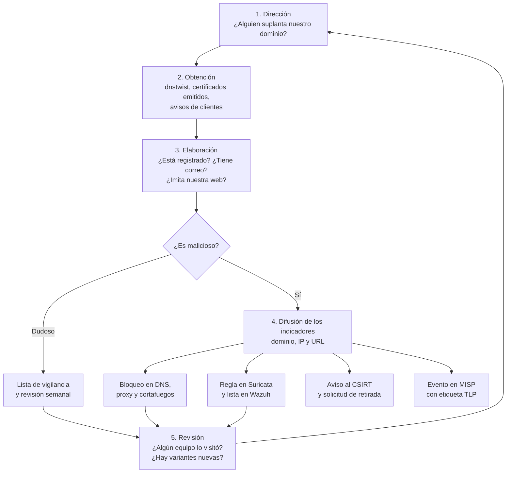

<a id="p-4-6"></a>

## 4.6 Ejemplo práctico: del indicador a la lista de bloqueo

Volvemos al correo del jueves. La investigación del dominio `acrne-logistica.example` ha dado estos resultados: se registró hace seis días, tiene servidor de correo, su página copia el portal de clientes y está alojado en `198.51.100.77`. Además, un evento compartido en MISP por otra empresa del sector describe la misma campaña y aporta dos direcciones más.

El objetivo del ejercicio es llevar esos indicadores al cortafuegos del laboratorio de forma controlada.

### Paso 1. Extraer los indicadores

```bash
# Desde MISP: direcciones IP marcadas para detección en los últimos siete días
curl -s -X POST "https://misp.acme-logistica.example/attributes/restSearch" \
  -H "Authorization: $CLAVE_MISP" \
  -H "Accept: application/json" -H "Content-Type: application/json" \
  -d '{"returnFormat":"text","type":"ip-dst","to_ids":1,"last":"7d","enforceWarninglist":true}' \
  > ioc_ip.txt

# Desde OTX: direcciones IPv4 de un pulso concreto
curl -s -H "X-OTX-API-KEY: $CLAVE_OTX" \
  "https://otx.alienvault.com/api/v1/pulses/ID_DEL_PULSO/indicators" \
  | jq -r '.results[] | select(.type=="IPv4") | .indicator' >> ioc_ip.txt
```

El fichero resultante, antes de depurar, contiene de todo:

```text
203.0.113.45
198.51.100.77
198.51.100.23
203.0.113.45
10.20.1.15
8.8.8.8
acrne-logistica.example
192.0.2.10
```

### Paso 2. Depurar antes de bloquear

Cargar una lista sin revisar es la forma más rápida de provocar un incidente de disponibilidad. Hay una dirección repetida, una interna, un servidor DNS público, un dominio que no es una IP y una dirección del rango público de la propia empresa. Este programa las filtra y genera el fichero para el cortafuegos:

```python
#!/usr/bin/env python3
"""Depura una lista de direcciones IP obtenidas de fuentes de inteligencia
y genera un conjunto de nftables listo para cargar en el cortafuegos."""
import ipaddress
import sys
from datetime import date

# Redes que nunca deben acabar en una lista de bloqueo
NO_BLOQUEAR = [ipaddress.ip_network(red) for red in (
    "10.0.0.0/8", "172.16.0.0/12", "192.168.0.0/16",   # direccionamiento privado
    "127.0.0.0/8", "169.254.0.0/16", "224.0.0.0/4",    # bucle local, enlace local, multidifusión
    "192.0.2.0/24",                                    # rango público de la organización (ejemplo)
)]
PERMITIDAS = {ipaddress.ip_address(ip) for ip in (
    "1.1.1.1", "8.8.8.8", "9.9.9.9",                   # servidores DNS públicos de uso general
)}


def depurar(lineas):
    validas, descartadas = set(), []
    for linea in lineas:
        texto = linea.split("#")[0].strip()
        if not texto:
            continue
        try:
            ip = ipaddress.ip_address(texto)
        except ValueError:
            descartadas.append((texto, "no es una dirección IP"))
            continue
        if ip.version != 4:
            descartadas.append((texto, "no es IPv4"))
        elif ip in PERMITIDAS:
            descartadas.append((texto, "está en la lista de direcciones permitidas"))
        elif any(ip in red for red in NO_BLOQUEAR):
            descartadas.append((texto, "pertenece a una red propia o reservada"))
        else:
            validas.add(ip)
    return sorted(validas), descartadas


def main():
    if len(sys.argv) != 3:
        sys.exit("Uso: depura_ioc.py ENTRADA.txt SALIDA.nft")
    with open(sys.argv[1], encoding="utf-8") as entrada:
        validas, descartadas = depurar(entrada)
    if not validas:
        sys.exit("No queda ninguna dirección válida: no se genera el fichero.")
    elementos = ", ".join(str(ip) for ip in validas)
    with open(sys.argv[2], "w", encoding="utf-8") as salida:
        salida.write(f"""#!/usr/sbin/nft -f
# Generado por depura_ioc.py el {date.today().isoformat()}
# Cada dirección caduca sola a los 30 días si no se vuelve a cargar.
table inet filtro_ioc
delete table inet filtro_ioc

table inet filtro_ioc {{
    set ioc_ipv4 {{
        type ipv4_addr
        flags timeout
        timeout 30d
        elements = {{ {elementos} }}
    }}
    chain reenvio {{
        type filter hook forward priority filter; policy accept;
        ip daddr @ioc_ipv4 counter log prefix "IOC-BLOQUEADA " drop
        ip saddr @ioc_ipv4 counter log prefix "IOC-BLOQUEADA " drop
    }}
}}
""")
    print(f"Direcciones cargadas: {len(validas)}")
    for texto, motivo in descartadas:
        print(f"Descartada {texto}: {motivo}")


if __name__ == "__main__":
    main()
```

```text
$ python3 depura_ioc.py ioc_ip.txt ioc.nft
Direcciones cargadas: 3
Descartada 10.20.1.15: pertenece a una red propia o reservada
Descartada 8.8.8.8: está en la lista de direcciones permitidas
Descartada acrne-logistica.example: no es una dirección IP
Descartada 192.0.2.10: pertenece a una red propia o reservada
```

> **En el laboratorio.** En un entorno real se puede simplificar la comprobación con la propiedad `ip.is_global` de Python. Aquí no se usa porque las direcciones de documentación de los ejemplos (`203.0.113.0/24`, `198.51.100.0/24`) no son direcciones globales y se descartarían todas.

### Paso 3. Cargar el conjunto en el cortafuegos

En la máquina Linux que hace de cortafuegos del laboratorio:

```bash
# Comprueba la sintaxis sin aplicar nada
sudo nft -c -f ioc.nft

# Carga las reglas
sudo nft -f ioc.nft

# Verifica el conjunto: cada dirección muestra el tiempo que le queda
sudo nft list set inet filtro_ioc ioc_ipv4
```

```text
table inet filtro_ioc {
        set ioc_ipv4 {
                type ipv4_addr
                timeout 30d
                elements = { 198.51.100.23 expires 29d23h59m59s, 198.51.100.77 expires 29d23h59m59s,
                             203.0.113.45 expires 29d23h59m59s }
        }
}
```

El conjunto usa la opción `timeout`: cada dirección desaparece sola a los 30 días salvo que se vuelva a cargar. Así el cortafuegos no acumula indicadores caducados. La regla, además de descartar, cuenta y registra cada paquete bloqueado con el prefijo `IOC-BLOQUEADA`, que el agente de Wazuh puede recoger.

### Paso 4. Detectar además de bloquear

Los mismos indicadores se cargan en una lista de Wazuh para que salte una alerta si aparecen en cualquier registro:

```text
# /var/ossec/etc/lists/ioc-ip
198.51.100.23:campana-acrne
198.51.100.77:campana-acrne
203.0.113.45:campana-acrne
```

```xml
<!-- En el ossec.conf del servidor, dentro de <ruleset> -->
<list>etc/lists/ioc-ip</list>
```

```xml
<group name="local,inteligencia,">

  <!-- Inicio de sesión correcto desde una dirección de la lista -->
  <rule id="100400" level="13">
    <if_group>authentication_success</if_group>
    <list field="srcip" lookup="address_match_key">etc/lists/ioc-ip</list>
    <description>Inicio de sesión correcto desde $(srcip), incluida en la lista de indicadores de compromiso.</description>
    <mitre>
      <id>T1078</id>
    </mitre>
  </rule>

  <!-- Tráfico hacia una dirección de la lista, visto por Suricata -->
  <rule id="100401" level="10">
    <if_sid>86600</if_sid>
    <list field="dest_ip" lookup="address_match_key">etc/lists/ioc-ip</list>
    <description>Suricata: tráfico hacia $(dest_ip), incluida en la lista de indicadores de compromiso.</description>
  </rule>

</group>
```

El dominio se vigila con la regla 3 de Suricata del módulo 2, que avisa de cualquier consulta DNS a `acrne-logistica.example`.

### Paso 5. Buscar hacia atrás

En el panel de Wazuh, en **Threat Hunting → Events**, con el intervalo «últimos 30 días»:

```text
data.dest_ip:("198.51.100.77" OR "198.51.100.23" OR "203.0.113.45") OR data.srcip:("198.51.100.77" OR "198.51.100.23" OR "203.0.113.45")
```

En ACME la búsqueda devuelve un resultado que nadie había mirado: una alerta de nivel 3 del martes en la que el puesto `PC-ADM-07` descarga un fichero `.exe` por HTTP desde `198.51.100.77`. Es la firma 4 de Suricata del módulo 2, que llegó a Wazuh con el nivel bajo que tienen por defecto las alertas de red. Ese equipo pasa a ser un caso para el módulo 5.

### Paso 6. Cerrar el ciclo

- Anotar en la ficha el origen de cada indicador, la fecha de alta y la de caducidad.
- Compartir los indicadores propios (el dominio y su IP) en MISP con la etiqueta TLP adecuada.
- Notificar el dominio a INCIBE-CERT y solicitar su retirada.
- Avisar a los clientes por un canal distinto del correo suplantado.

> **Idea clave.** Un indicador sin contexto es ruido, y un bloqueo sin depurar es un riesgo. El valor de la inteligencia está en la elaboración: saber de dónde viene cada dato, cuánto tiempo vale y qué se hace con él.

<a id="p-4-7"></a>

## 4.7 Recursos y referencias

> **[VÍDEO / RECURSO RECOMENDADO 4.1: «MISP Training Module 1 - An Introduction to Cybersecurity Information Sharing»]**
>
> - **Enlace:** <https://www.youtube.com/watch?v=aM7czPsQyaI>
> - **Autor, duración e idioma:** CIRCL (el CSIRT de Luxemburgo, que lidera el desarrollo de MISP), 1 hora y 6 minutos, en inglés.
> - **Qué aporta:** por qué se comparte inteligencia, qué es un indicador útil y cómo trabaja MISP, contado por sus desarrolladores.
> - **Cómo usarlo:** bastan los primeros 25 minutos. El resto del material del curso, con diapositivas y máquinas virtuales de prácticas, está en <https://www.circl.lu/misp-training>.

> **[VÍDEO / RECURSO RECOMENDADO 4.2: Seminario web de INCIBE-CERT «Introducción e identificación de phishing»]**
>
> - **Enlace:** <https://www.incibe.es/incibe-cert/seminarios-web/introduccion-e-identificacion-phishing>
> - **Autor e idioma:** INCIBE-CERT, en español.
> - **Qué aporta:** tipos de phishing y técnicas para distinguir una página legítima de una fraudulenta, que es el trabajo de la fase de elaboración.
> - **Cómo usarlo:** aplica sus criterios a la tabla de señales del apartado 4.4.

> **[VÍDEO / RECURSO RECOMENDADO 4.3: «MISP Tutorial - Enablings Feeds»]**
>
> - **Enlace:** <https://www.youtube.com/watch?v=k3l-CtOgQro>
> - **Autor, duración e idioma:** CIRCL, 34 segundos, sin narración.
> - **Qué aporta:** muestra en la interfaz de MISP cómo se activa una fuente externa de indicadores.
> - **Cómo usarlo:** demostración rápida antes de la práctica con MISP.

> **[REFERENCIAS Y GUÍAS OFICIALES]**
>
> - [Real Decreto 311/2022, Esquema Nacional de Seguridad](https://www.boe.es/buscar/act.php?id=BOE-A-2022-7191). Medida op.mon.3 (vigilancia) y sus refuerzos.
> - [MITRE ATT&CK, táctica TA0043: reconocimiento](https://attack.mitre.org/tactics/TA0043/). Lo que hace el atacante antes de atacar.
> - [FIRST: Traffic Light Protocol (TLP) 2.0](https://www.first.org/tlp/).
> - [MISP: plataforma de inteligencia de amenazas](https://www.misp-project.org/) y [materiales de formación de CIRCL](https://www.circl.lu/misp-training).
> - [Open Threat Exchange (LevelBlue Labs, antes AlienVault)](https://otx.alienvault.com/).
> - [OASIS: STIX 2.1](https://docs.oasis-open.org/cti/stix/v2.1/stix-v2.1.html).
> - [dnstwist](https://github.com/elceef/dnstwist), [TruffleHog](https://github.com/trufflesecurity/trufflehog), [ggshield de GitGuardian](https://github.com/GitGuardian/ggshield) y [OWASP Amass](https://github.com/owasp-amass/amass).
> - [Shodan](https://www.shodan.io/), [crt.sh](https://crt.sh/), [Have I Been Pwned](https://haveibeenpwned.com/), [urlscan.io](https://urlscan.io/) y [VirusTotal](https://www.virustotal.com/).
> - [Wazuh: listas CDB](https://documentation.wazuh.com/current/user-manual/ruleset/cdb-list.html).
> - [RFC 9162. Certificate Transparency Version 2.0](https://www.rfc-editor.org/rfc/rfc9162).
> - [RFC 3492. Punycode](https://www.rfc-editor.org/rfc/rfc3492). Codificación de los dominios con caracteres no latinos que aprovechan los homoglifos.
> - [RFC 2606](https://www.rfc-editor.org/rfc/rfc2606) y [RFC 5737](https://www.rfc-editor.org/rfc/rfc5737). Dominios y direcciones reservados para documentación, usados en todos los ejemplos.
> - [RFC 9116. security.txt](https://www.rfc-editor.org/rfc/rfc9116). Cómo publica una organización su contacto para avisos de seguridad.

<a id="p-4-act"></a>

## 4.8 Actividades interactivas

Cada actividad cuenta una vez, en el primer intento. Las preguntas de test muestran después la retroalimentación de todas las opciones.

### Actividad 4.1. La fuente adecuada (pregunta de test)

El SOC quiere averiguar, sin tocar ningún sistema, para qué subdominios de `acme-logistica.example` se han emitido certificados TLS, con el fin de localizar servidores olvidados. ¿Qué consulta?

- **a)** dnstwist.
- **b)** Have I Been Pwned.
- **c)** Un escaneo con Nmap de todo el rango público.
- **d)** Los registros de transparencia de certificados, por ejemplo en crt.sh.

| Opción | Resultado | Retroalimentación |
|---|---|---|
| a) | Incorrecta | No. dnstwist genera dominios *parecidos* al propio para detectar suplantaciones. Aquí se buscan subdominios *del propio* dominio. |
| b) | Incorrecta | No. Ese servicio indica si las cuentas de un dominio aparecen en filtraciones de datos. No sabe nada de certificados ni de subdominios. |
| c) | Incorrecta | No. Un escaneo es reconocimiento activo: toca los sistemas, y el enunciado lo excluye. Además solo encontraría lo que responda en las direcciones que ya conoces, no los nombres que has olvidado. |
| d) | **Correcta** | Correcto. Cada certificado de confianza pública queda anotado en registros que cualquiera puede consultar. Es reconocimiento pasivo: no se envía ni un paquete a los sistemas investigados. |

*Tipo de contenido H5P o Moodle:* Multiple Choice (una sola respuesta), con la retroalimentación de cada fila en el campo de la opción correspondiente.

### Actividad 4.2. Antes de bloquear (pregunta de test)

Has descargado de una fuente de inteligencia una lista con 3 000 direcciones IP. ¿Qué es imprescindible antes de cargarla en el cortafuegos?

- **a)** Depurarla: retirar las direcciones propias, las reservadas y las de servicios legítimos, y anotar el origen y la caducidad de cada indicador.
- **b)** Comprobar cada dirección conectándote a ella desde un equipo corporativo.
- **c)** Subirla a un servicio público para que otros la validen.
- **d)** Cargarla completa cuanto antes: cuantos más indicadores, más protección.

| Opción | Resultado | Retroalimentación |
|---|---|---|
| a) | **Correcta** | Correcto. Una lista sin depurar puede contener tu propio rango o un servidor DNS público, y bloquearlos es provocarte una denegación de servicio. La caducidad evita que una dirección que hoy es maliciosa siga bloqueada cuando pertenezca a otro. |
| b) | Incorrecta | No. Te expones a lo que haya al otro lado y avisas al atacante de que lo has descubierto. Para eso están los servicios de reputación y de análisis en entorno aislado. |
| c) | Incorrecta | No sin mirar antes su etiqueta TLP. La inteligencia compartida tiene límites de difusión, y publicarla puede romper la confianza de quien te la dio. |
| d) | Incorrecta | No. La cantidad no es calidad. Los indicadores caducados o erróneos generan bloqueos indebidos y alertas falsas, y entierran los que importan. |

*Tipo de contenido H5P o Moodle:* Multiple Choice (una sola respuesta), con la retroalimentación de cada fila en el campo de la opción correspondiente.

### Actividad 4.3. Cada herramienta, para lo suyo (emparejamiento)

Relaciona cada herramienta de fuentes abiertas con el uso que le da el SOC.

| Elemento | Va con | Comentario al corregir |
|---|---|---|
| Shodan | Buscar servicios de la organización expuestos a Internet | Censys cumple la misma función. |
| Have I Been Pwned | Saber si las cuentas del dominio aparecen en filtraciones | Anticipa el compromiso de cuentas por reutilización de contraseñas. |
| TruffleHog | Encontrar claves y contraseñas en el historial de un repositorio | ggshield, de GitGuardian, hace lo mismo. |
| dnstwist | Generar dominios parecidos al corporativo y comprobar cuáles existen | Es la herramienta contra el typosquatting. |
| urlscan.io | Examinar una página sospechosa sin visitarla desde un equipo propio | La abre en un entorno aislado y devuelve una captura. |
| MISP | Almacenar indicadores y compartirlos con otras organizaciones | OTX cumple un papel parecido como comunidad abierta. |

*Tipo de contenido H5P recomendado:* Drag the Words.

Texto preparado para pegar en **Drag the Words** (las respuestas van entre asteriscos):

```text
Buscar servicios de la organización expuestos a Internet: *Shodan*
Saber si las cuentas del dominio aparecen en filtraciones: *Have I Been Pwned*
Encontrar claves y contraseñas en el historial de un repositorio: *TruffleHog*
Generar dominios parecidos al corporativo y comprobar cuáles existen: *dnstwist*
Examinar una página sospechosa sin visitarla desde un equipo propio: *urlscan.io*
Almacenar indicadores y compartirlos con otras organizaciones: *MISP*
```


<a id="m-5"></a>

# Módulo 5. Triaje, registro inicial y seguimiento

**Criterio de evaluación:** CE 2.e. Se ha llevado a cabo la clasificación, valoración, documentación y seguimiento inicial del incidente de ciberseguridad.  
**Tiempo estimado de estudio:** 130 minutos.

<a id="p-5-1"></a>

## 5.1 Jueves, 11:52: una alerta de hace dos días

Jueves, 19 de noviembre de 2026, 11:52. La búsqueda retrospectiva del módulo 4 acaba de devolver un resultado: una alerta del martes, de nivel 3, que nadie llegó a abrir. El puesto `PC-ADM-07` descargó un fichero `.exe` por HTTP desde `198.51.100.77`, la dirección que aloja el dominio que suplanta a ACME.

Tienes delante una alerta vieja, un equipo de administración y una IP que ya sabes que es maliciosa. A partir de aquí hay cuatro preguntas, y hay que contestarlas en este orden:

1. ¿Es real o es un falso positivo?
2. Si es real, ¿qué ha pasado exactamente y cómo de grave es?
3. ¿Qué puedo hacer yo y a quién tengo que avisar?
4. ¿Cómo lo dejo escrito para que quien lo recoja no tenga que empezar de cero?

Los cuatro módulos anteriores te han dado las piezas: la taxonomía y la valoración, las fuentes de registros, la correlación con el mundo físico y los indicadores de compromiso. Este módulo las ordena en un método de trabajo:

1. El **triaje**: cómo se decide, en minutos, qué es cada alerta.
2. El **registro**: qué campos lleva la ficha de un incidente y cómo se rellenan.
3. El **seguimiento inicial**: cuándo y cómo se escala, a quién se notifica y cómo se cierra.

<a id="p-5-2"></a>

## 5.2 El SOC por niveles

### Quién hace qué

Un SOC reparte el trabajo en niveles para que cada alerta la mire primero quien puede resolver la mayoría, y solo lleguen arriba las que lo necesitan.

| Nivel | Quién lo forma | Qué hace | Qué entrega |
|---|---|---|---|
| **Nivel 1. Triaje inicial** | Analistas de turno | Vigila la consola, valida y enriquece cada alerta, descarta los falsos positivos, clasifica y valora, abre la ficha, aplica la contención inmediata prevista en el procedimiento y escala | Una ficha con el veredicto, la valoración y lo que ya se ha hecho |
| **Nivel 2. Análisis y contención** | Analistas con más experiencia; hay uno de guardia | Investiga a fondo el alcance y la causa, decide y ejecuta la contención, recoge las evidencias y coordina a los equipos de sistemas y de redes | Alcance confirmado, contención aplicada, evidencias custodiadas y propuesta de notificación |
| **Nivel 3. Comité de crisis** | Dirección, Responsable de la Seguridad, Responsable del Sistema, asesoría jurídica, delegado de protección de datos, comunicación y los responsables de las áreas afectadas | Decide lo que no es técnico: parar un servicio, notificar a las autoridades, informar a los clientes, denunciar o contratar ayuda externa | Decisiones, un portavoz y recursos |

En muchos SOC se llama *Tier 3* a los especialistas en análisis forense, análisis de malware o búsqueda proactiva de amenazas. En el esquema de esta unidad esos especialistas apoyan al nivel 2, y el nivel 3 es el órgano que decide.

Fuera de la organización está el **CSIRT de referencia** (INCIBE-CERT o CCN-CERT). No es un nivel jerárquico: se le notifica y presta apoyo técnico.

### Lo que el nivel 1 hace y lo que no hace

| Sí | No |
|---|---|
| Decide con datos si la alerta es real | Investiga durante horas un caso que debería haber escalado |
| Aísla un puesto o bloquea un indicador si el procedimiento lo prevé | Apaga, reinicia o «limpia» un equipo comprometido |
| Anota cada paso con su hora | Borra ficheros, correos o registros «para arreglarlo» |
| Escala con una ficha completa y una llamada | Notifica por su cuenta a organismos externos o a clientes |
| Propone ajustes de las reglas que fallan | Cierra una alerta sin escribir el motivo |

> **Recuerda.** El triaje tiene un tiempo máximo. En ACME, si a los 30 minutos no has podido decidir, escalas con lo que tengas. Una sospecha bien documentada que llega pronto al nivel 2 vale más que una certeza que llega tarde.

<a id="p-5-3"></a>

## 5.3 Metodología de triaje

### Ocho pasos, siempre en el mismo orden

El triaje (en inglés, *triage*) es la valoración rápida que separa lo urgente de lo que puede esperar y lo real de lo que no lo es. El término viene de la medicina de urgencias, y la idea es la misma: no se atiende por orden de llegada, sino por gravedad.

1. **Hacerse cargo.** Asígnate la alerta en la consola. Así nadie más la trabaja a la vez y queda constancia de la hora.
2. **Entender qué detecta la regla.** Lee su descripción y sus condiciones. Una regla que avisa de «cinco fallos en 60 segundos» no afirma que haya habido un acceso.
3. **Validar con el dato en bruto.** Ve al registro original que disparó la alerta. La alerta es un resumen; el registro es el hecho.
4. **Enriquecer.** Añade contexto: qué activo es, quién lo usa, qué hay al otro lado de la conexión, qué pasó antes y después.
5. **Emitir un veredicto.** Verdadero positivo, positivo benigno, falso positivo o no concluyente.
6. **Clasificar y valorar.** Taxonomía, peligrosidad, impacto y prioridad, con las tablas del módulo 1.
7. **Actuar.** Cerrar, contener o escalar.
8. **Documentar.** Lo que no está escrito en la ficha no ha ocurrido.

### Los resultados posibles

Una alerta puede acertar o equivocarse, y una actividad maliciosa puede verse o pasar inadvertida. De cruzar ambas cosas salen cuatro casos:

| | Saltó una alerta | No saltó ninguna alerta |
|---|---|---|
| **Hubo actividad maliciosa** | Verdadero positivo (VP) | Falso negativo (FN) |
| **No hubo actividad maliciosa** | Falso positivo (FP) | Verdadero negativo (VN) |

El falso negativo es el más peligroso, porque nadie lo está mirando. El falso positivo es el más frecuente, y su coste es otro: consume el tiempo del analista y, cuando abunda, le enseña a desconfiar de la consola.

En la práctica hay un quinto caso que conviene separar: el **verdadero positivo benigno**. La regla acertó, porque ocurrió exactamente lo que describe, pero la actividad estaba autorizada. Un barrido de puertos lanzado por el escáner de vulnerabilidades de la propia empresa es el ejemplo típico.

| Veredicto | Qué significa | Qué haces | Cómo queda |
|---|---|---|---|
| Verdadero positivo | La actividad ocurrió y es maliciosa o no autorizada | Abres el incidente, clasificas, valoras, contienes y escalas | Abierto |
| Verdadero positivo benigno | Ocurrió, pero estaba autorizada o es inocua | Cierras con el motivo y propones una excepción en la regla | Cerrado (Sin impacto) |
| Falso positivo | No ocurrió lo que la regla dice | Cierras con el motivo y propones corregir la regla | Cerrado (Falso positivo) |
| No concluyente | Faltan datos para decidir dentro del tiempo de triaje | Escalas como sospecha, indicando qué falta | Abierto |

### Cómo se enriquece una alerta

Enriquecer es responder a cinco preguntas. Cada una tiene su fuente:

| Pregunta | Dónde se responde |
|---|---|
| ¿Qué activo es y cuánto importa? | Inventario de activos: función, responsable, criticidad y categoría de seguridad |
| ¿Quién lo usa y qué hace normalmente? | Directorio de usuarios, turnos y calendario, historial de inicios de sesión |
| ¿Qué hay al otro lado? | Reputación de la dirección o del dominio, listas de indicadores de compromiso (módulo 4) |
| ¿Qué pasó antes y después? | El SIEM: los 30 minutos anteriores y posteriores en el mismo equipo y con la misma cuenta |
| ¿Ha pasado antes? | Historial de fichas: alertas iguales y cómo se cerraron |

### Falso positivo o verdadero positivo: qué mirar

La misma alerta puede ser una cosa u otra. Lo que decide es el contexto:

| Alerta | Apunta a falso positivo o a positivo benigno | Apunta a verdadero positivo |
|---|---|---|
| Fuerza bruta contra SSH | El origen es el escáner de vulnerabilidades, en su ventana programada | El origen es externo y, después de los fallos, hay un `Accepted` desde la misma IP |
| Descarga de un `.exe` por HTTP | Es el actualizador de un programa conocido, desde el dominio del fabricante y con firma digital válida | El dominio se registró hace días, el fichero no está firmado y se ejecutó desde la carpeta de descargas |
| Acceso al CPD fuera de horario | Hay una intervención planificada, con su orden de trabajo y la persona autorizada | El titular de la tarjeta está en su casa |
| Inicio de sesión desde otro país | El usuario está de viaje y lo ha comunicado | El usuario fichó en la oficina hace una hora |

> **Ejemplo SOC Tier 1.** Alerta de las 03:00: «Varios fallos de autenticación seguidos de un acceso correcto» en `srv-bd01`, con la cuenta `svc_backup`. Antes de alarmarte, miras el origen: es el servidor de copias, a la hora de la copia nocturna, y el historial muestra la misma alerta cada vez que se cambia la contraseña de la cuenta de servicio y alguien olvida actualizarla en un trabajo. Es un positivo benigno. Lo cierras con ese motivo y abres una petición para corregir el trabajo de copia; si te limitas a cerrarlo, volverá mañana.

### Qué se hace con los falsos positivos

Cada falso positivo es información sobre la calidad de una regla. Al cerrarlo se anotan tres cosas: qué regla saltó, por qué no es un incidente y qué cambio evitaría que se repita. Las formas habituales de ajuste son:

- añadir una excepción para un origen o una cuenta concretos (nunca para «todo lo interno»);
- subir el umbral o acortar la ventana de tiempo;
- exigir una segunda condición, como hizo la regla de correlación físico-lógica del módulo 3;
- bajar el nivel de la regla si solo aporta contexto.

> **Atención.** El ajuste tiene dos riesgos opuestos. Si no se ajusta nada, la consola se llena de ruido y las alertas importantes se pierden entre las demás: es la *fatiga de alertas*. Si se ajusta demasiado, se fabrican falsos negativos. Toda excepción debe ser estrecha, estar justificada por escrito y revisarse cada cierto tiempo.

### Cómo se mide el triaje

| Indicador | Qué mide |
|---|---|
| Tiempo de detección | Desde que empieza la actividad maliciosa hasta que alguien la advierte |
| Tiempo de triaje | Desde que salta la alerta hasta que hay un veredicto |
| Tiempo de contención | Desde el veredicto hasta que el daño deja de crecer |
| Tasa de falsos positivos por regla | Qué proporción de las alertas de cada regla se cierra como falso positivo |

La Guía Nacional añade indicadores para el proceso completo, entre ellos el tiempo que se tarda en cerrar los incidentes según su impacto y el porcentaje de incidentes que se cierran sin respuesta.

<a id="p-5-4"></a>

## 5.4 Del aviso al cierre: el flujo de trabajo

### El recorrido de una alerta

**Diagrama 5.1. Flujo de trabajo del analista de nivel 1.** Desde que recibe la alerta hasta que la cierra o la escala. Las líneas discontinuas son la mejora continua: lo que se aprende de cada cierre vuelve a las reglas.

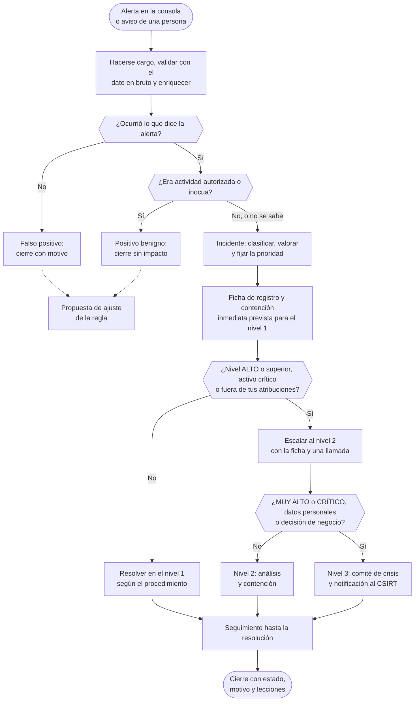

### Tiempos de respuesta

La prioridad que salió de la valoración (módulo 1) fija los plazos internos. Estos son los de ACME:

| Prioridad | Nivel que rige | Primera respuesta | Revisión de la ficha | Quién lo lleva |
|---|---|---|---|---|
| P1 | CRÍTICO o MUY ALTO | 15 minutos | Cada hora | Nivel 2 y comité de crisis |
| P2 | ALTO | 1 hora | Cada 4 horas | Nivel 2 |
| P3 | MEDIO | 8 horas laborables | Diaria | Nivel 1 |
| P4 | BAJO | Siguiente día hábil | Semanal | Nivel 1 |

### Los estados de una ficha

**Diagrama 5.2. Estados de una ficha en el SOC de ACME.** Toda alerta empieza como nueva y termina cerrada con un motivo. Entre medias, el estado dice a cualquier compañero en qué punto está el caso.

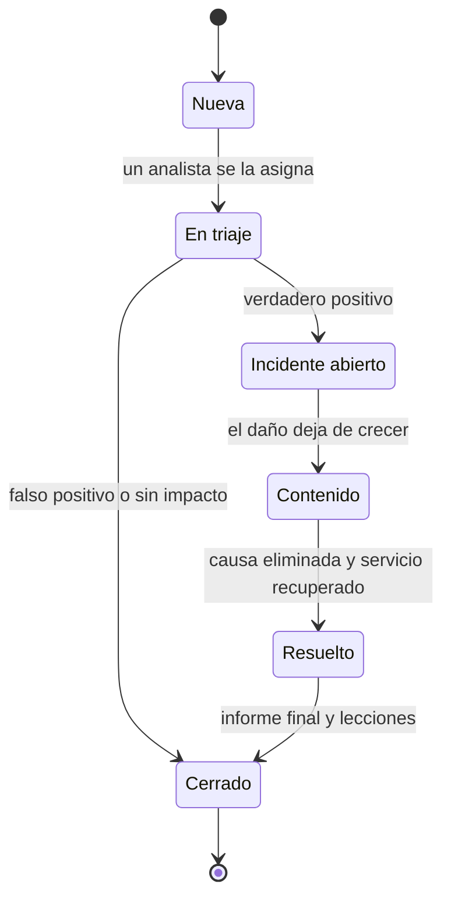

Cuando el incidente se ha notificado a un CSIRT, este usa los estados de la Guía Nacional:

| Estado | Cuándo se aplica |
|---|---|
| Abierto | Desde que se notifica hasta que se cierra |
| Cerrado (Resuelto y con respuesta) | El afectado ha resuelto la amenaza y lo comunica |
| Cerrado (Resuelto y sin respuesta) | El afectado no contesta, pero el incidente parece resuelto |
| Cerrado (Sin impacto) | La detección fue correcta, pero la organización no es vulnerable o no se ve afectada |
| Cerrado (Falso positivo) | La detección fue errónea |
| Cerrado (Sin resolución y con respuesta) | No se ha logrado una solución |
| Cerrado (Sin resolución y sin respuesta) | No se ha resuelto y el afectado no ha contactado |

Si el afectado no responde, el CSIRT cierra el incidente al cabo de un número de días naturales que depende del nivel: 120 días para CRÍTICO, 90 para MUY ALTO, 45 para ALTO, 30 para MEDIO y 21 para BAJO.

<a id="p-5-5"></a>

## 5.5 La ficha de registro del incidente

### Por qué se escribe todo

La ficha es la memoria del incidente. Sirve para cuatro cosas:

- **Continuidad.** El analista que entra en el turno siguiente, o el del nivel 2 que recibe el caso, sigue donde tú lo dejaste.
- **Notificación.** Los datos que pide el CSIRT de referencia salen de la ficha, sin volver a investigar.
- **Prueba.** Si el caso acaba en un juzgado o en una reclamación, lo que cuenta es lo que quedó documentado y cuándo.
- **Mejora.** Sin fichas no hay estadísticas ni lecciones aprendidas.

El Esquema Nacional de Seguridad lo exige en la medida **op.exp.9, Registro de la gestión de incidentes**: hay que registrar los reportes inicial, intermedio y final, las actuaciones de emergencia, los cambios hechos en el sistema a raíz del incidente y las evidencias que puedan necesitarse en un procedimiento judicial.

### Los campos indispensables

| Bloque | Qué se anota | Error frecuente |
|---|---|---|
| **ID del incidente** | Un código único y correlativo, por ejemplo `INC-2026-0162`, con un título que describa el hecho, el estado y la marca TLP | Títulos como «Alerta de Wazuh»; dos fichas para el mismo caso |
| **Marcas de tiempo** | Inicio, detección, registro, contención, escalado, notificación, resolución y cierre, con fecha, hora y zona horaria | Mezclar hora local y UTC; anotar «esta mañana» |
| **Origen de la alerta** | Quién o qué avisó: herramienta, regla e identificador de la alerta, o la persona y el canal | «Lo vio el SIEM» |
| **Activos involucrados** | Equipos, cuentas, servicios e información: nombre, dirección, función, usuario, responsable y criticidad | Anotar solo una IP |
| **Clasificación y valoración** | Taxonomía, peligrosidad, impacto, nivel que rige y prioridad; cada revisión con su fecha y su motivo | Sobrescribir la valoración anterior |
| **Indicadores de compromiso** | Tipo, valor, contexto en que se vio, fuente y qué se ha hecho con él | Pegar una lista sin contexto |
| **Línea de tiempo** | Los hechos en orden, cada uno con su hora y su fuente | Mezclar hechos con suposiciones |
| **Acciones** | Lo realizado y lo pendiente: quién, cuándo, qué y con qué resultado | Omitir lo que salió mal |
| **Cadena de custodia** | Cada evidencia con su identificador, su huella, quién la recogió, dónde está y cada traspaso | Calcular la huella después de manipular la evidencia |
| **Escalado y comunicaciones** | A quién se avisó, por qué canal, a qué hora y qué respondió | «Avisado nivel 2», sin hora |

### Marcas de tiempo

Un incidente tiene varias horas y no deben confundirse:

- **Inicio:** el primer hecho malicioso conocido. Se corrige a medida que la investigación retrocede.
- **Detección:** el momento en que una herramienta o una persona lo advierte.
- **Registro:** la apertura de la ficha.
- **Contención, escalado, notificación, resolución y cierre:** cada hito, cuando ocurre.

La diferencia entre el inicio y la detección es el tiempo que el atacante ha tenido para actuar sin que nadie lo viera. Es el dato que más interesa reducir.

Todas las horas se escriben en un formato sin ambigüedad. El más extendido es el de la RFC 3339, que indica el desfase respecto a UTC:

```text
2026-11-19T11:52:00+01:00    hora peninsular de invierno
2026-11-19T10:52:00Z         el mismo instante en UTC
```

> **Atención.** Antes de comparar horas de dos fuentes, comprueba en qué zona horaria escribe cada una. Suricata escribe la hora local con su desfase. Sysmon y el registro de eventos de Windows guardan la hora en UTC, aunque el visor la muestre en hora local. Muchos cortafuegos y servicios en la nube también usan UTC. Una hora de diferencia mal entendida descoloca toda la línea de tiempo.

### Origen de la alerta y activos

El origen se anota con precisión suficiente para que otra persona encuentre el dato: la herramienta, la regla o la firma, el identificador de la alerta y la consulta que la devolvió. Si el aviso vino de una persona, se anota quién, cuándo y por qué canal.

De cada activo interesan seis datos: nombre, dirección, función, usuario habitual, responsable y criticidad. De la información afectada, tres: de qué tipo es, cuánta hay y si contiene datos personales. Esa última respuesta decide si se abre la vía de la protección de datos.

### Indicadores de compromiso

Cada indicador se anota con su contexto: qué papel tuvo, dónde se vio, de qué fuente procede y qué se ha hecho con él. En fichas, correos e informes se escriben *desactivados*, para que nadie los abra por error y ningún programa los convierta en enlaces:

```text
hxxp://acrne-logistica[.]example/visor/VisorAlbaranes.exe
198.51.100[.]77
```

### Línea de tiempo

Es una tabla única en la que cada fila tiene una hora, una fuente y un hecho. Tres reglas la hacen útil:

- **Hechos, no opiniones.** «`visorsvc.exe` conecta con 198.51.100.77:443» es un hecho. «El equipo está controlado por un atacante» es una conclusión, y va en la descripción, marcada como hipótesis mientras no se confirme.
- **Cada hecho con su fuente.** Así cualquiera puede comprobarlo.
- **La hora del hecho, no la de la anotación.** Si descubres hoy algo que ocurrió el martes, la fila lleva la hora del martes.

### Cadena de custodia

La **cadena de custodia** es el registro documentado de quién ha tenido cada evidencia, cuándo, dónde y para qué, desde que se recoge hasta que se presenta. Permite demostrar que la evidencia es la original y que nadie la ha alterado.

1. **Recoger por orden de volatilidad.** Primero lo que antes desaparece: la memoria y las conexiones activas; después el disco; por último los registros y las copias de seguridad (RFC 3227).
2. **Calcular la huella** SHA-256 de cada evidencia en el momento de recogerla.
3. **Identificarla** con un código, una descripción, la fecha, la hora y la persona que la recoge.
4. **Guardarla** en un almacén de acceso restringido y trabajar siempre sobre copias.
5. **Anotar cada traspaso:** quién entrega, quién recibe, cuándo y por qué.

Las referencias técnicas son la RFC 3227, la norma ISO/IEC 27037 y, en España, la UNE 71506.

> **Atención.** El nivel 1 no suele recoger evidencias, pero sí puede destruirlas. No apagues ni reinicies un equipo comprometido: la memoria se pierde. No ejecutes herramientas de limpieza. No inicies sesión en él con una cuenta de administración. Aíslalo de la red y anota en la ficha todo lo que hayas tocado.

### Herramientas

La ficha puede vivir en una herramienta de gestión de casos o, en una organización pequeña, en una plantilla. Lo importante es que haya un único lugar, con control de acceso y con historial de cambios.

| Herramienta | Qué es | Dónde encaja |
|---|---|---|
| LUCIA | Herramienta del CCN-CERT para la gestión de ciberincidentes en las entidades del ámbito del Esquema Nacional de Seguridad. Usa la taxonomía nacional y comunica los incidentes al CCN-CERT | Sector público |
| DFIR-IRIS | Plataforma colaborativa de código abierto para la respuesta a incidentes: casos, activos, indicadores, línea de tiempo, evidencias y tareas | Equipos de respuesta y SOC. Se despliega con Docker, lo que la hace apta para el laboratorio |
| TheHive | Plataforma de gestión de casos de seguridad muy extendida en los SOC. Comprueba sus condiciones de licencia vigentes | SOC |
| RTIR | Gestor de peticiones de código abierto adaptado al trabajo de un CSIRT | CSIRT |
| GLPI u otro gestor de servicios de TI | Gestor de peticiones general, con una categoría propia para incidentes de seguridad y acceso restringido | Organizaciones pequeñas |

> **[IMAGEN ILUSTRATIVA 5.1: Captura de una ficha de registro de incidente cumplimentada]**
>
> - **Qué capturar:** la vista de detalle de un incidente ya cumplimentado en la herramienta de gestión de casos del laboratorio (por ejemplo, DFIR-IRIS o GLPI), o la plantilla de ficha rellenada si se trabaja con documentos.
> - **Anotaciones numeradas sobre la captura:** (1) identificador, título, estado y marca TLP; (2) marcas de tiempo; (3) origen de la alerta; (4) activos involucrados; (5) clasificación y valoración; (6) indicadores de compromiso; (7) línea de tiempo; (8) acciones y escalado.
> - **Formato:** PNG a 1 920 × 1 080 píxeles, con las anotaciones en círculos numerados y una leyenda debajo. Los datos reales deben sustituirse por datos de ejemplo.
> - **Texto alternativo:** «Ficha de registro de un incidente de ciberseguridad con sus bloques: identificación, marcas de tiempo, origen de la alerta, activos, clasificación y valoración, indicadores de compromiso, línea de tiempo y acciones».
> - **Nota para el docente:** el paquete SCORM muestra aquí una recreación de la ficha del intento de fuerza bruta del módulo 2 (`INC-2026-0158`), un caso sencillo que sirve para reconocer los campos antes de abordar la ficha completa del apartado 5.7.

<a id="p-5-6"></a>

## 5.6 Seguimiento inicial y escalado

### Cuándo se escala

Escalar es pasar el caso a quien tiene más conocimiento o más autoridad. Son dos movimientos distintos:

- **Escalado funcional:** a alguien con más capacidad técnica. Del nivel 1 al nivel 2.
- **Escalado jerárquico:** a alguien con más capacidad de decisión. Del nivel 2 al comité de crisis.

| Se escala del nivel 1 al nivel 2 cuando… | Se escala del nivel 2 al nivel 3 cuando… |
|---|---|
| El nivel que rige es ALTO o superior | El nivel que rige es MUY ALTO o CRÍTICO |
| Está afectado un activo crítico o una cuenta con privilegios | Hay datos personales comprometidos |
| Se confirma la ejecución de malware o hay indicios de salida de información | Hay que detener un servicio de negocio |
| Hay más de un equipo implicado | Hay que notificar a autoridades, informar a clientes o denunciar |
| La contención necesaria excede las atribuciones del nivel 1 | Hace falta ayuda externa o un gasto no previsto |
| Se agota el tiempo de triaje sin veredicto | El caso puede llegar a los medios de comunicación |

### Cómo se escala

Un escalado son dos cosas a la vez: la ficha y una llamada. La ficha lleva los datos; la llamada asegura que alguien los ha recibido. El mensaje sigue siempre el mismo guion de cinco puntos:

1. **Qué ha pasado**, en una frase.
2. **Qué he comprobado** y con qué fuentes.
3. **Qué he hecho** ya.
4. **Qué no sé** todavía.
5. **Qué necesito** de ti.

> **Ejemplo SOC Tier 1.** «Escalo el INC-2026-0162, prioridad P2. *Qué ha pasado:* el puesto PC-ADM-07, de facturación, descargó y ejecutó el martes a las 09:43 un programa desde el dominio que suplanta a ACME. *Qué he comprobado:* el proceso sigue activo e intenta conectar cada cinco minutos con 198.51.100.77; el miércoles a las 02:10 el equipo envió 1,9 GB a 198.51.100.23. *Qué he hecho:* el equipo está en cuarentena desde las 12:12, sin apagar; he cerrado las sesiones de la usuaria y he forzado el cambio de contraseña. *Qué no sé:* qué ficheros han salido ni si hay más equipos. *Qué necesito:* análisis del equipo y confirmación de la salida de datos.»

Escalar no es desentenderse. El nivel 1 sigue en el caso: busca los indicadores en el resto de equipos, vigila las alertas relacionadas y mantiene la ficha al día.

### A quién se avisa fuera

El analista de nivel 1 no notifica a organismos externos, pero prepara los datos con los que otros lo harán. Tiene que saber qué vías existen y qué plazos corren:

| Destinatario | Cuándo | Quién lo hace | Plazo |
|---|---|---|---|
| CSIRT de referencia (INCIBE-CERT o CCN-CERT) | Nivel de peligrosidad o de impacto ALTO, MUY ALTO o CRÍTICO, si la entidad está obligada; en el resto de casos, de forma voluntaria | Responsable de la Seguridad o la persona de contacto designada | Notificación inicial inmediata; intermedia y final según el nivel (módulo 1) |
| Agencia Española de Protección de Datos | Brecha de datos personales, salvo que sea improbable que suponga un riesgo para las personas | El responsable del tratamiento, con su delegado de protección de datos | 72 horas desde que se tiene constancia |
| Personas afectadas | Brecha con alto riesgo para sus derechos | El responsable del tratamiento | Sin dilación indebida |
| Fuerzas y Cuerpos de Seguridad | Indicios de delito | Dirección, con la asesoría jurídica | Cuanto antes |
| Clientes y terceros | Lo que establezca cada contrato | Dirección o el área que lleva la relación | El pactado |

La notificación inicial al CSIRT no espera a que la investigación termine. Se envía con lo que se sabe: qué ha ocurrido, cuándo empezó y cuándo se detectó, qué recursos están afectados, el origen si se conoce, la taxonomía, la peligrosidad y el impacto estimados y las medidas ya tomadas. La notificación final completa el resto, incluidos el esfuerzo de resolución y el impacto económico.

**Diagrama 5.3. Escalado y comunicaciones en un incidente con datos personales.** Cada nivel recibe el caso con la ficha, hace su parte y avisa al siguiente. El nivel 1 no desaparece: sigue buscando indicadores y manteniendo la ficha.

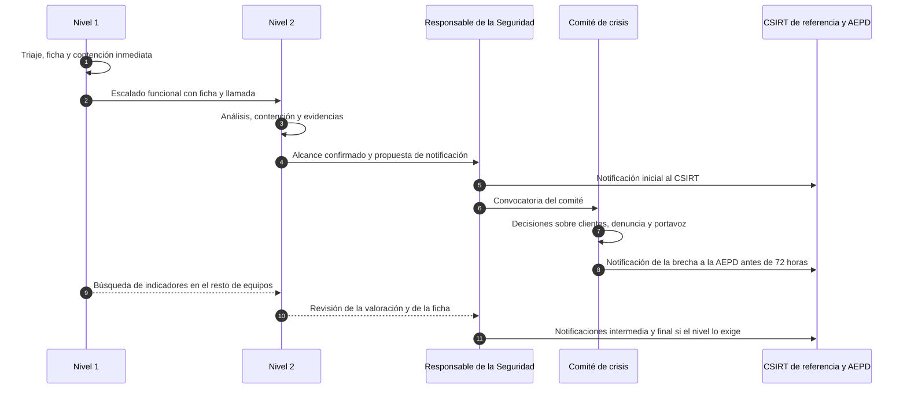

### El seguimiento

Mientras el incidente está abierto, la ficha se revisa con la frecuencia que marca su prioridad. En cada revisión se comprueba lo mismo:

- ¿Ha cambiado el alcance? Si hay más equipos, más cuentas o más datos, se revisa el impacto y, si procede, la prioridad.
- ¿Las acciones pendientes tienen responsable y fecha?
- ¿Se ha cumplido algún plazo de notificación?
- ¿Sigue siendo correcto el estado?

En el relevo de turno, el analista saliente repasa con el entrante los incidentes abiertos. La regla es que el entrante pueda continuar leyendo solo la ficha.

> **Recuerda.** Las primeras horas fijan el resto de la gestión. En la primera hora: ficha abierta, contención inmediata, escalado y nada destruido. En las primeras 24 horas: alcance conocido, evidencias volátiles recogidas, notificación inicial enviada si procede y valoración revisada.

<a id="p-5-7"></a>

## 5.7 Ejemplo práctico: ficha de una exfiltración confirmada

### El triaje, paso a paso

**11:55. Hacerse cargo.** Lucía Ortega, analista de nivel 1, se asigna la alerta y abre el registro `INC-2026-0162`.

**11:56. Entender la regla.** Es la firma 1000004 de Suricata: una petición HTTP `GET` desde la red interna hacia el exterior cuya ruta termina en `.exe`. Por sí sola describe una infracción de la política de uso, no un ataque. Llegó a Wazuh con la regla 86601, de nivel 3.

**11:58. Validar con el dato en bruto.** El evento original de `ids01` confirma la descarga y aporta el nombre del fichero y la página desde la que se pidió:

```json
{
  "timestamp": "2026-11-17T09:42:31.341000+0100",
  "event_type": "alert",
  "src_ip": "10.20.5.37",
  "src_port": 49822,
  "dest_ip": "198.51.100.77",
  "dest_port": 80,
  "proto": "TCP",
  "alert": {
    "action": "allowed",
    "signature_id": 1000004,
    "signature": "LOCAL Descarga de ejecutable .exe por HTTP en claro",
    "category": "Potential Corporate Privacy Violation",
    "severity": 1
  },
  "http": {
    "hostname": "acrne-logistica.example",
    "url": "/visor/VisorAlbaranes.exe",
    "http_refer": "https://acrne-logistica.example/portal/albaranes",
    "http_method": "GET",
    "status": 200
  }
}
```

El campo `action` vale `allowed`: Suricata trabaja como detector y no bloqueó nada. El servidor respondió con un código 200, de modo que el fichero llegó al equipo.

**12:00. Enriquecer.** Las cinco preguntas, con su fuente:

| Pregunta | Respuesta | Fuente |
|---|---|---|
| ¿Qué activo es? | `PC-ADM-07`, 10.20.5.37, Windows 11, puesto de facturación. Tiene conectada la unidad `\\srv-files01\administracion` | Inventario |
| ¿Quién lo usa? | `amolina` (Ana Molina, facturación), con horario de 08:00 a 15:00 | Directorio y Recursos Humanos |
| ¿Qué hay al otro lado? | 198.51.100.77 aloja el dominio que suplanta a ACME y está en la lista de indicadores desde las 11:40 | Módulo 4 |
| ¿Qué pasó después? | El fichero se ejecutó, creó una tarea programada y conecta cada cinco minutos con la misma dirección | Eventos de Sysmon |
| ¿Ha salido información? | El miércoles a las 02:10 el equipo envió 1,9 GB a 198.51.100.23, otra dirección de la lista | Registros del cortafuegos |

Los eventos de Sysmon no habían generado ninguna alerta: la creación de un proceso o de un fichero es actividad normal, y las reglas de serie de Wazuh la registran con nivel 0. Se han podido consultar porque ACME archiva todos los eventos, no solo las alertas, con la opción `logall_json` del servidor. Están en el índice `wazuh-archives-*`:

```text
agent.name:"PC-ADM-07" AND data.win.system.eventID:(1 OR 3 OR 11 OR 26)
```

| Hora del 17 de noviembre | Evento de Sysmon | Dato |
|---|---|---|
| 09:42:33 | 11, fichero creado | `C:\Users\amolina\Downloads\VisorAlbaranes.exe` |
| 09:43:05 | 1, proceso creado | `VisorAlbaranes.exe`, lanzado por `explorer.exe`, sin firma digital |
| 09:43:12 | 11, fichero creado | `C:\Users\amolina\AppData\Roaming\Visor\visorsvc.exe` |
| 09:43:14 | 1, proceso creado | `schtasks.exe /create /tn VisorUpdate /sc minute /mo 5 /tr "…\Visor\visorsvc.exe"` |
| 09:48:14 | 3, conexión de red | `visorsvc.exe` hacia 198.51.100.77:443. Se repite cada cinco minutos |

Hay una confirmación más. Desde que a las 11:40 se cargaron los indicadores en el cortafuegos, aparece cada cinco minutos una línea `IOC-BLOQUEADA` con origen en 10.20.5.37. El programa sigue vivo y sigue llamando.

**12:10. Veredicto, clasificación y valoración.** Es un verdadero positivo. Con lo que se sabe en ese momento:

| Paso | Resultado | Razonamiento |
|---|---|---|
| Clasificación principal | Compromiso de la información → Acceso no autorizado a información | Hay indicios sólidos de salida de datos; es el daño más grave |
| Clasificaciones secundarias | Contenido dañino → Sistema infectado. Fraude → Phishing | El equipo ejecuta malware; el vector fue un correo con enlace |
| Peligrosidad | ALTO | Los tres tipos tienen nivel ALTO |
| Impacto (estimación inicial) | MEDIO | Un puesto afectado; entre 1 y 5 jornadas-persona. Pendiente de confirmar qué datos han salido |
| Nivel que rige | ALTO (P2) | Primera respuesta en una hora; lo lleva el nivel 2 |

**12:12. Contención inmediata.** El procedimiento de ACME autoriza al nivel 1 a aislar un puesto de usuario. Lucía pasa `PC-ADM-07` a la red de cuarentena desde la consola de gestión y no lo apaga. A las 12:14 cierra las sesiones de `amolina` y fuerza el cambio de su contraseña.

**12:15. Escalado.** Llama al analista de nivel 2 de guardia, Raúl Vidal, con el mensaje de cinco puntos del apartado 5.6.

**12:40. Confirmación.** El nivel 2 cruza tres fuentes: la auditoría del servidor de ficheros (la sesión de `amolina` leyó 1 312 ficheros en dos minutos, a las 02:07 del miércoles), Sysmon (se creó y se borró un archivo comprimido de 1,9 GB) y el cortafuegos (ese mismo volumen salió hacia 198.51.100.23). La exfiltración queda confirmada. El impacto se revisa a ALTO y, como hay datos personales, se avisa a la Responsable de la Seguridad para convocar el comité de crisis.

### La ficha

Esta es la ficha tal como queda a las 13:30 del jueves, al empezar la primera reunión del comité.

#### 1. Identificación

| Campo | Valor |
|---|---|
| ID del incidente | `INC-2026-0162` |
| Título | Exfiltración de documentación de administración desde `PC-ADM-07` tras un phishing con descarga de malware |
| Estado | Abierto. Contenido en el equipo de origen; alcance en análisis |
| Marca TLP | TLP:AMBER |
| Registrado por | Lucía Ortega, analista de nivel 1 |
| Responsable actual | Raúl Vidal, analista de nivel 2 |
| Próxima revisión | 2026-11-19T16:15:00+01:00 |

#### 2. Marcas de tiempo

| Hito | Fecha y hora |
|---|---|
| Inicio (entrada del correo) | 2026-11-17T09:36:48+01:00 |
| Primera alerta generada | 2026-11-17T09:42:31+01:00, de nivel 3, sin revisar |
| Detección efectiva | 2026-11-19T11:52:00+01:00 |
| Registro | 2026-11-19T11:55:00+01:00 |
| Veredicto del triaje | 2026-11-19T12:10:00+01:00 |
| Contención inicial | 2026-11-19T12:12:00+01:00 |
| Escalado al nivel 2 | 2026-11-19T12:15:00+01:00 |
| Confirmación de la exfiltración | 2026-11-19T12:40:00+01:00 |
| Notificación inicial al CSIRT | 2026-11-19T13:05:00+01:00 |
| Límite para notificar a la AEPD | 2026-11-22T12:40:00+01:00 |

Tiempo de detección: 50 horas y 15 minutos. Tiempo de triaje, desde la detección efectiva: 18 minutos. Tiempo hasta la contención inicial: 20 minutos.

#### 3. Origen de la alerta

| Campo | Valor |
|---|---|
| Cómo se detectó | Búsqueda retrospectiva de indicadores en Wazuh, a raíz del aviso de un cliente sobre un correo fraudulento |
| Alerta original | Suricata, firma 1000004, en `ids01`; regla 86601 de Wazuh, nivel 3 |
| Consulta | `data.dest_ip:("198.51.100.77" OR "198.51.100.23" OR "203.0.113.45")`, últimos 30 días |
| Fuentes de confirmación | Sysmon de `PC-ADM-07` (índice de archivo), auditoría de `srv-files01`, registros del cortafuegos, pasarela de correo |

#### 4. Activos involucrados

| Activo | Datos | Papel en el incidente | Criticidad |
|---|---|---|---|
| `PC-ADM-07` | 10.20.5.37, Windows 11, facturación. Usuaria: `amolina` | Equipo infectado; origen de la exfiltración | Media |
| `srv-files01` | 10.20.1.20, servidor de ficheros. Recurso `administracion` | Origen de los datos; sin indicios de infección | Alta |
| Cuenta `amolina` | Usuaria sin privilegios de administración | Sesión utilizada por el malware | Media |
| Información | Carpetas `clientes` y `facturacion\2026`: 1 312 ficheros, 1,9 GB comprimidos | Datos de contacto de clientes, datos fiscales y bancarios de clientes autónomos y facturas, incluidas las del contrato con el organismo público | Alta. Contiene datos personales |

#### 5. Clasificación y valoración

| Campo | Valor |
|---|---|
| Clasificación principal | Compromiso de la información → Acceso no autorizado a información |
| Clasificaciones secundarias | Contenido dañino → Sistema infectado. Fraude → Phishing |
| Nivel de peligrosidad | ALTO |
| Nivel de impacto | **ALTO** (revisado el 2026-11-19T12:40:00+01:00 por R. Vidal). Valor anterior: MEDIO (12:10, L. Ortega). Motivo: se confirma la exfiltración; el esfuerzo de resolución se estima en 9 jornadas-persona, dentro del tramo de 5 a 30 |
| Nivel que rige | ALTO |
| Prioridad interna | P2. Se convoca además el comité de crisis por haber datos personales y un contrato público afectados |
| Regulación afectada | Reglamento General de Protección de Datos (artículos 33 y 34); Real Decreto 311/2022 (artículo 33); contrato de servicio con el organismo público |
| Técnicas de MITRE ATT&CK | T1566.002, enlace de phishing · T1204.002, ejecución por el usuario · T1053.005, tarea programada · T1071.001, protocolos web · T1039, datos de unidades de red · T1560, archivo de los datos recopilados · T1048, exfiltración por un canal alternativo |

#### 6. Descripción

El martes 17 de noviembre, la usuaria `amolina` recibió un correo que aparentaba proceder de facturación de ACME y que enlazaba con una copia del portal de clientes alojada en un dominio parecido al corporativo. La página le ofreció un «visor de albaranes», que descargó y ejecutó. El programa instaló un componente persistente que se comunica cada cinco minutos con un servidor externo.

En la madrugada del miércoles 18, con el equipo encendido y la unidad de red conectada, el programa leyó 1 312 ficheros del recurso `administracion`, los comprimió y los envió a un segundo servidor externo.

*Hipótesis pendientes de confirmar:* que no haya otros equipos afectados (el mismo correo llegó a tres buzones más) y que el programa no haya obtenido las contraseñas guardadas en el navegador.

#### 7. Indicadores de compromiso

| Tipo | Valor | Contexto | Fuente | Acción |
|---|---|---|---|---|
| Dominio | `acrne-logistica[.]example` | Página falsa y descarga del programa | Aviso de un cliente; dnstwist | Bloqueado en DNS y proxy |
| Dirección IP | `198.51.100[.]77` | Aloja el dominio; mando y control por el puerto 443 cada cinco minutos | DNS; Sysmon, evento 3 | Bloqueada en el cortafuegos a las 11:40 |
| Dirección IP | `198.51.100[.]23` | Destino de la exfiltración | Evento compartido en MISP; cortafuegos | Bloqueada en el cortafuegos a las 11:40 |
| URL | `hxxp://acrne-logistica[.]example/visor/VisorAlbaranes.exe` | Descarga del programa | Suricata, firma 1000004 | Bloqueada en el proxy |
| Correo | `facturacion@acrne-logistica[.]example`, asunto «Albarán pendiente de firma 2026-11-0457» | Mensaje de phishing | Pasarela de correo | Remitente bloqueado; mensaje retirado de los otros tres buzones |
| Fichero | `VisorAlbaranes.exe`, 4,2 MB, sin firma | Instalador | Sysmon, evento 1 | Huella añadida a la lista de bloqueo |
| Fichero | `%APPDATA%\Visor\visorsvc.exe` | Componente persistente | Sysmon, evento 11 | Huella añadida a la lista de bloqueo |
| Tarea programada | `VisorUpdate`, cada cinco minutos | Persistencia | Sysmon, evento 1 (`schtasks.exe`) | Búsqueda en el resto de puestos |
| Fichero | `%TEMP%\alb_7f3a.7z`, 1,9 GB | Archivo comprimido, enviado y borrado | Sysmon, eventos 11 y 26 | — |

```text
Huellas SHA-256 (valores inventados para el ejercicio)
VisorAlbaranes.exe   406f2bf9198ad143adab702a181963914321095d289aba47f92ef4ff4beadbe9
visorsvc.exe         5c1b11bc31933338bc1945aa1e26927ddf184ab4467767ee0b916b1c572425ac
```

#### 8. Línea de tiempo

Todas las horas son locales (UTC+01:00).

| Fecha y hora | Fuente | Hecho |
|---|---|---|
| 17 nov, 09:36:48 | Pasarela de correo | Entra el mensaje de `facturacion@acrne-logistica[.]example` para `amolina` y tres buzones más |
| 17 nov, 09:42:10 | Suricata, registro DNS | `PC-ADM-07` resuelve el dominio falso: 198.51.100.77 |
| 17 nov, 09:42:31 | Suricata, firma 1000004 | Descarga de `VisorAlbaranes.exe` por HTTP. Alerta de nivel 3 en Wazuh, sin revisar |
| 17 nov, 09:43:05 | Sysmon, evento 1 | La usuaria ejecuta el fichero |
| 17 nov, 09:43:14 | Sysmon, evento 1 | Se crea la tarea programada `VisorUpdate` |
| 17 nov, 09:48:14 | Sysmon, evento 3 | Primera conexión de `visorsvc.exe` con 198.51.100.77:443 |
| 18 nov, 02:07:20 | Auditoría de `srv-files01` | La sesión de `amolina` lee 1 312 ficheros en dos minutos |
| 18 nov, 02:09:41 | Sysmon, evento 11 | Se crea `alb_7f3a.7z` |
| 18 nov, 02:10:05 a 02:48:33 | Cortafuegos | 1,9 GB enviados a 198.51.100.23:443 |
| 18 nov, 02:48:40 | Sysmon, evento 26 | Se borra `alb_7f3a.7z` |
| 19 nov, 10:20 | Correo de un cliente | Aviso de un correo fraudulento que suplanta a ACME |
| 19 nov, 11:40 | Cortafuegos | Se cargan los indicadores. Empiezan los bloqueos `IOC-BLOQUEADA` con origen en 10.20.5.37 |
| 19 nov, 11:52 | Wazuh | La búsqueda retrospectiva localiza la alerta del martes |
| 19 nov, 11:55 | L. Ortega | Apertura de la ficha |
| 19 nov, 12:10 | L. Ortega | Veredicto: verdadero positivo. Clasificación y valoración inicial |
| 19 nov, 12:12 | L. Ortega | `PC-ADM-07` pasa a la red de cuarentena, sin apagar |
| 19 nov, 12:14 | L. Ortega | Cierre de sesiones y cambio forzado de la contraseña de `amolina` |
| 19 nov, 12:15 | L. Ortega | Escalado al nivel 2, por teléfono y con la ficha |
| 19 nov, 12:40 | R. Vidal | Exfiltración confirmada. Impacto revisado a ALTO |
| 19 nov, 12:42 | R. Vidal | Aviso a la Responsable de la Seguridad, Marta Cano |
| 19 nov, 13:05 | M. Cano | Notificación inicial a INCIBE-CERT |
| 19 nov, 13:30 | Comité de crisis | Primera reunión |

#### 9. Acciones

| Acción | Responsable | Estado |
|---|---|---|
| Aislar `PC-ADM-07` sin apagarlo | L. Ortega | Hecha, 12:12 |
| Cerrar las sesiones y forzar el cambio de contraseña de `amolina` | L. Ortega | Hecha, 12:14 |
| Capturar la memoria y obtener la imagen del disco de `PC-ADM-07` | R. Vidal | Memoria hecha, 12:52. Disco en curso |
| Buscar los indicadores en todos los puestos y en el correo | L. Ortega | Hecha, 13:20. Sin más resultados; mensaje retirado de tres buzones |
| Notificación inicial a INCIBE-CERT | M. Cano | Hecha, 13:05 |
| Determinar la lista exacta de ficheros y de personas afectadas | R. Vidal, con la responsable de administración | Pendiente. Límite: 20 nov, 12:00 |
| Decidir la notificación a la AEPD y la comunicación a las personas afectadas | Delegada de protección de datos y comité | Pendiente. Límite legal: 22 nov, 12:40 |
| Informar al organismo público contratante | M. Cano | Pendiente. Hoy |
| Presentar denuncia | Asesoría jurídica | Pendiente de decisión del comité |
| Reinstalar `PC-ADM-07` cuando termine la adquisición de evidencias | Sistemas | Pendiente |
| Elevar el nivel de la firma 1000004 en Wazuh y crear una regla para ejecutables lanzados desde la carpeta de descargas | R. Vidal | Pendiente |

#### 10. Evidencias y cadena de custodia

| ID | Evidencia | Recogida por | Fecha y hora | Ubicación |
|---|---|---|---|---|
| EV-01 | Volcado de la memoria de `PC-ADM-07` (16 GB) | R. Vidal | 2026-11-19T12:52:00+01:00 | Almacén de evidencias del SOC, carpeta `INC-2026-0162`, solo lectura |
| EV-02 | Imagen del disco de `PC-ADM-07` (512 GB) | R. Vidal | En curso | Disco externo precintado n.º 0031 |
| EV-03 | Eventos de Wazuh y de Suricata del 17 al 19 de noviembre, exportados en JSON | L. Ortega | 2026-11-19T12:30:00+01:00 | Almacén de evidencias del SOC |
| EV-04 | Registros del cortafuegos del 17 al 19 de noviembre | L. Ortega | 2026-11-19T12:35:00+01:00 | Almacén de evidencias del SOC |
| EV-05 | Correo original en formato `.eml`, con todas sus cabeceras | R. Vidal | 2026-11-19T13:15:00+01:00 | Almacén de evidencias del SOC |

```text
Huellas SHA-256 calculadas en el momento de la recogida (valores inventados para el ejercicio)
EV-01  83abc65dee9982a9068c667fe25e295c02891057ab6b8526ae027205c37a58d3
EV-03  260714a51bf6916c990c9fcd2ca6c12f9afe294a4d858725c6a0ccb41f143e13
EV-04  2b330c3926376b9d99e597f1c6d069238f203dce1511e90a5bf7af257331858a
EV-05  95be3d63a96ab921babb3722821706e5ef72e0e017cb6380ab9ba1794ebd2fc8
EV-02  pendiente: se calculará al terminar la adquisición
```

| Traspaso | Evidencia | Entrega | Recibe | Motivo |
|---|---|---|---|---|
| 2026-11-19T13:25:00+01:00 | EV-01 (original) | R. Vidal | M. Cano | Custodia del original en el armario de seguridad. R. Vidal trabaja sobre una copia cuya huella coincide |

#### 11. Escalado y comunicaciones

| Fecha y hora | De | A | Canal | Contenido |
|---|---|---|---|---|
| 19 nov, 12:15 | L. Ortega (nivel 1) | R. Vidal (nivel 2) | Teléfono y ficha | Escalado funcional con el guion de cinco puntos. Aceptado a las 12:20 |
| 19 nov, 12:42 | R. Vidal | M. Cano, Responsable de la Seguridad | Teléfono | Exfiltración confirmada, con datos personales |
| 19 nov, 12:50 | M. Cano | Dirección | Teléfono | Convocatoria del comité de crisis a las 13:30 |
| 19 nov, 13:05 | M. Cano | INCIBE-CERT | Canal de notificación, con cifrado | Notificación inicial: descripción, fechas, recursos afectados, taxonomía, peligrosidad e impacto, indicadores y medidas tomadas |
| 19 nov, 13:30 | Comité de crisis | — | Reunión | Decisiones pendientes: AEPD, organismo público, clientes afectados y denuncia |

### Qué hace buena a esta ficha

- **Se entiende sola.** Quien la lea sin haber estado allí sabe qué pasó, qué se hizo y qué falta.
- **Separa hechos e hipótesis.** La descripción dice qué está confirmado y qué no.
- **Conserva la historia.** El impacto pasó de MEDIO a ALTO, y constan los dos valores, quién los fijó y por qué.
- **Cada hecho tiene fuente y cada acción, responsable.**
- **Los plazos están calculados**, no solo citados: el límite de la AEPD tiene fecha y hora.
- **Los indicadores llevan contexto** y están desactivados.

### Lo que enseña el caso

- **La alerta existía.** Suricata vio la descarga el martes a las 09:42, pero la alerta llegó con nivel 3 y nadie la abrió. El atacante tuvo 50 horas. Una firma que avisa de un ejecutable descargado por HTTP merece una regla que la eleve, como se hizo con la fuerza bruta en el módulo 2.
- **Archivar todos los eventos permitió reconstruirlo.** Sin el archivo, la ejecución, la tarea programada y el fichero comprimido no se habrían visto.
- **La inteligencia compartida dio el destino de los datos.** La dirección a la que salieron los ficheros estaba en el evento de MISP de otra empresa.
- **El nivel 1 hizo lo que debía:** decidió en 18 minutos, aisló sin apagar y escaló con datos.

> **En el laboratorio.** No hace falta malware para practicarlo. Sirve un ejecutable inofensivo desde una máquina situada fuera de `HOME_NET` (por ejemplo, con `sudo python3 -m http.server 80`) y descárgalo desde el puesto Windows con el navegador: Suricata disparará la firma 1000004. Con esa alerta, haz el triaje completo y rellena una ficha con tus propios datos, horas y huellas.

> **Idea clave.** Detectar es la mitad del trabajo. La otra mitad es decidir bien y dejarlo escrito: una ficha completa convierte lo que ha visto un analista en algo que toda la organización puede usar.

<a id="p-5-8"></a>

## 5.8 Recursos y referencias

> **[VÍDEO / RECURSO RECOMENDADO 5.1: Cómo se notifica un incidente a INCIBE-CERT]**
>
> - **Enlace:** <https://www.incibe.es/incibe-cert/incidentes/respuesta-incidentes>
> - **Formato e idioma:** página oficial en español, con el procedimiento descargable para el sector privado y la ciudadanía.
> - **Qué aporta:** los canales de notificación según el tipo de entidad, las claves para cifrar el envío y la información que conviene incluir.
> - **Cómo usarlo:** compara los datos que pide INCIBE-CERT con los bloques de la ficha del apartado 5.7 y señala de qué campo saldría cada uno.

> **[VÍDEO / RECURSO RECOMENDADO 5.2: Jornada «Cómo gestionamos las ciberincidencias», de la Cátedra CiberUGR (INCIBE y Universidad de Granada)]**
>
> - **Enlace:** <https://catedras.ugr.es/ciberugr-incibe/print/pdf/node/81> (programa de la jornada; el acceso al vídeo en YouTube está en la propia página)
> - **Autor, duración e idioma:** tres ponencias del 23 de abril de 2025, en español, a cargo de RedIRIS, el CERT de Andalucía y la Policía Nacional.
> - **Qué aporta:** cómo gestionan los incidentes tres equipos reales y qué ocurre cuando el caso desborda el procedimiento.
> - **Cómo usarlo:** elige una ponencia y anota tres decisiones que tomó el equipo y en qué nivel de este módulo se habría tomado cada una.

> **[VÍDEO / RECURSO RECOMENDADO 5.3: Sala «SOC L1 Alert Triage», de TryHackMe]**
>
> - **Enlace:** <https://tryhackme.com/room/socl1alerttriage>
> - **Formato e idioma:** práctica guiada en inglés. Requiere registro; comprueba si el acceso es gratuito.
> - **Qué aporta:** una cola de alertas simulada en la que hay que asignarse cada alerta, investigarla y cerrarla con un veredicto y un comentario.
> - **Cómo usarlo:** como práctica de ampliación, después del ejemplo del apartado 5.7.

> **[REFERENCIAS Y GUÍAS OFICIALES]**
>
> - [CCN-STIC 817. Esquema Nacional de Seguridad. Gestión de ciberincidentes](https://www.ccn-cert.cni.es/series-ccn-stic/800-guia-esquema-nacional-de-seguridad/988-ccn-stic-817-gestion-de-ciberincidentes/file.html). Proceso de gestión, métricas, custodia de evidencias e informe de cierre.
> - [Guía Nacional de Notificación y Gestión de Ciberincidentes](https://www.incibe.es/sites/default/files/contenidos/guias/doc/guia_nacional_notificacion_gestion_ciberincidentes.pdf). Información que se notifica, estados del incidente, plazos de cierre e indicadores.
> - [INCIBE-CERT: procedimiento de gestión de ciberincidentes para el sector privado y la ciudadanía](https://www.incibe.es/sites/default/files/contenidos/guias/doc/incibe-cert_gestion_ciberincidentes_sector_privado.pdf).
> - [Real Decreto 311/2022, Esquema Nacional de Seguridad](https://www.boe.es/buscar/act.php?id=BOE-A-2022-7191). Artículo 33 y medidas op.exp.7 (gestión de incidentes) y op.exp.9 (registro de la gestión de incidentes).
> - [LUCIA, herramienta de gestión de ciberincidentes del CCN-CERT](https://administracionelectronica.gob.es/ctt/lucia/abstract).
> - [Reglamento (UE) 2016/679, General de Protección de Datos](https://eur-lex.europa.eu/eli/reg/2016/679/oj). Artículos 33 y 34.
> - [AEPD: Guía para la notificación de brechas de datos personales](https://www.aepd.es/guias/guia-brechas-seguridad.pdf).
> - [NIST SP 800-61 Rev. 3](https://csrc.nist.gov/pubs/sp/800/61/r3/final). Recomendaciones de respuesta a incidentes.
> - [ISO/IEC 27035-1:2023](https://webstore.iec.ch/en/publication/83157). Gestión de incidentes de seguridad de la información. Para las evidencias: ISO/IEC 27037 y UNE 71506.
> - [Wazuh: archivo de todos los eventos](https://documentation.wazuh.com/current/user-manual/manager/event-logging.html).
> - [DFIR-IRIS, plataforma de respuesta a incidentes de código abierto](https://github.com/dfir-iris/iris-web).
> - [Sysmon (Microsoft Sysinternals)](https://learn.microsoft.com/sysinternals/downloads/sysmon). Identificadores de los eventos.
> - [MITRE ATT&CK, técnica T1048: exfiltración por un protocolo alternativo](https://attack.mitre.org/techniques/T1048/).
> - [RFC 3227. Guidelines for Evidence Collection and Archiving](https://www.rfc-editor.org/rfc/rfc3227).
> - [RFC 3339. Date and Time on the Internet: Timestamps](https://www.rfc-editor.org/rfc/rfc3339).
> - [RFC 9424. Indicators of Compromise (IoCs) and Their Role in Attack Defence](https://www.rfc-editor.org/rfc/rfc9424).
> - [RFC 2350. Expectations for Computer Security Incident Response](https://www.rfc-editor.org/rfc/rfc2350).
> - [RFC 7970. The Incident Object Description Exchange Format Version 2](https://www.rfc-editor.org/rfc/rfc7970).

<a id="p-5-act"></a>

## 5.9 Actividades interactivas

Cada actividad cuenta una vez, en el primer intento. Las preguntas de test muestran después la retroalimentación de todas las opciones.

### Actividad 5.1. El veredicto (pregunta de test)

Jueves, 02:30. Alerta: «Barrido de puertos desde 10.20.0.50 contra la red de servidores». Según el inventario, 10.20.0.50 es el escáner de vulnerabilidades de ACME, que tiene programado un análisis semanal los jueves a las 02:00. ¿Cuál es el veredicto y qué haces?

- **a)** Falso positivo. La regla se ha equivocado, así que la desactivo.
- **b)** Verdadero positivo benigno. Cierro con el motivo y propongo una excepción limitada a ese origen y a esa ventana horaria.
- **c)** Verdadero positivo. Abro un incidente de «Escaneo de redes» y lo escalo al nivel 2.
- **d)** No concluyente. Lo dejo en la cola por si se repite.

| Opción | Resultado | Retroalimentación |
|---|---|---|
| a) | Incorrecta | No. La regla no se equivocó: el barrido ocurrió. Y desactivarla deja sin detectar los barridos reales: es fabricar un falso negativo para ahorrarse una alerta por semana. |
| b) | **Correcta** | Correcto. La regla acertó: hubo un barrido. Pero es una actividad autorizada. Se cierra como «sin impacto», con el motivo escrito, y la excepción se limita al origen y al horario conocidos, de modo que un barrido desde ese equipo a otra hora siga avisando. |
| c) | Incorrecta | No. El origen, el día y la hora coinciden con una tarea planificada. Escalar actividad autorizada gasta el tiempo del nivel 2 y resta crédito a tus escalados. Otra cosa sería que la hora o los destinos no encajaran con el análisis programado. |
| d) | Incorrecta | No. Hay datos de sobra para decidir, y ninguna alerta se queda sin veredicto. Las que se aparcan acaban sin revisar, que es exactamente lo que ocurrió con la alerta del caso del módulo. |

*Tipo de contenido H5P o Moodle:* Multiple Choice (una sola respuesta), con la retroalimentación de cada fila en el campo de la opción correspondiente.

### Actividad 5.2. La primera medida (pregunta de test)

Confirmas que un puesto de usuario ejecuta un programa malicioso que se comunica con un servidor externo. El procedimiento te autoriza a aislar puestos. ¿Qué haces primero?

- **a)** Lo apago para detener el programa.
- **b)** Paso el antivirus y borro los ficheros sospechosos.
- **c)** Lo aíslo de la red sin apagarlo, lo anoto en la ficha y escalo al nivel 2.
- **d)** Inicio sesión en el equipo con una cuenta de administración del dominio para investigarlo.

| Opción | Resultado | Retroalimentación |
|---|---|---|
| a) | Incorrecta | No. Al apagar se pierde la memoria: procesos, conexiones y claves que pueden ser la única prueba de lo que hacía el programa. Aislar consigue el mismo efecto sin destruir nada. |
| b) | Incorrecta | No. Borras evidencias y no sabes qué más ha dejado el atacante. La limpieza llega después del análisis y, en un puesto de usuario, suele consistir en reinstalarlo. |
| c) | **Correcta** | Correcto. El aislamiento corta la comunicación con el atacante y conserva la memoria, donde está el proceso en ejecución. Anotarlo permite al nivel 2 saber qué estado va a encontrar. |
| d) | Incorrecta | No. En un equipo comprometido, las credenciales con las que entres pueden acabar en manos del atacante. Le estarías entregando una cuenta con privilegios. |

*Tipo de contenido H5P o Moodle:* Multiple Choice (una sola respuesta), con la retroalimentación de cada fila en el campo de la opción correspondiente.

### Actividad 5.3. Cada dato, en su campo (emparejamiento)

Relaciona cada bloque de la ficha de registro con el dato del caso que le corresponde.

| Elemento | Va con | Comentario al corregir |
|---|---|---|
| ID del incidente | `INC-2026-0162` | Único y correlativo. |
| Marca de tiempo | `2026-11-19T11:52:00+01:00` | Con zona horaria, para que no haya ambigüedad. |
| Origen de la alerta | Suricata, firma 1000004; regla 86601 de Wazuh, nivel 3 | Herramienta, regla e identificador. |
| Activo involucrado | `PC-ADM-07`, 10.20.5.37, puesto de facturación | Nombre, dirección y función. |
| Indicador de compromiso | `198.51.100[.]77`, mando y control por el puerto 443 | Desactivado y con su contexto. |
| Línea de tiempo | 17 nov, 09:43:05. Sysmon, evento 1. La usuaria ejecuta el fichero | Hora, fuente y hecho. |
| Cadena de custodia | EV-01, volcado de memoria, recogido por R. Vidal, con su huella SHA-256 | Qué es, quién lo recogió y cómo se demuestra que no ha cambiado. |

*Tipo de contenido H5P recomendado:* Drag the Words.

Texto preparado para pegar en **Drag the Words** (las respuestas van entre asteriscos):

```text
INC-2026-0162: *ID del incidente*
2026-11-19T11:52:00+01:00: *Marca de tiempo*
Suricata, firma 1000004; regla 86601 de Wazuh, nivel 3: *Origen de la alerta*
PC-ADM-07, 10.20.5.37, puesto de facturación: *Activo involucrado*
198.51.100[.]77, mando y control por el puerto 443: *Indicador de compromiso*
17 nov, 09:43:05. Sysmon, evento 1. La usuaria ejecuta el fichero: *Línea de tiempo*
EV-01, volcado de memoria, recogido por R. Vidal, con su huella SHA-256: *Cadena de custodia*
```


<a id="m-c"></a>

# Cierre de la unidad

<a id="p-c-1"></a>

## Ideas clave de la unidad

Has recorrido el camino completo de un analista de nivel 1: desde la señal que aparece en una consola hasta la ficha que permite a otros continuar el trabajo.

**Diagrama 6.1. La unidad en una imagen.** Cuatro familias de fuentes producen alertas; el triaje decide cuáles son incidentes; la taxonomía y las dos escalas les ponen nombre y urgencia; la ficha lo deja escrito y abre el escalado. Lo aprendido en cada cierre vuelve a las fuentes en forma de reglas mejor ajustadas.

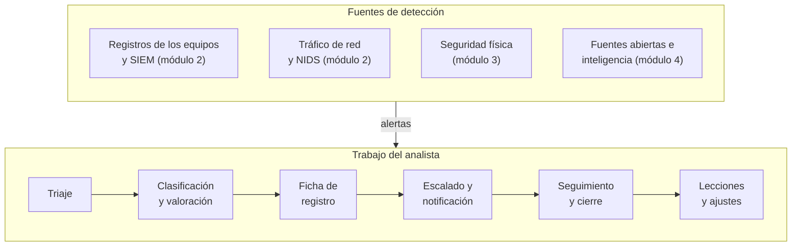

### Módulo 1. Taxonomía y valoración

- Evento, alerta e incidente son tres cosas distintas. Una alerta es una hipótesis; el incidente lo declara el analista.
- La taxonomía nacional tiene diez clasificaciones. Si un suceso encaja en varios tipos, manda el de mayor peligrosidad y los demás se anotan como secundarios.
- La peligrosidad depende del tipo de amenaza; el impacto, de las consecuencias. El nivel que rige es el mayor de los dos, y a partir de ALTO hay que notificar si la entidad está obligada.

### Módulo 2. Monitorización técnica

- Sin registros no hay detección. Deben estar activados, centralizados y con la hora sincronizada.
- El agente ve el equipo por dentro y el sensor ve la red: se complementan. Suricata no sabe si una contraseña falló; Wazuh no ve los paquetes.
- Una regla de correlación avisa de un patrón, no de un evento. Toda regla propia se prueba antes de cargarla.

### Módulo 3. Seguridad física

- Los incidentes físicos también están en la taxonomía: el robo dentro de «Intrusión»; el sabotaje y las interrupciones, dentro de «Disponibilidad».
- Cada control físico puede funcionar bien y no avisar de nada. La alerta nace de relacionar un evento físico con uno lógico.
- La correlación exige relojes sincronizados, eventos en un formato que el SIEM entienda y una relación fiable entre tarjeta y cuenta.

### Módulo 4. Fuentes abiertas

- El atacante mira primero desde fuera. Vigilar la superficie de exposición es adelantarse a ese reconocimiento.
- Que un dato sea público no hace lícito cualquier uso: se investiga lo propio, de forma pasiva y sin manejar datos robados.
- Un indicador sin contexto es ruido. Antes de bloquear se depura, y todo indicador lleva origen y caducidad. Con cada indicador nuevo se busca también hacia atrás.

### Módulo 5. Triaje, registro y seguimiento

- El triaje tiene un orden fijo y un tiempo máximo. Si no llegas a un veredicto, escalas con lo que tengas.
- Un falso positivo se cierra con su motivo y con una propuesta de ajuste. Un equipo comprometido se aísla; no se apaga ni se limpia.
- La ficha separa hechos de hipótesis, conserva cada cambio de valoración y da a cada hecho una hora y una fuente.

Las unidades siguientes continúan donde esta termina: la investigación a fondo del incidente, las medidas de contención y de recuperación, y la documentación y la notificación completas.

<a id="p-c-2"></a>

## Glosario

| Término | Definición |
|---|---|
| **Agente** | Programa instalado en un equipo que recoge sus registros y su estado y los envía al servidor del SIEM. |
| **Alerta** | Aviso que emite una herramienta o una persona cuando uno o varios eventos cumplen una condición definida. Es una hipótesis pendiente de comprobar. |
| **Anti-passback** | Función del control de accesos que impide usar una acreditación para entrar dos veces seguidas sin haber registrado la salida. |
| **APT** | Amenaza persistente avanzada: ataque dirigido, sofisticado y sostenido contra una organización concreta. Es el único tipo con peligrosidad CRÍTICO. |
| **Cadena de custodia** | Registro documentado de quién ha tenido cada evidencia, cuándo, dónde y para qué, desde que se recoge hasta que se presenta. |
| **Ciberincidente** | Suceso inesperado o no deseado con consecuencias en detrimento de la seguridad de la información o de los servicios. |
| **Correlación** | Relación de varios eventos, de una o de varias fuentes, para detectar un patrón que ninguno revela por separado. |
| **CSIRT de referencia** | Equipo de respuesta al que una entidad notifica sus incidentes y del que recibe apoyo: CCN-CERT para el sector público, INCIBE-CERT para empresas y ciudadanía, ESPDEF-CERT para la Defensa. |
| **Decodificador** | Componente del SIEM que extrae los campos de una línea de registro: usuario, dirección de origen, puerto. |
| **Escalado** | Traspaso de un caso a quien tiene más conocimiento técnico (funcional) o más capacidad de decisión (jerárquico). |
| **Esclusa** | Paso con dos puertas enclavadas que solo deja entrar a una persona cada vez. En inglés, *mantrap*. |
| **Evento de seguridad** | Ocurrencia observable que apunta a un posible incumplimiento de la política de seguridad o a un fallo de los controles. |
| **Exfiltración** | Salida no autorizada de información hacia fuera de la organización. |
| **Falso negativo** | Actividad maliciosa que no generó ninguna alerta. |
| **Falso positivo** | Alerta que avisa de algo que no ha ocurrido. |
| **HIDS** | Sistema de detección de intrusiones basado en el equipo: analiza registros, ficheros y procesos desde dentro. |
| **Indicador de compromiso (IoC)** | Dato técnico observable que delata la actividad de una amenaza: una dirección, un dominio, la huella de un fichero. |
| **Inteligencia de amenazas (CTI)** | Conocimiento elaborado sobre quién ataca, cómo y con qué medios, presentado para tomar decisiones. |
| **Línea de tiempo** | Relación ordenada de los hechos de un incidente, cada uno con su hora y su fuente. |
| **NIDS** | Sistema de detección de intrusiones de red: analiza una copia del tráfico. |
| **Nivel de impacto** | Valoración de las consecuencias de un incidente para la organización. Seis niveles, de SIN IMPACTO a CRÍTICO. |
| **Nivel de peligrosidad** | Valoración de la amenaza potencial de un tipo de incidente. Cinco niveles, de BAJO a CRÍTICO. |
| **OSINT** | Inteligencia obtenida de fuentes de acceso público. |
| **Phishing** | Suplantación de una entidad de confianza para obtener credenciales, datos o la ejecución de un programa. |
| **Regla** | Condición que el SIEM o el detector de intrusiones evalúa sobre los eventos; si se cumple, genera una alerta con un nivel. |
| **SIEM** | Sistema que centraliza los registros de toda la organización, los normaliza, los correlaciona y genera alertas. |
| **SOC** | Centro de operaciones de seguridad: el equipo que vigila, detecta y coordina la respuesta. |
| **Superficie de exposición** | Todo lo que la organización tiene a la vista de Internet: dominios, servicios, certificados, repositorios, cuentas y marca. |
| **Taxonomía** | Sistema de clasificación común de los tipos de incidente. |
| **TLP** | Protocolo del semáforo: etiqueta que indica hasta dónde puede circular una información compartida. |
| **Triaje** | Valoración rápida de una alerta para decidir si es real, cuánto importa y qué se hace con ella. |
| **Typosquatting** | Registro de dominios casi idénticos al legítimo para engañar a quien no se fija. |
| **Ventana temporal de reporte** | Plazos de las notificaciones inicial, intermedia y final al CSIRT de referencia, según el nivel del incidente. |
| **Verdadero positivo benigno** | Alerta correcta sobre una actividad que ocurrió, pero que estaba autorizada o es inocua. |

<a id="p-c-3"></a>

## Referencias generales

> **[REFERENCIAS Y GUÍAS OFICIALES]**
>
> - [Guía Nacional de Notificación y Gestión de Ciberincidentes (2020)](https://www.incibe.es/sites/default/files/contenidos/guias/doc/guia_nacional_notificacion_gestion_ciberincidentes.pdf).
> - [CCN-STIC 817. Esquema Nacional de Seguridad. Gestión de ciberincidentes (abril de 2020)](https://www.ccn-cert.cni.es/series-ccn-stic/800-guia-esquema-nacional-de-seguridad/988-ccn-stic-817-gestion-de-ciberincidentes/file.html).
> - [Real Decreto 311/2022, por el que se regula el Esquema Nacional de Seguridad](https://www.boe.es/buscar/act.php?id=BOE-A-2022-7191).
> - [Real Decreto 43/2021, con la Instrucción nacional de notificación y gestión de ciberincidentes](https://www.boe.es/buscar/act.php?id=BOE-A-2021-1192).
> - [Taxonomía de INCIBE-CERT](https://www.incibe.es/incibe-cert/incidentes/taxonomia).
> - [Reference Security Incident Taxonomy (ENISA y TF-CSIRT)](https://github.com/enisaeu/Reference-Security-Incident-Taxonomy-Task-Force).
> - [NIST SP 800-61 Rev. 3 (abril de 2025)](https://csrc.nist.gov/pubs/sp/800/61/r3/final).
> - [ISO/IEC 27035-1:2023](https://webstore.iec.ch/en/publication/83157).
> - [Reglamento (UE) 2016/679, General de Protección de Datos](https://eur-lex.europa.eu/eli/reg/2016/679/oj).
> - [Documentación de Wazuh](https://documentation.wazuh.com/current/index.html) y [documentación de Suricata](https://docs.suricata.io/en/latest/).

---

<a id="docente"></a>

# Guía para el docente

Esta sección no forma parte del contenido del alumnado. Reúne lo que necesitas para montar, adaptar y mantener la unidad.

## Ficha de la unidad

| Dato | Valor |
|---|---|
| Enseñanza | Curso de Especialización en Ciberseguridad en Entornos de las Tecnologías de la Información |
| Módulo profesional | 5021. Incidentes de ciberseguridad |
| Unidad didáctica | UD2. Análisis de incidentes de ciberseguridad |
| Resultado de aprendizaje | RA2. Analiza incidentes de ciberseguridad utilizando herramientas, mecanismos de detección y alertas de seguridad |
| Criterios de evaluación | CE 2.a, 2.b, 2.c, 2.d y 2.e (un módulo por criterio) |
| Tiempo de estudio estimado | Unas 10 horas: 90, 150, 100, 120 y 130 minutos por módulo |
| Enfoque | Inductivo y visual: cada módulo parte de una situación del SOC de una empresa ficticia, ACME Logística, y la resuelve al final |
| Actividades | 15 en total: por módulo, dos preguntas de test con retroalimentación en todas las opciones y una actividad de clasificación o emparejamiento |
| Terminología | Alineada con el Real Decreto 311/2022 (ENS), la Guía Nacional de Notificación y Gestión de Ciberincidentes y la guía CCN-STIC 817 |

## Qué incluye la entrega

| Fichero | Para qué sirve |
|---|---|
| `UD2_Analisis_Incidentes_Contenido_SCORM.md` | Este documento: el guion maestro en Markdown, con todos los textos, diagramas Mermaid, cuadros de imagen y de recursos, actividades y retroalimentación |
| `UD2_Analisis_Incidentes_SCORM12.zip` | Paquete SCORM 1.2 ya montado, listo para subir a Moodle. Incluye portada, índice navegable, los diagramas ya dibujados, las actividades interactivas y el registro de progreso y de nota |
| `UD2_Analisis_Incidentes_Contenido.pdf` | El mismo contenido en PDF, con portada e índice con enlaces internos, para quien prefiera leer o imprimir |
| `UD2_Recursos_docente.zip` | Los diagramas en SVG, PNG y código Mermaid; las figuras; el banco de preguntas en formato GIFT; los textos de las actividades listos para pegar en H5P; la plantilla de ficha de incidente y la portada |

## Mapa de recursos

| Módulo | CE | Diagramas Mermaid | Imagen | Recursos | Actividades |
|---|---|---|---|---|---|
| 1. Taxonomía y valoración de incidentes | 2.a | 1.1 Del evento al incidente; 1.2 Árbol de la taxonomía; 1.3 Árbol de decisión de la peligrosidad; 1.4 Los tres casos de ACME sobre la matriz | 1.1 Malware, denegación de servicio y fuga de información, frente a frente | 1.1 | test, test, clasificación |
| 2. Monitorización técnica: SIEM (Wazuh) y NIDS (Suricata) | 2.b | 2.1 Dónde se coloca cada sensor en la red de ACME; 2.2 Del registro al panel; 2.3 El ataque visto por los dos sensores | 2.1 Panel del SIEM con la fuerza bruta contra SSH | 2.1, 2.2, 2.3 | test, test, emparejamiento |
| 3. Detección e identificación en seguridad física | 2.c | 3.1 Integración de la seguridad física con el SIEM; 3.2 Fichaje fuera de horario e inicio de sesión concurrente | 3.1 Arquitectura de integración entre la seguridad física y el SIEM | 3.1, 3.2 | test, test, emparejamiento |
| 4. Ciberinteligencia OSINT y fuentes abiertas | 2.d | 4.1 El ciclo de inteligencia aplicado a un dominio sospechoso | 4.1 Servicios expuestos y dominios parecidos al de ACME | 4.1, 4.2, 4.3 | test, test, emparejamiento |
| 5. Triaje, registro inicial y seguimiento | 2.e | 5.1 Flujo de trabajo del analista de nivel 1; 5.2 Estados de una ficha en el SOC de ACME; 5.3 Escalado y comunicaciones en un incidente con datos personales | 5.1 Ficha de registro cumplimentada del intento de fuerza bruta del módulo 2 | 5.1, 5.2, 5.3 | test, test, emparejamiento |

## Uso en Moodle

1. En el curso, **Añadir una actividad o un recurso → Paquete SCORM** y sube `UD2_Analisis_Incidentes_SCORM12.zip` sin descomprimir.
2. Ajustes recomendados: mostrar en **ventana nueva**; **método de calificación: calificación más alta**; **calificación máxima: 100**; número de intentos ilimitado; **forzar nuevo intento: no**, para que el alumnado retome la unidad donde la dejó.
3. Si usas el seguimiento de finalización, marca **requerir estado: completado**.

Cómo puntúa el paquete:

- Cada actividad vale un punto y solo cuenta el primer intento. En las de clasificación y emparejamiento se puntúa la proporción de aciertos.
- La nota que recibe Moodle es el porcentaje sobre las 15 actividades.
- El estado pasa a «completado» cuando se han visitado todas las páginas y se han respondido las 15 actividades. Hasta entonces figura como «incompleto» y la plataforma guarda el punto en que se dejó.

El paquete también funciona abierto directamente en un navegador, sin plataforma: en ese caso guarda el progreso en el propio navegador.

## Uso en eXeLearning y en H5P

Si prefieres rehacer la unidad con tu estilo en eXeLearning, el guion está pensado para trasladarlo sin reescribir:

- **Estructura.** Cada título de segundo nivel (`## 1.3 …`) es una página. Crea un nodo por módulo y una página por apartado.
- **Texto.** Pega cada apartado en un iDevice de texto. Los recuadros «Recuerda», «Atención», «Ejemplo SOC Tier 1», «En el laboratorio» e «Idea clave» corresponden a cajas destacadas.
- **Diagramas.** eXeLearning no interpreta Mermaid por sí mismo. Inserta las imágenes SVG o PNG de `UD2_Recursos_docente.zip`, que llevan el mismo número que en el guion. Si quieres modificarlos, edita el fichero `.mmd` en un editor de Mermaid y vuelve a exportar.
- **Imágenes.** Cada cuadro `[IMAGEN ILUSTRATIVA]` describe qué captura o infografía va en ese punto, su formato y su texto alternativo.
- **Preguntas de test.** Importa `UD2_banco_preguntas.gift` en el banco de preguntas de Moodle, o cópialas en un iDevice de preguntas de elección múltiple. Cada opción lleva su retroalimentación.
- **Actividades H5P.** Cada actividad de clasificación o emparejamiento incluye el tipo de contenido H5P recomendado, la tabla de soluciones y un texto preparado para pegar en **Drag the Words** (las respuestas van entre asteriscos). En `UD2_actividades_H5P.txt` están los quince textos seguidos.

## Imágenes pendientes de sustituir

El paquete SCORM no deja huecos: donde el guion pide una captura, muestra una figura construida en HTML. Dos de ellas son definitivas y tres son recreaciones con datos ficticios que conviene sustituir por capturas reales de tu laboratorio.

| Figura | Qué muestra el paquete | Qué hacer |
|---|---|---|
| 1.1 Infografía de malware, denegación de servicio y fuga | Infografía definitiva | Nada, salvo que quieras un diseño propio |
| 2.1 Panel de Wazuh con la fuerza bruta | Recreación esquemática | Sustituir por la captura real tras hacer la práctica |
| 3.1 Arquitectura del fichaje y el SIEM | Esquema definitivo | Nada |
| 4.1 Mapa de Shodan y árbol de dnstwist | Recreación. Las variantes del árbol son las que genera dnstwist para el dominio del caso | Sustituir la parte de Shodan por una captura de un rango autorizado |
| 5.1 Ficha de incidente cumplimentada | Recreación de una ficha sencilla | Sustituir por una captura de tu herramienta de gestión de casos |

## Qué se ha verificado y qué debes validar

| Elemento | Estado |
|---|---|
| Reglas de Suricata del módulo 2 | Probadas con Suricata 7.0.3 sobre capturas sintéticas: las cuatro firmas cargan y disparan como se describe. El evento JSON del apartado 5.7 es salida real de esa prueba, recortada |
| Programa `depura_ioc.py` y reglas de nftables del módulo 4 | Ejecutados: la salida que aparece en el texto es la real |
| Variantes de dnstwist | Generadas con dnstwist para `acme-logistica.example` |
| Reglas XML de Wazuh (módulos 2, 3 y 4) | **No ejecutadas.** Están escritas contra la documentación y el código de la rama 4.14, pero no he podido instalar un servidor Wazuh para probarlas. Valídalas con `wazuh-logtest` antes de usarlas en clase |
| Normativa y guías | Taxonomía, niveles, plazos y estados contrastados con la Guía Nacional, el Real Decreto 43/2021 y el Real Decreto 311/2022 |
| Paquete SCORM | Probado con una plataforma SCORM 1.2 simulada: inicio, guardado del progreso, nota, reanudación en la última página y cierre de sesión. Revisado en pantallas de escritorio y de móvil. **No lo he probado dentro de tu Moodle**: súbelo primero a un curso de pruebas |
| Enlaces | Las guías oficiales, la normativa, los vídeos y los recursos recomendados se han comprobado uno a uno en noviembre de 2026. Las páginas de las herramientas y los RFC son direcciones estables |

## Temporalización sugerida

| Sesión | Contenido | Trabajo en el aula |
|---|---|---|
| 1 | Presentación y módulo 1 | Resolver en grupo los tres casos antes de ver la solución |
| 2 y 3 | Módulo 2 | Desplegar Wazuh y Suricata en máquinas virtuales; reproducir la fuerza bruta contra un equipo propio |
| 4 | Módulo 3 | Simular los eventos del control de accesos con un fichero JSON y probar la correlación |
| 5 | Módulo 4 | Ejecutar dnstwist sobre el dominio del centro; depurar una lista de indicadores y cargarla en nftables |
| 6 | Módulo 5 | Triaje de una alerta generada en la sesión 2 o 3 y ficha completa por parejas |

## Qué puede quedar desfasado

- **NIS2.** A la fecha de cierre (noviembre de 2026) España no ha publicado la ley de transposición. Cuando se apruebe, revisa los sujetos obligados y los plazos del módulo 1.
- **Wazuh 5.** La rama 5 cambia el motor y el formato de las reglas. Los ejemplos XML son de la rama 4.x.
- **Suricata.** La rama 7 terminó su soporte en septiembre de 2026; la sintaxis de las reglas de la unidad es válida en la rama 8.
- **Vídeos y enlaces externos.** Revísalos al empezar cada curso.
